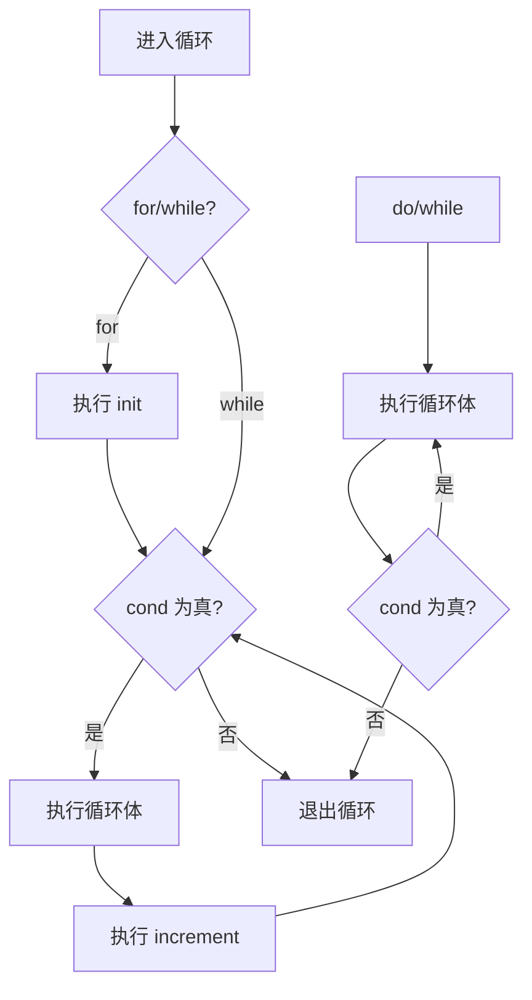

# 控制表达式与语句（if/else选择、switch语法与语义、while/for/do-while循环）

## 控制表达式与语句

JavaScript 中的控制流决定了代码的执行顺序。当我们需要根据表单输入验证数据（如课件提到的 form validation）或处理数组元素时，`if/else`、`switch` 及循环结构便是核心工具。你是否想过，为什么在遍历数组删除元素时，简单的 `for` 循环比 `while` 更不易出错？这涉及到控制表达式的求值时机与边界安全。

### 选择结构：if/else 与 switch

`if` 和 `if-else` 的语法与 C/C++ 或 Java 类似，但 ==JavaScript 的控制表达式会进行隐式类型转换==。例如 `"3"` 在布尔上下文中为 `true`，而 `0`、`""`、`null`、`undefined`、`NaN` 均为 `false`。

> [!WARNING]
> 避免使用 `==` 进行比较，它会在比较前尝试转换类型（如 `7 * "3"` 会将字符串转为数字）。==始终使用 `===` 进行严格相等判断==，防止 `"0" == false` 这类意外结果为 `true`。

`switch` 适用于多分支离散值匹配，其语义基于 `===` 严格比较。若某个 `case` 缺少 `break`，将发生“穿透”（fall-through），继续执行下一个 `case` 的代码块。

### 循环结构对比与陷阱

三种基础循环的核心区别在于 ==控制表达式的求值时机==：

| 循环类型 | 语法特征 | 执行特点 | 适用场景 |
| :--- | :--- | :--- | :--- |
| `while` | `while (expr) stmt` | 先判断后执行，可能0次 | 条件驱动，次数未知 |
| `do/while` | `do stmt while(expr)` | 先执行后判断，至少1次 | 菜单交互、输入验证 |
| `for` | `for(init;cond;inc)` | 初始化/条件/增量集中管理 | 数组遍历、计数循环 |



> [!TIP]
> 课件指出 JavaScript 解释器会在行末自动插入分号（ASI），但在 `return`、`throw` 等语句后换行可能导致逻辑错误。==循环体内建议始终显式书写分号并使用花括号包裹复合语句==。

此外，`for-in` 循环用于遍历对象属性（`for (identifier in object)`），但不推荐用于数组遍历，因为它会枚举原型链上的可枚举属性且顺序不保证。

### 实战解析：no_zeros 函数

以经典考题 Exercise 4.8 为例，要求修改原数组移除零值并返回是否含零。此题综合考察了 `for` 循环、`if` 判断与数组操作：

```javascript
function no_zeros(arr) {
    let hasZero = false;
    // 第一步：用 for + if 检测零值
    for (let i = 0; i < arr.length; i++) {
        if (arr[i] === 0) { // 必须用 ===
            hasZero = true;
        }
    }
    // 第二步：原地修改数组
    let nonZero = arr.filter(item => item !== 0);
    arr.length = 0;          // 清空原数组引用不变
    for (let val of nonZero) {
        arr.push(val);       // 回填非零元素
    }
    return hasZero;
}
```

> [!IMPORTANT]
> 该题关键得分点：==必须原地修改传入的数组对象==，而非返回新数组。直接 `arr = arr.filter(...)` 仅改变了局部变量引用，调用方的数组不会被修改。使用 `arr.length = 0` 配合 `push` 是保持引用的安全做法。

注意自增运算符的位置差异：`i++` 与 `++i` 在单独作为 `for` 的 increment expression 时效果相同，但在复杂表达式中返回值不同。同时，使用 `isNaN(a)` 检测无效数值时，需留意其对非数字参数的隐式转换行为。
