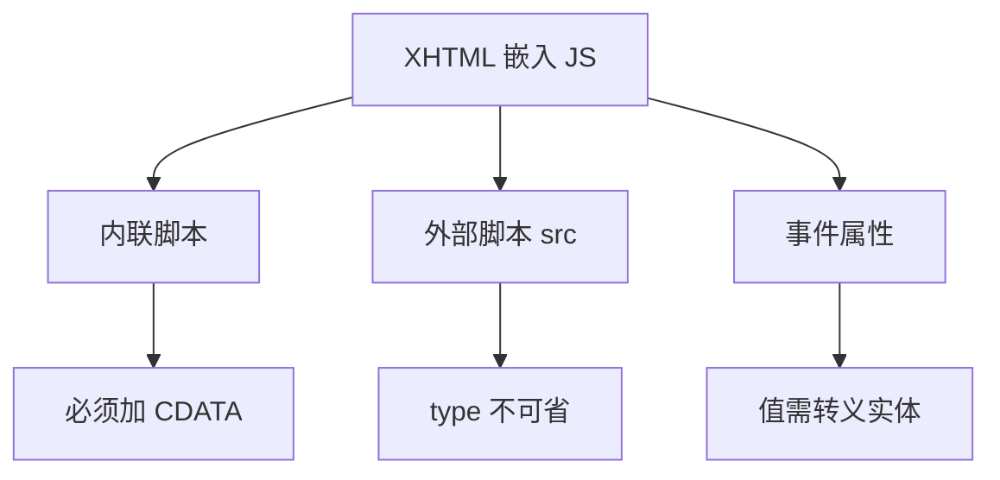

# 在XHTML文档中嵌入JavaScript的方法

在 XHTML 中嵌入 JavaScript 的核心约束来自 MIME 类型：`script` 元素的 `type` 属性必须显式指定为 `text/javascript`，且内联脚本必须包裹在 CDATA 节中，否则解析器会将 `<`、`&` 等符号视为 XML 标记而报错。

## 三种嵌入方法

| 方法 | 语法要点 | 适用场景 |
|------|---------|---------|
| **内联脚本** | 直接写在 `<script>` 标签对内 | 少量特定页面逻辑 |
| **外部脚本** | `src="URL"` 引入 `.js` 文件 | 多页面共享、缓存优化 |
| **事件处理** | `onclick="..."` 等属性 | 简单交互（不推荐复杂逻辑） |



## 内联脚本的 CDATA 陷阱

XHTML 是严格的 XML。若脚本包含 `a < b` 或 `&&`，解析器会将其误认为标签起始或实体引用而中断解析。CDATA 节告诉解析器：**其中内容为字符数据，非标记**。

```html
<script type="text/javascript">
//<![CDATA[
  function compare(a, b) {
    if (a < b && b != 0) {   // 含 < 和 &
      return "valid";
    }
  }
//]]>
</script>
```

> [!IMPORTANT]
> `//<![CDATA[` 与 `//]]>` 中的 `//` 并非注释，而是防止旧版浏览器将 CDATA 标记显示为文本的兼容写法。在纯 XHTML（MIME 为 `application/xhtml+xml`）中可省略，但为兼容性通常保留。

## 与 HTML 的关键差异

| 特性 | HTML 4/5 | XHTML 1.0 |
|------|---------|-----------|
| `type` 属性 | 可省略（默认 JS） | **必须显式写出** |
| CDATA 节 | 非法（视为注释） | **内联脚本必需** |
| 大小写 | 不敏感 | 元素名必须小写 |
| 空元素 | `<script ...>` 即可 | 必须成对闭合 `</script>` |

> [!WARNING]
> 常见错误：直接粘贴 HTML 习惯到 XHTML 中，省略 `type` 或 CDATA，导致 Firefox 等严格浏览器抛出 XML 解析错误（`XML Parsing Error: not well-formed`）。

## 正确示例

```html
<?xml version="1.0" encoding="UTF-8"?>
<!DOCTYPE html PUBLIC "-//W3C//DTD XHTML 1.0 Strict//EN"
  "http://www.w3.org/TR/xhtml1/DTD/xhtml1-strict.dtd">
<html xmlns="http://www.w3.org/1999/xhtml" xml:lang="zh">
<head>
  <title>Demo</title>
  <script type="text/javascript" src="utils.js"></script>
  <script type="text/javascript">
  //<![CDATA[
    window.onload = function() {
      alert("Page loaded");  // 含引号，安全
    };
  //]]>
  </script>
</head>
<body>
  <button onclick="alert('hi'); return false;">点击</button>
</body>
</html>
```

==核心结论==：XHTML 中 `type="text/javascript"` 是强制属性，内联脚本必须置于 `//<![CDATA[ ... //]]>` 内，这是与 HTML 混用时最容易踩的坑。
