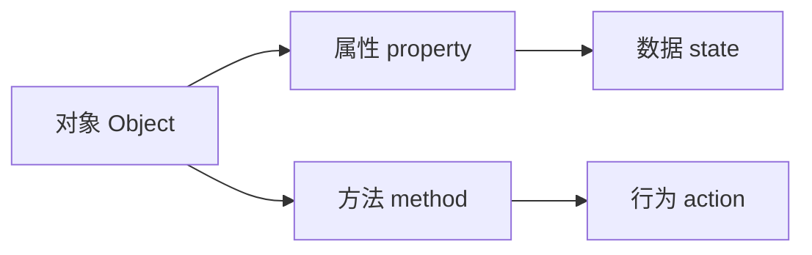

# 基于对象的概念与JavaScript内置对象

JavaScript 是一门==基于对象（Object-Based）==的语言：它没有严格的"类"模板，却到处用对象组织数据。无论是自定义的 `person`，还是浏览器提供的 `document`、`window`，本质上都是==一组属性（property）与方法（method）的集合==。

> [!IMPORTANT]
> 把 HTML 元素看成对象、把元素属性看成对象的属性，是理解 DOM 与 JS 内置对象的==同一条主线==。

## 什么是"基于对象"

所谓基于对象，就是"数据 + 行为"打包在一起：属性存状态，方法存操作。JS 不强制先声明类再实例化，而是直接拿一个对象字面量 `{}` 就能开工：

```javascript
let person = {};        // 空对象
person.name = "Alice";  // 赋值即创建新属性
person.sayHi = function () { return "Hi, " + this.name; };
```

> [!TIP]
> 记法：`obj.newProperty = value;` —— ==给不存在的属性赋值，就会创建它==。

## 为什么要用对象

假如不打包，`name`、`age`、`sayHi` 会散落在全局变量里，容易重名、难以复用。用对象把它们收拢起来，就能像"数据包"一样传递、访问：



## JS 内置对象一览

JS 自带一批"出厂即用"的对象，最常考的几个：

| 内置对象 | 用途 | 常见成员 |
| --- | --- | --- |
| `Object` | 通用对象基座 | `hasOwnProperty()` |
| `Array` | 数组/列表 | `push`、`length`、`join` |
| `String` | 字符串 | `indexOf`、`substring`、`length` |
| `Number` | 数值包装 | `toFixed()` |
| `Math` | 数学常量与函数 | `PI`、`random()`、`max()` |
| `Date` | 时间 | `getFullYear()`、`getTime()` |
| `RegExp` | 正则 | `test()`、`exec()` |
| `window` | 浏览器全局对象 | `alert`、`location` |
| `document` | DOM 根节点 | `getElementById()` |

> [!NOTE]
> `Math`、`JSON` 是==静态命名空间==，不 `new`，直接 `Math.random()` 调用；`Array`、`Date`、`String` 可以 `new` 出实例。

## 和相近概念的区别

| 概念 | 是否含方法 | 典型例子 |
| --- | --- | --- |
| 基本类型 | 否 | `let s = "abc"` |
| 包装对象 | 是 | `new String("abc")` |
| 对象字面量 | 是 | `{a: 1, b(){}}` |
| DOM 节点对象 | 是 | `document.getElementById("id")` |

## 常见的坑

- **属性 vs 方法**：`person.name` 是属性，`person.sayHi()` 是方法（加括号调用）。
- **未定义属性返回 `undefined`**，不是报错；`null.x` 才会 TypeError。
- **字符串是基本类型**，但 `str.length` 能用——JS 会临时"装箱"成 `String` 对象。
- **`new` 的坑**：`let a = new Array(3)` 造出的是长度 3 的空数组，不是 `[3]`。

## 一个算对了的例子

题目（Reviews Questions 4.31）：*How is a new property of an object created?*

答案是直接赋值 `objectName.newProperty = value;`，例如：

```javascript
let person = {};
person.name = "Alice";   // ==赋值即创建==
console.log(person.name); // "Alice"
console.log(person.age);  // undefined（未创建）
```

> [!WARNING]
> 写简答题时，==必须给出语法模板 `objectName.newProperty = value;` 再配示例==，只写示例不给语法一般会扣分。
