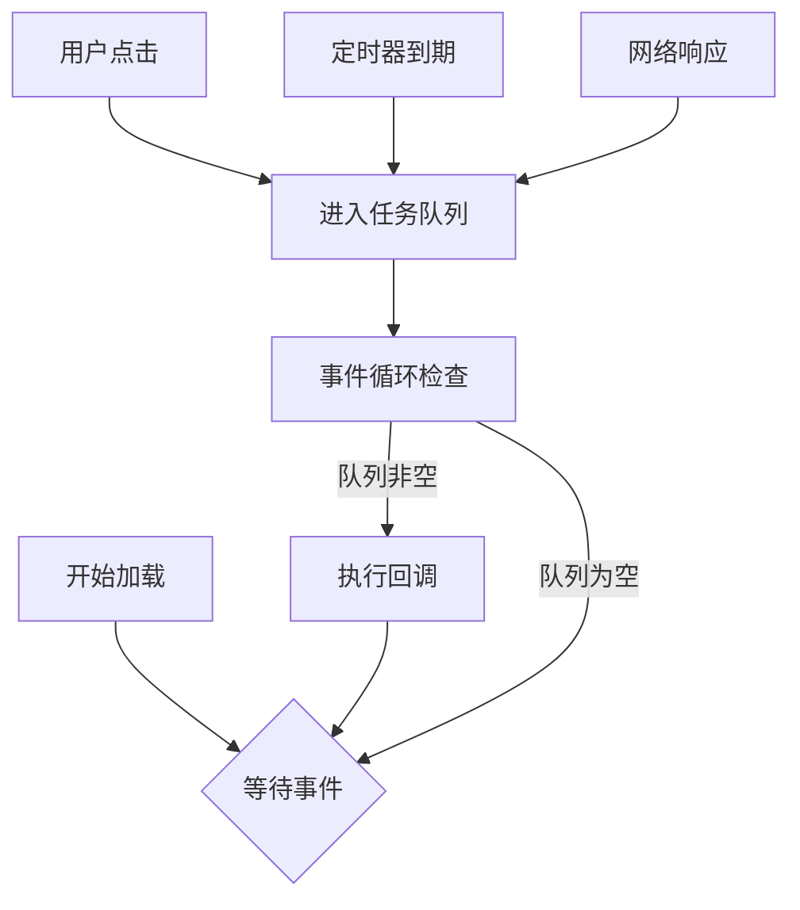

# JavaScript概述、起源与用途（事件驱动计算Event-driven Computation）

## JavaScript 概述与事件驱动模型

JavaScript（JS）最初由 Netscape 的 Brendan Eich 于 1995 年开发，旨在为静态 HTML 页面添加动态交互能力。在现代 Web 技术体系中，它已成为客户端脚本的核心标准（ECMAScript）。

==核心概念==：**事件驱动计算（Event-driven Computation）**。与传统的过程式编程不同，JS 的执行流程不是线性的，而是由**事件循环（Event Loop）**驱动的。程序大部分时间处于等待状态，当特定事件（如用户点击、网络响应、定时器触发）发生时，才执行对应的回调函数。



> [!IMPORTANT]
> JS 是==单线程==且==非阻塞==的。这意味着所有同步代码在主线程执行，而异步操作（如 I/O）通过回调机制处理，避免了界面冻结。

## 为什么需要客户端验证？

在表单提交场景中，为何要优先使用 JS 进行输入验证？

1.  **减轻服务器负载**：非法数据在客户端即被拦截，无需发送 HTTP 请求。
2.  **提升用户体验**：提供即时反馈（Immediate Feedback），无需等待服务器往返（Round-trip）。
3.  **节省带宽**：减少无效的网络流量。

> [!WARNING]
> 客户端验证仅用于优化体验，==不能替代服务器端验证==。恶意用户可绕过 JS 直接发送请求，因此后端必须进行二次校验。

## 常见陷阱：`undefined` 值

在 JS 中，`undefined` 表示“已声明但未赋值”或“不存在”。以下情况变量值为 `undefined`：

| 场景 | 示例代码 | 结果 |
| :--- | :--- | :--- |
| 声明未初始化 | `let x; console.log(x);` | `undefined` |
| 缺失参数 | `func(a)` (func 定义需2参) | 第2个参数为 `undefined` |
| 访问不存在的属性 | `obj.nonExistent` | `undefined` |
| 无返回值函数 | `let y = func();` (func无return) | `y` 为 `undefined` |

> [!TIP]
> 区分 `null` 与 `undefined`：`null` 是显式赋值的“空对象指针”，而 `undefined` 是系统默认的“未定义”。

## 实战示例：数组原地修改

题目要求编写函数 `no_zeros(arr)`，移除数组中的 `0` 并返回是否曾包含 `0`。关键在于==原地修改（Modify in place）==原数组，而非创建新数组后忽略原引用。

```javascript
function no_zeros(arr) {
    let hasZero = false;
    // 1. 检测是否存在零
    for (let i = 0; i < arr.length; i++) {
        if (arr[i] === 0) hasZero = true;
    }
    
    // 2. 过滤非零元素
    let nonZeros = arr.filter(item => item !== 0);
    
    // 3. 原地修改：清空原数组并填入新值
    arr.length = 0; 
    for (let val of nonZeros) {
        arr.push(val);
    }
    
    return hasZero;
}
```

> [!CAUTION]
> 若直接执行 `arr = nonZeros`，仅改变了局部变量 `arr` 的指向，==调用者的原数组不会被修改==。必须通过修改 `arr.length` 或 `splice` 等操作改变原内存空间的内容。
