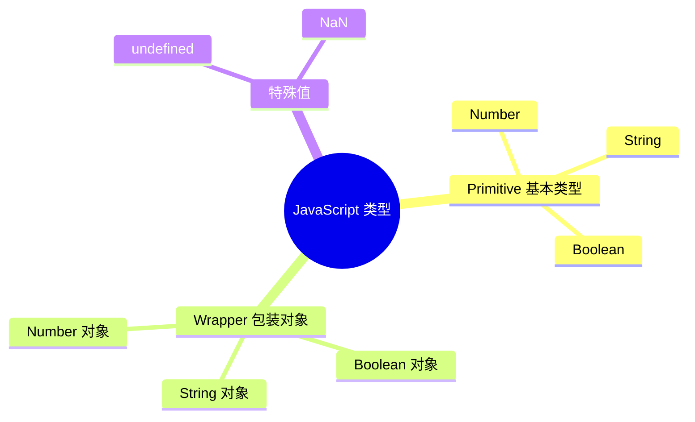

# 基本数据类型（Primitive Types）、字面量（Numeric and String Literals）及布尔类型

## 基本数据类型、字面量与布尔类型

JavaScript 是 **object-based** 的脚本语言：一切皆对象，但日常使用的 `Number`、`String`、`Boolean` 属于 **primitive types（基本类型）**。基本类型不是对象，却能在需要时自动“包装”成对应的对象（wrapper object），从而调用方法——这就是 **type conversion（类型转换）** 的底层逻辑。

> [!IMPORTANT]
> 基本类型只有三种：**Number、String、Boolean**。每种都有对应的包装对象（`Number`、`String`、`Boolean`），包装对象既存储原始值，又提供方法。原始值与包装对象之间会自动互相转换（coerced）。



## 字面量（Literals）

**Numeric literals** 支持整数与浮点数，浮点数可带小数点和指数：

```javascript
let intNum = 42;        // 整数
let floatNum = 3.14;    // 浮点数
let expNum = 1.5e-3;    // 科学计数法 = 0.0015
```

**String literals** 由单引号或双引号界定，两者**完全等价**：

```javascript
let s1 = 'Hello';
let s2 = "Hello";   // 与 s1 无任何区别
```

> [!WARNING]
> 不要混淆 `undefined` 与 `null`。变量**已声明未赋值**时值为 `undefined`；这是简答题 4.11 的考点。

## 布尔类型与运算符

Boolean 只有两个值：`true` 和 `false`。数值运算符包括标准算术（`+ - * / %`）和自增自减（`++ --`）。==自增/自减在变量前与后的效果不同==：前置先增减再参与运算，后置先取值再增减。

```javascript
let x = 5;
console.log(x++);   // 输出 5，x 变为 6
console.log(++x);   // x 变为 7，输出 7
```

## 类型转换与字符串连接（Catenation）

JavaScript 是**弱类型**语言，运算时会自动转换类型：

| 表达式 | 结果 | 转换方向 |
|--------|------|----------|
| `"August " + 1977` | `"August 1977"` | Number → String |
| `7 * "3"` | `21` | String → Number |
| `Number("42")` | `42` | 显式转换 |
| `parseInt("3.14")` | `3` | 从开头解析整数 |
| `parseFloat("abc")` | `NaN` | 解析失败返回 NaN |

> [!TIP]
> `parseInt` 和 `parseFloat` 只从字符串**开头**解析，失败即返回 `NaN`（Not a Number）。

## 字符串常用方法

| 方法 | 参数 | 返回 |
|------|------|------|
| `charAt()` | 数字 | 指定位置的字符 |
| `indexOf()` | 单字符 | 参数首次出现的位置 |
| `substring()` | 两个数字 | 两位置间的子串 |
| `toLowerCase()` | 无 | 转小写 |
| `toUpperCase()` | 无 | 转大写 |

## 输入输出与对象创建

`Window` 是默认对象，其方法可直接调用：`alert()` 弹出对话框，`confirm()` 返回布尔值，`prompt()` 返回用户输入的字符串。

```javascript
var my_car = new Object();      // 创建对象
my_car.make = "Ford";           // 添加属性
my_car.model = "Contour SVT";   // 初始化属性
```

> [!CAUTION]
> `==` 只比较值，`===` 同时比较值和**数据类型**。这是考试高频陷阱。

```javascript
console.log(5 == "5");    // true，类型自动转换
console.log(5 === "5");   // false，类型不同
