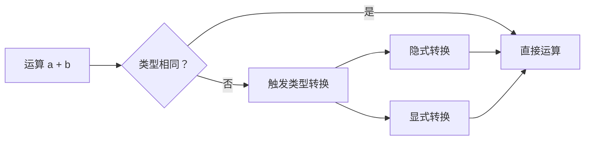
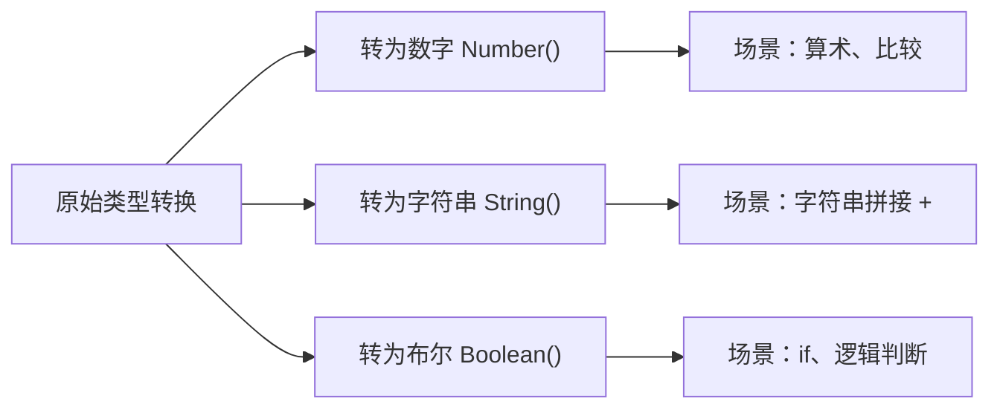

# 隐式类型转换（Implicit）与显式类型转换（Explicit）、typeof运算符

## 类型转换：隐式与显式

JavaScript 是**动态类型**语言，变量的类型在运行时才确定。当运算符两侧的类型不匹配时，JS 不会直接报错，而是尝试把其中一个值**转换成**另一个的类型，再执行运算。这就是类型转换（Type Conversion）。



---

## 隐式类型转换（Implicit Type Conversion）

隐式转换由 **JS 引擎自动完成**，不需要开发者写额外代码。

### 常见触发场景

| 场景 | 示例 | 转换规则 | 结果 |
|---|---|---|---|
| 字符串拼接 `+` | `"5" + 3` | 数字转为字符串 | `"53"` |
| 算术运算 `- * /` | `"5" - 3` | 字符串转为数字 | `2` |
| 比较运算 `==` | `5 == "5"` | 转数字再比较 | `true` |
| 布尔上下文 | `if ("abc")` | 非空串 → `true` | — |

> [!WARNING]
> `+` 是隐式转换中最大的坑：只要一侧是**字符串**，`+` 就执行**字符串拼接**，而不是数值加法。`"5" + 3 + 2` 结果是 `"532"`，不是 `10` 也不是 `"55"`。

### 转换规则的简化记忆



> [!TIP]
> 记忆口诀：**加号有串就拼串，减乘除都转数；双等先转再比较，三绝不转换。**

---

## 显式类型转换（Explicit Type Conversion）

显式转换是开发者**故意调用**转换函数，让意图更清晰，避免隐式规则带来的歧义。

### 常用转换函数

| 函数 | 作用 | 示例 | 结果 |
|---|---|---|---|
| `Number()` | 转为数字 | `Number("5")` | `5` |
| `String()` | 转为字符串 | `String(5)` | `"5"` |
| `Boolean()` | 转为布尔 | `Boolean(0)` | `false` |
| `parseInt()` | 解析整数 | `parseInt("12px")` | `12` |
| `parseFloat()` | 解析浮点数 | `parseFloat("3.14a")` | `3.14` |

> [!IMPORTANT]
> 课件重点：**字符串转数字的显式转换**。`Number("42")` 返回数字 `42`；但 `parseInt("42px")` 也能返回 `42`，而 `Number("42px")` 返回 `NaN`。两者行为不同，`parseInt` **逐字符解析**直到遇到非数字，`Number` 要求**整个串都是合法数字**。

### 一个算对的例子

```javascript
let age = prompt("请输入你的年龄：");   // 用户输入 "20"，类型为 string
// 显式转换：字符串 → 数字
let nextYear = Number(age) + 1;         // 21
// 如果不转换：
let wrong = age + 1;                    // "201"（字符串拼接）
console.log(nextYear);  // 21
console.log(wrong);     // "201"
```

这个例子说明：**拿到用户输入（永远是字符串）后，做算术运算前必须先显式转成数字**，否则 `+` 会触发隐式拼接。

---

## typeof 运算符

`typeof` 用于**查看一个值当前的类型**，返回一个字符串。它是排查类型转换问题的基本工具。

| 表达式 | 返回值 |
|---|---|
| `typeof 42` | `"number"` |
| `typeof "42"` | `"string"` |
| `typeof true` | `"boolean"` |
| `typeof undefined` | `"undefined"` |
| `typeof null` | `"object"` |
| `typeof NaN` | `"number"` |
| `typeof function(){}` | `"function"` |

> [!CAUTION]
> `typeof null` 返回 `"object"` 是历史遗留 bug，考试常见。另外 `typeof NaN` 返回 `"number"`——NaN 是数字类型中的一个特殊“不是数”的值。

> [!TIP]
> 调试口诀：**先 `typeof` 看类型，再决定要不要 `Number()` 转。**

---

## 隐式 vs 显式：怎么选

| 对比维度 | 隐式转换 | 显式转换 |
|---|---|---|
| 触发者 | JS 引擎自动 | 开发者手动调用 |
| 代码可读性 | 差，容易被误解 | 好，意图清晰 |
| 出错风险 | 高（`+` 拼接、`==` 结果出人意料） | 低，行为明确 |
| 使用频率 | 不可避免 | **推荐多写** |

> [!IMPORTANT]
> ==核心结论==：加法 `+` 中只要出现字符串，就变成拼接；做数值运算前，==显式调用 `Number()` 是最稳妥的做法==；判断类型用 `typeof`，但它对 `null` 的返回是历史 bug，不能据此判断是否为对象。
