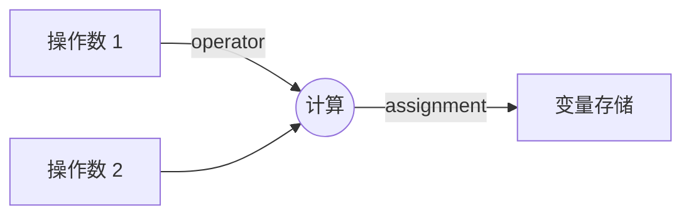

# 变量声明、数值运算符、字符串连接与赋值语句

---
requires: [Web技术/HTML基础]
---

## 变量声明（Variables & Declaration）

在 JavaScript 中，数据需要存放在内存里。我们怎么给这块内存起个名字以便后续使用？这就需要**标识符（identifier）**和**变量（variables）**。

JavaScript 是一门动态（dynamic）脚本语言（scripting language），变量不需要预先指定类型。声明变量的关键字有三个：

| 关键字 | 作用域 | 能否重新赋值 | 能否重复声明 |
| :---: | :---: | :---: | :---: |
| `var` | 函数级 | 能 | 能 |
| `let` | 块级 | 能 | 不能 |
| `const` | 块级 | 不能 | 不能 |

> [!IMPORTANT]
> 标识符命名规则：以字母、下划线 `_` 或美元符号（dollar sign）`$` 开头，区分大小写，且不能使用保留字（reserved words）。

```javascript
let userName = "Alice";      // 合法
let $price = 100;            // 合法，使用了 dollar sign
// let 2ndValue = 5;         // 报错：不能以数字开头
// let class = "Math";       // 报错：class 是 reserved words
```

## 数值运算符与赋值语句（Operators & Assignment）

运算符（operator）作用于操作数（operand），构成表达式（expression），加上分号即成为语句（statement）。

常见的数值运算符包括加 `+`、减 `-`、乘 `*`、除 `/`、取模 `%`。而赋值（assignment）语句通过 `=` 将右侧表达式的计算结果存入左侧变量。

> [!WARNING]
> `=` 是赋值语句，不是数学里的“等于”！判断相等请用 `===`（严格相等）或 `==`（宽松相等，会触发 type conversion）。



## 字符串连接（Catenation）

如果运算符 `+` 两边的操作数不全是数字，会发生什么？

当 `+` 任意一侧出现字符串时，它就不再是数值加法，而是执行字符串连接（catenation）。此时解释器（interpreter）会自动进行隐式类型转换（type conversion），将基本类型（primitives）转为字符串再拼接。

> [!TIP]
> 记忆口诀：“见字如面”。只要 `+` 号旁边有字符串，整个表达式就按 catenation 处理，从左往右依次拼接。

```javascript
let a = 10 + 20;        // 30 (数值运算)
let b = "10" + 20;      // "1020" (catenation)
let c = 10 + 20 + "px"; // "30px" (先算 10+20=30，再 catenation)
```

## 综合示例：求三个数的最大值

下面这道题完整串联了上述知识点：通过对话框窗口（dialog window）获取输入，用数值运算符比较，最后用 catenation 输出。

> [!NOTE]
> `prompt()` 返回的永远是字符串，必须用 `parseFloat()` 等函数做显式 type conversion，否则后续的 `+` 会变成 catenation 而非数值相加。

```javascript
// 1. 变量声明与赋值语句
let num1 = parseFloat(prompt("请输入第一个数字"));
let num2 = parseFloat(prompt("请输入第二个数字"));
let num3 = parseFloat(prompt("请输入第三个数字"));

// 2. 数值运算（调用预定义函数 Math.max）
let maxNum = Math.max(num1, num2, num3);

// 3. 字符串连接（catenation）并执行输出
let resultMsg = "最大的数字是：" + maxNum;
console.log(resultMsg);
alert(resultMsg);
```

> [!CAUTION]
> 如果漏写 `parseFloat()`，输入 `5`、`12`、`8` 时，`Math.max` 虽能勉强工作，但若你尝试自己写 `num1 + num2`，结果会变成 `"512"` 而不是 $17$。务必保证参与数值运算的操作数是 Number 类型！
