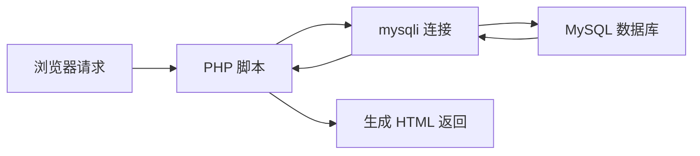
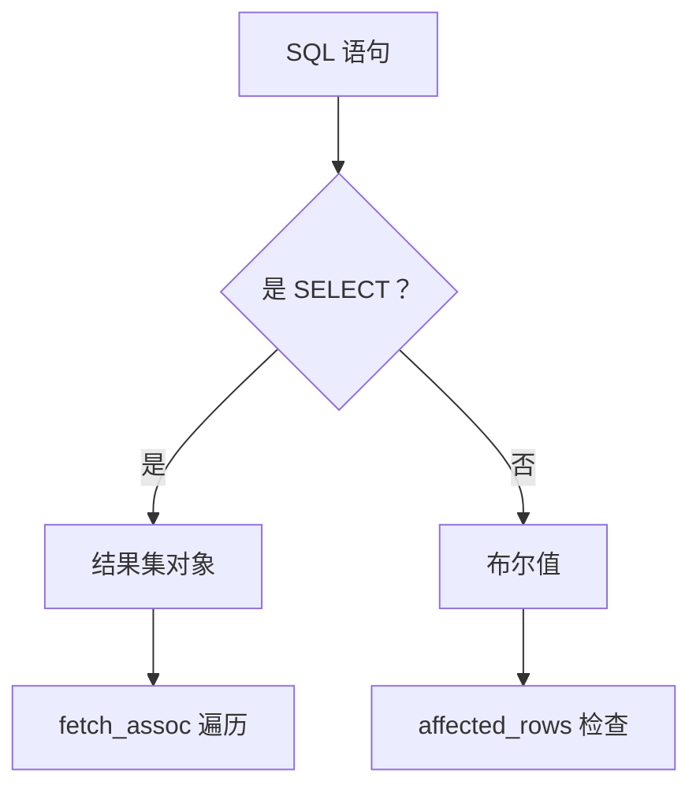

# 实验3：Web数据库访问（PHP+MySQL综合实践）

## 实验目标：打通 PHP 与 MySQL

在 Web 应用里，静态页面只能“展示写死的内容”，一旦需要用户注册、留言、购物车，就必须把数据存起来、读出来。这个实验要解决的核心问题就是：**浏览器请求 → PHP 脚本执行 → 访问 MySQL → 返回结果页面**，也就是常说的“数据库驱动的动态网站”。

先想一个问题：PHP 脚本每次运行完就结束了，MySQL 则一直运行在服务器上。那么 PHP 要“找到并请求”MySQL，需要哪些信息？

答案是四个：==主机地址、用户名、密码、数据库名==。有了这四样，PHP 才能建立连接。



## 为什么需要 mysqli / PDO

PHP 操作 MySQL 有两种主流方式：`mysqli` 扩展和 `PDO`（PHP Data Objects）。本课程实验以 ==mysqli 面向过程写法== 为主，因为它直观、资料多；PDO 的优势是“换数据库不改代码”，但初学阶段我们聚焦 MySQL。

> [!IMPORTANT]
> 实验环境（如 XAMPP / phpStudy）中，MySQL 默认用户通常是 `root`，密码为空或 `root`。连接失败时九成是密码或服务未启动。

## 核心步骤：四件事

任何数据库操作都逃不开这四个阶段：

| 步骤 | 典型代码（mysqli 面向过程） | 说明 |
|---|---|---|
| 连接 | `$conn = mysqli_connect($host, $user, $pass, $db);` | 返回连接对象，失败返回 `false` |
| 执行 SQL | `$result = mysqli_query($conn, "SELECT * FROM student");` | 查询返回结果集，增删改返回 `true/false` |
| 取数据 | `$row = mysqli_fetch_assoc($result);` | 每次取一行关联数组 |
| 关闭 | `mysqli_close($conn);` | 释放连接 |

```php
<?php
$conn = mysqli_connect("localhost", "root", "", "njupt");
if (!$conn) {
    die("连接失败: " . mysqli_connect_error());
}
mysqli_set_charset($conn, "utf8");  // 防止中文乱码

$sql = "SELECT id, name, score FROM student WHERE score >= 60";
$result = mysqli_query($conn, $sql);

while ($row = mysqli_fetch_assoc($result)) {
    echo $row['name'] . " - " . $row['score'] . "<br>";
}
mysqli_close($conn);
?>
```

> [!WARNING]
> `mysqli_query()` 对 `SELECT/SHOW/DESCRIBE` 返回结果集对象，对 `INSERT/UPDATE/DELETE` 返回布尔值。**把 `INSERT` 的结果当结果集遍历是常见报错源**。

## 查询 vs 增删改：返回值不同

- **查询（SELECT）**：拿到结果集，用 `mysqli_fetch_assoc()` / `mysqli_fetch_row()` / `mysqli_fetch_array()` 逐行读取。
- **写入（INSERT / UPDATE / DELETE）**：拿到布尔值，用 `mysqli_affected_rows($conn)` 查看影响了多少行。



## 拼 SQL 的坑：引号与注入

SQL 字符串必须用单引号包住值，而 PHP 字符串本身也用引号，拼接时极易出错：

```php
// 错误：SQL 里少了引号
$sql = "SELECT * FROM user WHERE name = $name";
// 正确：数值不加引号，字符串加引号
$sql = "SELECT * FROM user WHERE id = $id";  
$sql = "SELECT * FROM user WHERE name = '$name'";  
```

更危险的是 **SQL 注入**——用户输入 `' OR '1'='1` 会绕过登录验证。实验阶段可以先记住两点：==对外部输入必须用 `mysqli_real_escape_string()` 处理或改用预处理语句==。

> [!CAUTION]
> 直接把 `$_GET['id']` 拼进 SQL 是最危险的写法。实验中哪怕为了省事，也要养成转义的习惯。

## 一个算对了的例子

假设 `student` 表有 3 条记录：

| id | name | score |
|---|---|---|
| 1 | 张三 | 85 |
| 2 | 李四 | 45 |
| 3 | 王五 | 67 |

执行 `SELECT * FROM student WHERE score >= 60`，`while` 循环会输出 2 行（张三、王五）。若把条件写成 `score > 60` 则也是 2 行；若写成 `score >= 67` 则只输出 1 行（王五）。

注意：`mysqli_fetch_assoc()` 每次调用移动一次指针，循环结束后再调用返回 `NULL`。如果忘了循环而只调用一次，就只拿到第一行。

## 常见错误速查

| 现象 | 原因 |
|---|---|
| `Warning: mysqli_connect(): Access denied` | 用户名/密码错 |
| `Unknown database 'xxx'` | 数据库名拼错或未创建 |
| 中文显示 `???` | 未设置 `mysqli_set_charset($conn, "utf8")` |
| `mysqli_fetch_assoc() expects parameter 1 to be mysqli_result, bool given` | 把 `false`（SQL 执行失败）当结果集用 |
| 循环只输出一条 | 只写了一次 `fetch`，没用 `while` |
