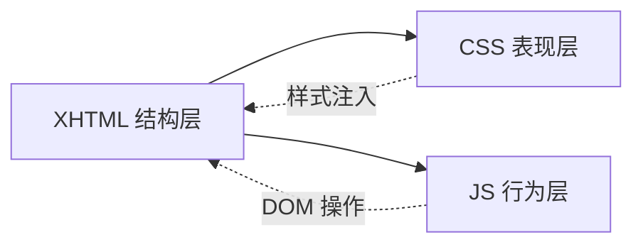

# 实验1：客户端HTML脚本编写（综合XHTML/CSS/JS）

## 实验核心：XHTML/CSS/JS 综合应用

如果 HTML 定义了网页的“骨架”，那么谁来负责“皮肤”与“肌肉”？在《Web技术（双语）》实验1中，我们不仅要写出合法的 XHTML 结构，更要通过 CSS 控制表现层，并用 JS 赋予交互能力。这三者如何在同一个文档中协同工作而不混乱？

> [!IMPORTANT]
> ==结构与表现分离==是 Web 标准的核心原则。CSS 虽可嵌入 HTML，但逻辑上独立；实验要求掌握三者在客户端脚本中的正确整合方式。

## 三者定位与协作关系

XHTML 是严格的 XML 化 HTML，强调语义与闭合；CSS 控制视觉呈现；JS 处理动态行为。它们的关系并非简单堆叠，而是分层解耦：



| 技术 | 职责 | 嵌入方式 | 关键特性 |
| :--- | :--- | :--- | :--- |
| XHTML | 内容语义化 | 文档主体 | 标签闭合、属性引号、小写 |
| CSS | 视觉样式控制 | `<style>` 或外链 | 选择器优先级、盒模型、级联 |
| JS | 客户端交互 | `<script>` | DOM API、事件绑定、异步 |

> [!NOTE]
> 课件 Example 2-tablesection.html 展示了表格语义化（`<thead>`/`<tbody>`）与 CSS 样式结合，这是理解“结构-表现”分离的典型范例。

## 怎么做：从静态到动态的整合步骤

1.  **构建合法 XHTML**：确保所有标签闭合、属性值加引号、使用语义化标签（如 `<table>` 配合 `<caption>`）。
2.  **嵌入或链接 CSS**：优先使用外部样式表；若内嵌，置于 `<head>` 的 `<style>` 中。注意 CSS 属性名区分大小写（如 `background-color` 非 `BackgroundColor`）。
3.  **添加 JS 交互**：脚本置于 `</body>` 前或使用 `defer`，避免阻塞渲染。通过 `document.getElementById()` 等 DOM 方法操作 XHTML 元素。

> [!TIP]
> 调试时先用浏览器验证 XHTML 合法性（W3C Validator），再检查 CSS 是否生效，最后测试 JS 功能。分步排查效率更高。

## 常见坑与辨析

-   **XHTML vs HTML5**：XHTML 必须严格闭合（`<br />` 而非 `<br>`），属性必须小写且带引号。实验环境若指定 XHTML，切勿用 HTML5 宽松语法。
-   **CSS 嵌入误区**：CSS 不是 HTML 标签，不能直接写在 `<body>` 中作为内容；`<style>` 块内写的是 CSS 规则，不是 HTML。
-   **XML 显示混淆**：课件 8.8 节提到“用 CSS 显示 XML”，这仅适用于纯 XML 数据展示，==不适用于常规网页开发==。实验中勿将 XHTML 当作普通 XML 处理。

> [!WARNING]
> JS 操作 DOM 时，若元素尚未加载（如脚本在 `<head>` 中执行），会返回 `null`。务必确保 DOM 就绪后再绑定事件或修改样式。

## 正确示例：表格样式与交互

以下片段来自 Experiment 1 典型需求，展示三者合规整合：

```xhtml
<!DOCTYPE html PUBLIC "-//W3C//DTD XHTML 1.0 Strict//EN"
  "http://www.w3.org/TR/xhtml1/DTD/xhtml1-strict.dtd">
<html xmlns="http://www.w3.org/1999/xhtml">
<head>
  <title>Table Demo</title>
  <style type="text/css">
    table { border-collapse: collapse; width: 80%; }
    th, td { border: 1px solid #333; padding: 8px; }
    .highlight { background-color: #ffeb3b; }
  </style>
</head>
<body>
  <table id="scoreTable">
    <thead><tr><th>Name</th><th>Score</th></tr></thead>
    <tbody>
      <tr><td>Alice</td><td>92</td></tr>
    </tbody>
  </table>
  <script type="text/javascript">
    // DOM 就绪后执行
    var row = document.getElementById("scoreTable").rows[1];
    row.cells[1].className = "highlight";
  </script>
</body>
</html>
```

此例中：XHTML 严格闭合、CSS 控制边框与高亮、JS 动态添加类名。三者各司其职，符合实验评分标准。
