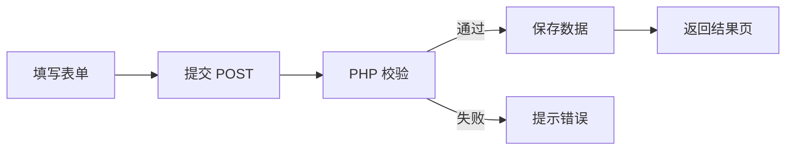

# 实验2：Web服务端脚本编写（PHP综合应用）

## 它是什么

本实验要求使用 **PHP** 完成 Web 服务端脚本编写，综合运用表单处理、请求参数获取、数组与字符串处理、文件操作、函数、数据库访问、会话管理以及动态页面输出等内容。最终应形成一个可运行的小型 Web 应用，而不只是输出单个 PHP 页面。

> [!IMPORTANT]
> PHP 在服务器端执行：浏览器提交请求，服务器运行 PHP 并生成 HTML，浏览器只负责显示结果。

## 为什么需要

静态 HTML 只能展示固定内容。当页面需要“接收用户输入、处理业务逻辑、保存数据、返回处理结果”时，就需要服务端脚本。

例如，注册页面先由 HTML 表单收集信息，再把数据交给 PHP 校验并写入数据库：



## 怎么做

### 搭建运行目录

将程序放入 Web 服务器的站点目录，例如：

```text
www/
├── index.php
├── register.php
├── login.php
├── logout.php
├── config.php
└── uploads/
```

`config.php` 用于保存数据库连接等配置，`uploads/` 用于存放上传文件。生产环境还应限制脚本执行权限、关闭详细错误显示，并妥善保管数据库密码。

### 处理表单请求

HTML 表单需要明确提交方法和接收字段：

```html
<form method="post" action="register.php">
    <input type="text" name="username">
    <input type="password" name="password">
    <button type="submit">注册</button>
</form>
```

PHP 使用超全局数组读取参数：

```php
$method = $_SERVER['REQUEST_METHOD'] ?? 'GET';

if ($method === 'POST') {
    $username = trim($_POST['username'] ?? '');
    $password = $_POST['password'] ?? '';

    if ($username === '' || $password === '') {
        echo '用户名和密码不能为空';
    } else {
        echo "收到用户：{$username}";
    }
}
```

`$_GET` 通常读取 URL 查询参数，`$_POST` 读取表单提交的数据。`??` 可以避免键不存在时出现未定义变量警告。

### 查询与过滤数据

显示数据时必须进行 HTML 转义，防止跨站脚本攻击：

```php
function e(string $value): string
{
    return htmlspecialchars($value, ENT_QUOTES, 'UTF-8');
}

echo e($username);
```

接收数据后还应检查格式、长度和业务规则，例如用户名是否重复、密码是否达到最低长度、文件类型和大小是否符合要求。==校验应尽量在服务端完成==，浏览器端 JavaScript 校验只能改善体验，不能替代安全检查。

### 使用数据库和会话

访问数据库时使用预处理语句，避免把用户输入直接拼入 SQL：

```php
$stmt = $pdo->prepare(
    'INSERT INTO users (username, password_hash) VALUES (?, ?)'
);
$stmt->execute([$username, password_hash($password, PASSWORD_DEFAULT)]);
```

密码应使用 `password_hash()` 保存，使用 `password_verify()` 验证，不能明文存储或直接使用普通 MD5。

登录成功后用会话保存登录状态：

```php
session_start();
$_SESSION['username'] = $username;
```

```php
session_start();
echo $_SESSION['username'] ?? '未登录';
```

登录页面读取的是 `$_POST`，不是 `$_SESSION`；`$_SESSION` 保存的是服务器端会话数据。

## 相近概念的区别

| 项目 | HTML | PHP | JavaScript |
|---|---|---|---|
| 主要运行位置 | 浏览器解析 | Web 服务器 | 浏览器 |
| 主要作用 | 页面结构与内容 | 业务逻辑、数据库访问 | 页面交互 |
| 能否直接访问数据库 | 通常不能 | 可以 | 通常不能 |
| 能否绕过页面直接请求接口 | 不涉及 | 可以校验和拒绝非法请求 | 不能代替服务端校验 |

PHP 与 JSP、ASP.NET 都属于服务器端脚本技术；但本课程使用 PHP，常与 MySQL、Apache 或 Nginx 配合。PHP 页面也可包含 HTML，因此一个 `.php` 文件常同时承担模板和控制器职责。

## 常见坑

> [!WARNING]
> 下列问题会造成程序报错、结果错误或安全风险。

- **忘记开启会话**：调用 `session_start()` 前不能使用 `$_SESSION`。
- **混淆 GET 与 POST**：表单若写成 `method="post"`，PHP 就应读取 `$_POST`。
- **直接输出用户输入**：会引发 XSS，应使用 `htmlspecialchars()`。
- **SQL 字符串拼接**：可能造成 SQL 注入，应使用预处理语句。
- **密码明文保存**：应使用 `password_hash()`。
- **上传文件只检查后缀**：后缀容易伪造，应同时检查 MIME、扩展名、文件大小和存储位置。
- **忽略 `$_FILES` 错误**：还需检查 `UPLOAD_ERR_OK`，并通过 `move_uploaded_file()` 移动文件。
- **文件目录暴露源码**：上传目录不应允许 PHP 文件直接执行。

> [!CAUTION]
> 在本地显示 PHP 错误有助于调试；部署到服务器后应记录错误日志，而不是向访问者输出数据库路径、堆栈等敏感信息。

## 一个算对了的例子

某表单提交：

```text
method=POST
username=alice
score=85
```

读取并转换成绩：

```php
$username = trim($_POST['username'] ?? '');
$score = (int)($_POST['score'] ?? 0);

if ($username === '') {
    echo '用户名不能为空';
} elseif ($score < 0 || $score > 100) {
    echo '成绩必须在 0～100 之间';
} else {
    echo "{$username} 的成绩是 {$score} 分";
}
```

正确输出：

```text
alice 的成绩是 85 分
```

这里不仅完成了取值，还依次完成了去空格、类型转换、范围判断和结果输出，体现了本实验所要求的 **PHP 综合应用**。
