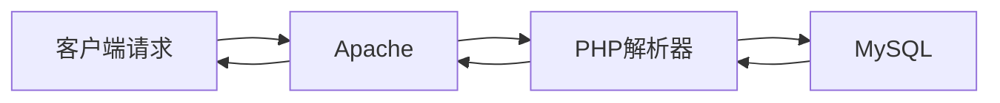

# Linux下LAMP环境的安装与配置及常用命令

## LAMP 是什么与为何需要

LAMP 是 Linux、Apache、MySQL/MariaDB、PHP/Perl/Python 的首字母缩写，代表一套经典的开源 Web 服务器技术栈。为什么 Web 开发实验首选它而非 Windows + IIS？因为 ==Linux 是生产环境事实标准==，而 LAMP 组件解耦、配置透明，能帮你理解请求从网络层到应用层的完整链路，而非被图形界面屏蔽底层细节。

> [!IMPORTANT]
> LAMP 不是单一软件，而是四个独立服务的协作体系，实验中需分别验证各层是否正常。

## 安装配置核心步骤

在南邮双语实验环境中，推荐使用 `apt`（Debian/Ubuntu）或 `yum`（CentOS）进行包管理安装，避免源码编译的环境依赖陷阱。

1.  **安装组件**：`sudo apt install apache2 mysql-server php libapache2-mod-php php-mysql`
2.  **启动服务**：`sudo systemctl start apache2 mysql`
3.  **验证连通**：浏览器访问 `http://localhost` 见 Apache 默认页；创建 `/var/www/html/info.php` 写入 `<?php phpinfo(); ?>` 验证 PHP 解析。
4.  **数据库初始化**：执行 `sudo mysql_secure_installation` 设置 root 密码并移除测试库。

> [!TIP]
> 配置文件路径是高频考点：Apache 主配置为 `/etc/apache2/apache2.conf`，站点配置在 `sites-available/`；PHP 配置为 `/etc/php/*/apache2/php.ini`。

## 常用命令速查

| 操作目标 | 推荐命令 | 说明 |
| :--- | :--- | :--- |
| 服务状态检查 | `systemctl status apache2` | 确认 active (running) |
| 端口监听验证 | `ss -tlnp \| grep :80` | 比 netstat 更现代 |
| 错误日志查看 | `tail -f /var/log/apache2/error.log` | 实时追踪排错 |
| 配置语法检测 | `apachectl configtest` | ==重启前必做== |
| MySQL 登录 | `mysql -u root -p` | 注意 `-p` 后无空格 |

## 与相近概念的区别

LAMP 常与 LNMP（Nginx 替代 Apache）混淆。Apache 采用进程/线程模型处理并发，配置灵活但内存占用高；Nginx 基于事件驱动异步架构，静态资源性能更强，但 PHP 需通过 FastCGI 外部调用。==本课程实验以 LAMP 为主==，因其模块加载机制更直观体现“Web 服务器 + 解释器”的集成方式。

> [!NOTE]
> XAMPP/WAMP 等集成包虽便捷，但隐藏了服务间交互细节，不适合本课程“理解原理”的实验目标。

## 常见坑与正确示例

> [!WARNING]
> 修改配置后未重载服务、文件权限不足、SELinux/AppArmor 拦截是三大高频故障源。

**典型问题**：访问 `info.php` 显示源码而非解析结果。  
**错误做法**：反复重装 PHP。  
**正确排查**：

1.  检查 Apache 是否加载 PHP 模块：`apache2ctl -M | grep php`
2.  若未加载，执行 `sudo a2enmod php8.1 && sudo systemctl reload apache2`
3.  确认文件权限：`ls -l /var/www/html/info.php` 应为 `644`，属主 `www-data`

> [!CAUTION]
> 切勿在生产环境保留 `phpinfo()` 页面，它会泄露服务器完整配置信息，构成安全风险。实验完成后务必删除或限制访问。
