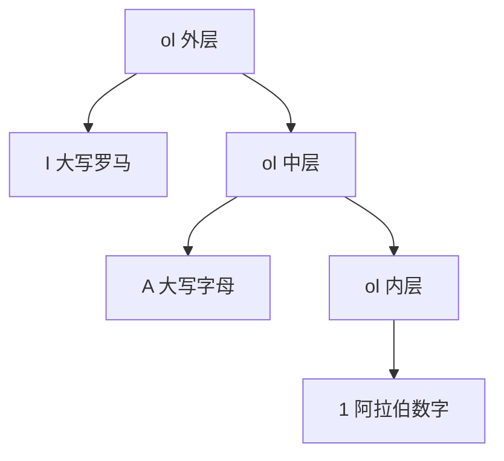

# 列表（无序列表、有序列表、定义列表）

## 三种列表各管什么用

页面里凡是"一组并列条目"，都该用列表而不是手动敲 `<br>`。XHTML 提供三种语义不同的列表：

| 列表 | 标签 | 默认外观 | 典型场景 |
|---|---|---|---|
| 无序列表 | `<ul>` + `<li>` | 实心圆点 disc | 购物清单、导航菜单 |
| 有序列表 | `<ol>` + `<li>` | 1. 2. 3. | 操作步骤、章节编号 |
| 定义列表 | `<dl>` + `<dt>` + `<dd>` | 术语加缩进解释 | 名词解释、FAQ |

> [!IMPORTANT]
> 三种列表的**直接子元素只能是 `<li>`**（或 `<dt>`/`<dd>`），不允许出现裸文本或其他标签。

## 无序列表与有序列表

无序列表用 `<ul>` 包裹若干 `<li>`，每个 `<li>` 是一个条目；有序列表把 `<ul>` 换成 `<ol>`，浏览器会自动编号。二者都可以**嵌套**：在某个 `<li>` 内部再放一个完整的 `<ul>` 或 `<ol>`，浏览器会按层级自动更换项目符号或编号样式。

```html
<ul>
  <li>牛奶</li>
  <li>鸡蛋</li>
  <li>蔬菜
    <ul>
      <li>菠菜</li>
      <li>胡萝卜</li>
    </ul>
  </li>
</ul>
```

> [!TIP]
> 嵌套列表必须**完全写在父级 `<li>` 的开闭标签之间**，不能放在 `</li>` 之后——这是初学者最常见的结构错误。

## 定义列表

定义列表用 `<dl>`（definition list）作容器，每个术语用 `<dt>`（definition term），解释用 `<dd>`（definition description）。一个 `<dt>` 可以对应多个 `<dd>`，多个 `<dt>` 也可以共享一个 `<dd>`。

```html
<dl>
  <dt>URL</dt>
  <dd>统一资源定位符，标识 Web 资源地址</dd>
  <dt>HTTP</dt>
  <dd>超文本传输协议</dd>
</dl>
```

## 默认样式与考试要点

> [!IMPORTANT]
> 无序列表默认项目符号是 **disc（实心圆点）**；有序列表默认序号是 **1, 2, 3（阿拉伯数字）**。这是教材 REVIEW QUESTIONS 2.16&17 的原题答案。

实际编号样式由 CSS 控制，三层嵌套时各层互不相同：



> [!WARNING]
> 不要用 `<ol>` 的 `type` 属性改样式（XHTML Strict 已废弃），考试要求用 **CSS 的 `list-style-type`**。若题目指定"所有样式写在文档样式表"，就把 `<style>` 放进 `<head>`，不要写内联 `style` 属性。

## 综合题完整示范

以 Exercise 3.6 为例：外层汽车分类用罗马数字，中层车身形式用字母，内层具体车型用数字，并给三类车配不同背景色。

```html
<!DOCTYPE html>
<html>
<head>
  <title>Cars</title>
  <style type="text/css">
    ol.roman   { list-style-type: upper-roman; }
    ol.alpha   { list-style-type: upper-alpha; }
    ol.arabic  { list-style-type: decimal; }
    #compact  { background-color: pink; }
    #midsize  { background-color: blue; }
    #sports   { background-color: red; }
  </style>
</head>
<body>
  <ol class="roman">
    <li id="compact">Compact
      <ol class="alpha">
        <li>Two Door
          <ol class="arabic">
            <li>Honda Civic</li>
            <li>Toyota Corolla</li>
            <li>Ford Focus</li>
          </ol>
        </li>
        <li>Four Door
          <ol class="arabic">
            <li>Honda Accord</li>
            <li>Toyota Camry</li>
            <li>Nissan Altima</li>
          </ol>
        </li>
      </ol>
    </li>
    <li id="midsize">Midsize
      <ol class="alpha">
        <li>Two Door
          <ol class="arabic">
            <li>BMW 3 Series</li>
            <li>Audi A5</li>
            <li>Mercedes C-Class</li>
          </ol>
        </li>
        <li>Four Door
          <ol class="arabic">
            <li>BMW 5 Series</li>
            <li>Audi A6</li>
            <li>Lexus ES</li>
          </ol>
        </li>
      </ol>
    </li>
    <li id="sports">Sports
      <ol class="alpha">
        <li>Coupe
          <ol class="arabic">
            <li>Porsche 911</li>
            <li>Chevrolet Corvette</li>
            <li>Nissan GT-R</li>
          </ol>
        </li>
        <li>Convertible
          <ol class="arabic">
            <li>Mazda MX-5</li>
            <li>BMW Z4</li>
            <li>Audi TT</li>
          </ol>
        </li>
      </ol>
    </li>
  </ol>
</body>
</html>
```

> [!NOTE]
> 背景色加在**外层 `<li>`** 上，其嵌套子列表会一并继承背景；若只想要外层条目变色而不影响内层，需改用 `ol > li` 选择器或给内层显式设置 `background-color: transparent`。
