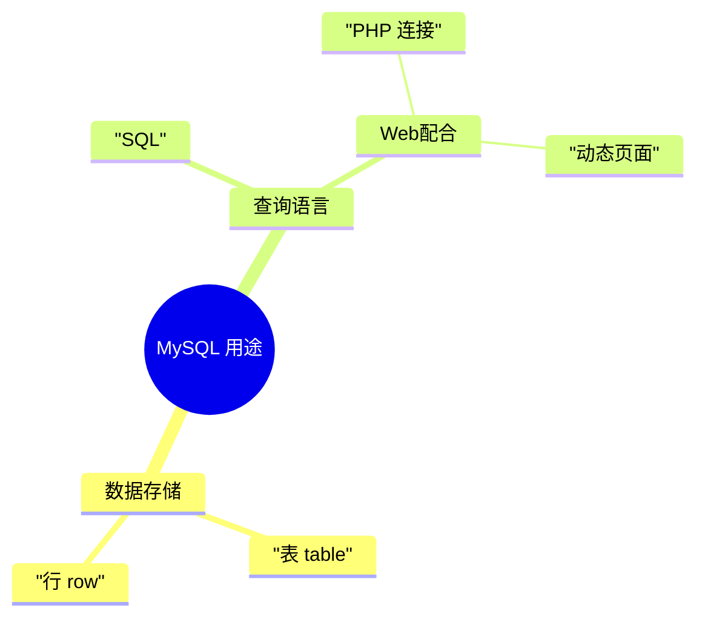

# MySQL数据库系统简介

## 它是什么

MySQL 是一种关系型数据库管理系统（==RDBMS==），用表（table）来存放数据，用 SQL（Structured Query Language）来读写数据。在《Web 技术（双语）》里，它属于“Part 7 数据库访问”这一层：Web 应用通常用 PHP/Node.js 等服务器端脚本连接 MySQL，把用户提交的数据持久化到库中，或从库中取出页面所需内容。

先想一个问题：如果网站只用文件保存用户注册信息，多人同时写入时会发生什么？——很容易互相覆盖、难以按条件查询。于是我们需要一个能**并发安全访问**、**按结构查询**的系统，这就是 MySQL 的用途。

## 为什么需要 MySQL

- 数据结构化：用表、行、列组织，而不是散乱文本。
- 支持 SQL：`SELECT`、`INSERT`、`UPDATE`、`DELETE` 统一操作。
- 多用户并发与权限控制，适合 Web 后端。
- 与 PHP 等 Web 技术配合，构成动态站点的数据底座。



## 怎么做：基本访问流程

典型流程是：浏览器请求 → 服务器脚本 → 连接 MySQL → 执行 SQL → 返回结果 → 生成页面。


建库、建表、插数据的最小例子：

```sql
CREATE DATABASE webdb;
USE webdb;
CREATE TABLE user(
  id INT PRIMARY KEY,
  name VARCHAR(20)
);
INSERT INTO user VALUES (1, 'Alice');
SELECT * FROM user;
```

[!IMPORTANT]
> 上面 `SELECT * FROM user;` 的结果为：`id=1, name='Alice'`，这就是一个“算对了”的例子。

## 与相近概念的区别

| 概念 | 说明 | 与 MySQL 关系 |
|---|---|---|
| 数据库 DB | 存放数据的容器 | MySQL 管理多个 DB |
| 表 table | 结构化的二维数据 | DB 内部的组成单位 |
| SQL | 查询语言 | 操作 MySQL 的工具 |
| MySQL | 具体的 RDBMS 软件 | 实现 SQL 的系统 |

## 常见的坑

[!WARNING]
> 写 Web 程序时不要把用户输入直接拼进 SQL，否则会产生 SQL 注入；应使用预处理语句（prepared statement）。

[!CAUTION]
> 忘记写 `USE webdb;` 或在 PHP 里连错 host，会导致“No database selected / Access denied”。

[!TIP]
> 记忆：先 `CREATE DATABASE`，再 `CREATE TABLE`，最后 `INSERT` 与 `SELECT`。

综上，==MySQL 是 Web 后端用来结构化存储与 SQL 查询的关系数据库系统==，掌握建库建表与基本 SQL 就抓住了 Part 7 的入口。
