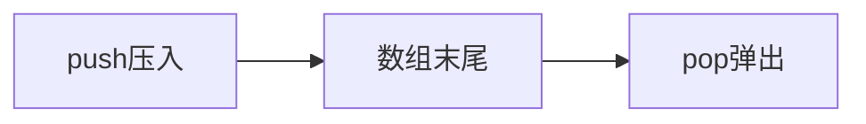

# PHP数组（创建、访问元素、作为函数参数、作为栈Stacks、遍历Iterating、排序Sorting）

在 Web 开发中，如果要把一个班级所有学生的成绩存起来，难道要定义几十个独立变量吗？显然不合理。我们需要一种能批量存储、按规则存取的数据结构——这就是 ==PHP 数组（Array）==。它本质上是**有序映射（ordered map）**，将键（key）映射到值（value）。

## 创建与访问元素

PHP 提供两种创建方式：`array()` 函数或短语法 `[]`。根据键的类型，分为索引数组和关联数组。

```php
// 索引数组（默认从0开始）
$fruits = ["Apple", "Banana"];
echo $fruits[0]; // 输出 Apple

// 关联数组（自定义字符串键）
$stu = ["name" => "NJUPT", "score" => 95];
echo $stu["name"]; // 输出 NJUPT
```

> [!WARNING]
> 关联数组的键是字符串，访问时务必加引号。写 `$stu[name]` 会导致 PHP 将其误认为未定义常量而报错。

## 作为函数参数

数组可以直接传给函数。但修改形参是否会影响实参？这取决于传递方式。

| 传递方式 | 语法 | 修改形参影响原数组？ |
| --- | --- | --- |
| 值传递 | `function f($arr)` | 否（复制副本） |
| 引用传递 | `function f(&$arr)` | 是（操作原地址） |

```php
function addScore(&$a) { $a[1] += 5; }
$s = [90, 80];
addScore($s);
// $s 现在是 [90, 85]
```

## 作为栈 Stacks

栈遵循后进先出（LIFO）。若把数组末尾视为栈顶，可用 `array_push()` 入栈，`array_pop()` 出栈。



```php
$stack = [];
array_push($stack, "A", "B"); // ["A", "B"]
$top = array_pop($stack);     // $top="B", $stack=["A"]
```

> [!TIP]
> `array_push($arr, $val)` 等价于 `$arr[] = $val`，后者执行效率略高。

## 遍历 Iterating

如何逐个取出元素？常用 `foreach` 循环。

```php
$colors = ["red" => "#FF0000", "blue" => "#0000FF"];
foreach ($colors as $key => $val) {
    echo "$key: $val\n";
}
```

> [!NOTE]
> `foreach` 默认操作数组副本。若需在遍历时修改原数组的值，必须用引用：`foreach ($arr as &$val)`。

## 排序 Sorting

排序（sorting）是考试高频词汇。请回忆课件专业词汇表中的考点：**sorting 对应的中文是“排序”**。

| 函数 | 排序依据 | 键值关系 |
| --- | --- | --- |
| `sort()` | 值（升序） | 重新分配数字键 |
| `asort()` | 值（升序） | ==保持键值对应== |
| `ksort()` | 键（升序） | 保持键值对应 |

```php
$grades = ["Bob" => 85, "Amy" => 92];
sort($grades);
// 结果: [0 => 85, 1 => 92]，字符串键丢失！

asort($grades);
// 结果: ["Bob" => 85, "Amy" => 92]，键保留且按值升序
```

> [!CAUTION]
> 对关联数组使用 `sort()` 会==销毁原有的字符串键名==并重建数字索引，这是最常见的丢分坑点。处理关联数组务必选用 `asort()` 或 `ksort()`。
