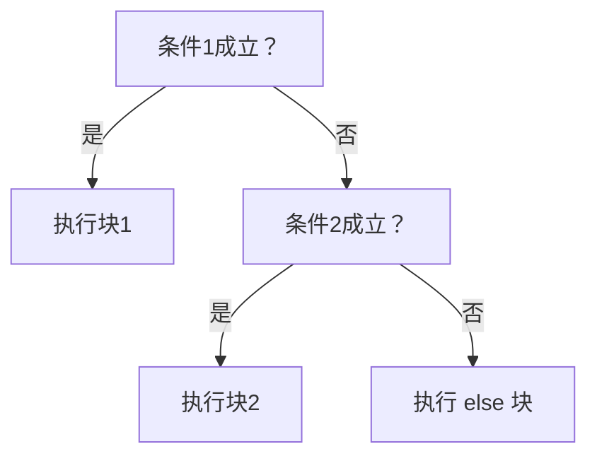

# PHP控制语句（关系运算符、布尔运算符、选择语句Selection、循环语句Loop）

## 分支与循环：程序的决策和重复

PHP 脚本按语句顺序从上往下执行。但真实需求经常是：**满足某条件才做某件事**（如“登录成功才跳转”），或**重复做某件事直到条件改变**（如“遍历购物车所有商品”）。控制语句就是用来改变默认执行顺序的。

在进入具体语法前，先想一个问题：我们要判断“用户年龄在 18 到 60 岁之间”。能否写成 `18 <= $age <= 60`？

答案是**不能**。PHP 会先算 `18 <= $age`，得到布尔值 `true` 或 `false`，再拿这个布尔值和 `60` 比较。必须用布尔运算符连接两个关系表达式：`18 <= $age && $age <= 60`。

### 关系运算符与布尔运算符

关系运算符比较两个值，返回布尔结果：

| 运算符 | 含义 | 示例（设 `$a = 3`） | 结果 |
|---|---|---|---|
| `==` | 等于（值相等） | `$a == "3"` | `true` |
| `===` | 全等（值相等且类型相同） | `$a === "3"` | `false` |
| `!=` / `<>` | 不等于 | `$a != 4` | `true` |
| `!==` | 不全等 | `$a !== "3"` | `true` |
| `<` `<=` `>` `>=` | 小于/小于等于/大于/大于等于 | `$a > 2` | `true` |

> [!WARNING]
> ==`==` 和 `===` 是最容易混淆的一对==。`"3" == 3` 为 `true`（PHP 自动转换类型），`"3" === 3` 为 `false`。比较两个变量是否“真的一样”时，优先用 `===`。

布尔运算符组合多个条件：

| 运算符 | 含义 | 示例 | 结果 |
|---|---|---|---|
| `&&` / `and` | 逻辑与 | `true && false` | `false` |
| `\|\|` / `or` | 逻辑或 | `true \|\| false` | `true` |
| `!` | 逻辑非 | `!true` | `false` |

> [!TIP]
> 记忆口诀：`&&` 是“都要满足”，`||` 是“满足一个就行”，`!` 就是“反过来”。

### 选择语句：if / else / elseif 与 switch

最常用的结构：

```php
if (条件1) {
    // 条件1为 true 时执行
} elseif (条件2) {
    // 条件1为 false 且条件2为 true 时执行
} else {
    // 以上都为 false 时执行
}
```

当判断的是**同一个变量的多个离散取值**时，`switch` 更清晰：

```php
switch ($day) {
    case "Mon":
        echo "星期一";
        break;
    case "Tue":
        echo "星期二";
        break;
    default:
        echo "其他日子";
}
```

> [!NOTE]
> `switch` 的 `case` 比较默认用的是“松散比较”（类似 `==`）。另外每个 `case` 末尾**必须写 `break`**，否则会继续执行下一个 `case` 的代码，这称为“贯穿（fall-through）”。

下面用一个流程图概括 `if-elseif-else` 的判断路径：



### 循环语句：while / do-while / for / foreach

- **`while`**：先判断条件，为 `true` 才进入循环体。
- **`do-while`**：先执行一次循环体，再判断条件。==至少执行一次==。
- **`for`**：适合循环次数确定的场景，格式为 `for (初始化; 条件; 步进)`。
- **`foreach`**：专用于遍历数组。

```php
// for：计算 1 到 100 的和
$sum = 0;
for ($i = 1; $i <= 100; $i++) {
    $sum += $i;
}
echo $sum;   // 5050

// foreach：遍历关联数组
$score = ["Tom" => 85, "Jerry" => 92];
foreach ($score as $name => $s) {
    echo "$name: $s\n";
}
```

> [!IMPORTANT]
> `while` 条件在每次循环**开始前**检查，可能一次都不执行；`do-while` 条件在每次循环**结束后**检查，==循环体至少执行一次==。`for` 和 `while` 可以互相改写，但 `for` 把初始化、条件、步进放在一起，更紧凑。

### 一个算对了的例子

判断一个年份是否为闰年：能被 4 整除但不能被 100 整除，或能被 400 整除。

```php
$year = 2024;
if (($year % 4 == 0 && $year % 100 != 0) || $year % 400 == 0) {
    echo "$year 是闰年";
} else {
    echo "$year 不是闰年";
}
// 输出：2024 是闰年
```

验证：2024 能被 4 整除且不能被 100 整除，第一个子条件 `true && true` 得 `true`，整个 `||` 表达式即为 `true`，进入 `if` 分支。
