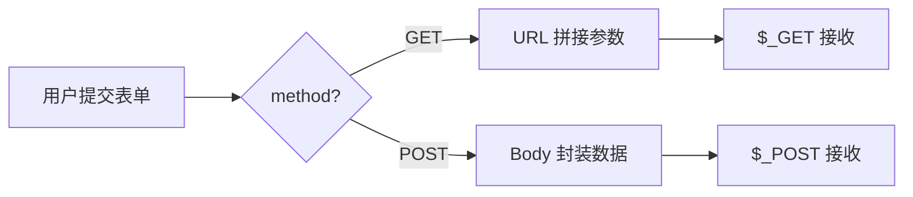

# PHP表单处理（Form Handling，接收客户端表单数据）

## 什么是表单处理

当用户在浏览器填写并提交表单后，数据如何安全、准确地到达 PHP 脚本？==PHP 表单处理的核心机制是通过超全局变量 `$_GET` 和 `$_POST` 自动接收客户端提交的键值对数据==。这不同于普通变量赋值，它是 PHP 与前端交互的“入口网关”。

为什么不能直接用 `$username = $_POST['user']` 就认为万事大吉？因为客户端输入永远不可信。表单处理不仅是“接收”，更包含“验证”与“过滤”两个隐含步骤。若跳过这两步，轻则程序报错，重则引发 SQL 注入或 XSS 攻击。

## GET 与 POST 的选择

两种方法在数据传输方式上有本质区别，选错会导致功能异常或安全隐患：

| 特性 | `$_GET` | `$_POST` |
| :--- | :--- | :--- |
| 数据位置 | URL 查询字符串 | HTTP 请求体 |
| 长度限制 | 受 URL 长度约束（约 2KB） | 理论上无上限 |
| 缓存/书签 | 可被缓存、收藏 | 不被缓存 |
| 适用场景 | 搜索、分页、筛选 | 登录、注册、文件上传 |



> [!IMPORTANT]
> ==敏感数据（密码、Token）严禁使用 GET==，因其会完整暴露在浏览器历史与服务器日志中。

## 正确接收数据的三步法

一个健壮的表单处理流程应遵循以下顺序：

1.  **检查存在性**：用 `isset()` 或 `empty()` 判断字段是否提交，避免未定义索引警告。
2.  **过滤原始输入**：使用 `filter_input()` 或 `htmlspecialchars()` 清洗数据。
3.  **业务验证**：校验格式、长度、范围等是否符合预期。

> [!TIP]
> 优先使用 `filter_input(INPUT_POST, 'email', FILTER_VALIDATE_EMAIL)` 而非手动正则，既简洁又符合 PHP 标准库规范。

## 常见误区与辨析

很多初学者混淆 `$_REQUEST` 与 `$_POST`。`$_REQUEST` 默认合并了 GET、POST 甚至 COOKIE 数据，来源不明确，==在生产环境中应始终显式指定 `$_GET` 或 `$_POST`==，杜绝隐式信任。

另一个高频错误是未做转义直接输出用户输入。即使只是显示用户名，也必须经过 `htmlspecialchars($str, ENT_QUOTES, 'UTF-8')` 处理，否则 `<script>` 标签会被浏览器执行。

> [!CAUTION]
> 永远不要假设表单字段一定存在！未检查 `isset()` 就直接访问数组键，在 PHP 8+ 中会抛出 Warning，破坏 JSON API 响应结构。

## 完整示例：安全接收邮箱

```php
// ✅ 正确做法：存在性检查 + 类型过滤 + 输出转义
if ($_SERVER['REQUEST_METHOD'] === 'POST') {
    $email = filter_input(INPUT_POST, 'email', FILTER_VALIDATE_EMAIL);
    
    if ($email === false || $email === null) {
        echo "无效邮箱格式";
    } else {
        // 输出时仍需转义，防止存储型XSS
        $safe_email = htmlspecialchars($email, ENT_QUOTES, 'UTF-8');
        echo "收到邮箱：" . $safe_email;
    }
}
```

> [!NOTE]
> 此例中 `filter_input` 返回 `false` 表示格式非法，返回 `null` 表示字段未提交，两者需分别处理，这是考试与实战中的易错点。
