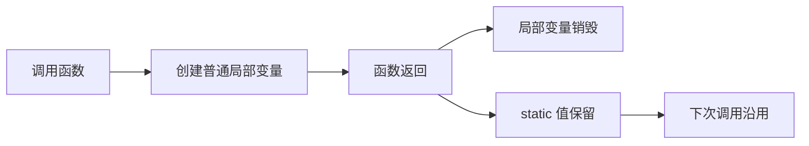

# PHP函数（参数Parameters、变量作用域Scope、变量生命周期Lifetime）

## 为什么需要函数

把一段可复用的逻辑封装成函数，例如 `add()`、`checkLogin()`，调用时只需传入数据，不必重复书写代码。学习 PHP 函数要分清三个问题：**参数怎样传入、变量在哪里有效、变量能存在多久**。它们分别对应 Parameters、Scope 和 Lifetime。

## 参数 Parameters

定义函数时写的是**形式参数**，调用时传入的是**实际参数**：

```php
function welcome($name, $year = 2025) {
    return "Hello, $name ($year)";
}

echo welcome("Tom");        // Hello, Tom (2025)
echo welcome("Ann", 2024);  // Hello, Ann (2024)
```

`$year = 2025` 是默认参数；调用者未传值时使用默认值。默认参数通常放在参数列表末尾，否则容易出现“后面的参数有默认值，前面的参数却没传”的混乱。

PHP 默认采用**值传递**：函数得到实参值的副本，修改形参通常不影响外部变量。若希望函数直接修改原变量，需要在形参前加 `&`，使用**引用传递**：

```php
function increase($x)  { $x++; }   // 值传递
function addOne(&$x)   { $x++; }   // 引用传递

$n = 10;
increase($n);   // $n 仍为 10
addOne($n);     // $n 变为 11
```

> [!IMPORTANT]
> ==值传递修改的是副本，引用传递修改的是原变量==；`&` 写在函数定义的形参前，不是写成 `addOne(&$n)`。

## 变量作用域 Scope

作用域回答的是“这个名字在这里能不能访问”。PHP 中，函数外定义的变量属于全局作用域，函数内普通变量属于局部作用域；==函数内部默认不能直接读取同名的全局变量==。

| 写法 | 含义 | 常见用途 |
|---|---|---|
| 局部变量 | 只在当前函数内有效 | 保存临时计算结果 |
| `global $x` | 在函数内引入全局变量 `$x` | 直接读写全局变量 |
| `$GLOBALS['x']` | 通过超全局数组访问全局变量 | 读写全局变量 |
| 参数、返回值 | 在函数内外显式传递数据 | 通常更清晰、易测试 |

```php
$count = 3;

function showCount() {
    global $count;
    echo $count;  // 3
}
```

不要因为有 `global` 就频繁使用它。函数依赖隐藏的全局状态后，调用结果更难预测；能通过参数传入、通过 `return` 返回时，优先这样做。

## 变量生命周期 Lifetime

生命周期回答的是“变量从何时存在，到何时被销毁”。普通局部变量通常在**进入函数、执行到定义时创建，函数返回后销毁**，因此下一次调用不会保留上一次的值。

若使用 `static` 声明静态局部变量，它仍只能在当前函数内访问，但==函数返回后其值会保留到脚本结束，供后续调用继续使用==。注意：作用域和生命周期不是一回事，静态局部变量并没有因此变成全局变量。

```php
function nextNumber() {
    static $num = 0;  // 初始化只执行一次
    $num++;
    return $num;
}

echo nextNumber();  // 1
echo nextNumber();  // 2
echo nextNumber();  // 3
```



## 一个完整例子

```php
$base = 10;

function calc($x, $step = 1) {
    global $base;
    static $times = 0;
    $times++;
    $result = $base + $x + $step;
    return "$result, called $times time(s)";
}

echo calc(5);      // 16, called 1 time(s)
echo calc(5, 2);   // 17, called 2 time(s)
```

第一次调用中，`$x = 5`、`$step = 1`，所以结果为 $10+5+1=16$；第二次显式传入 `$step = 2$，结果为 $10+5+2=17$。`$times` 是静态局部变量，因此第二次调用显示 `2`，而 `$result` 是普通局部变量，每次调用都会重新计算。

> [!WARNING]
> 常见错误包括：以为函数内能自动访问全局变量；把值传递误认为引用传递；认为 `static` 扩大了作用域；以及把“静态变量跨调用保留”理解成“跨所有用户、所有请求永久保存”。PHP 变量通常随当前请求结束而释放，长期保存应使用 Session、数据库或文件。
