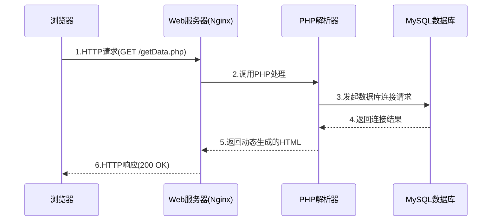

# 使用PHP连接MySQL数据库（Connecting to MySQL）

---

## 连接前的核心概念回顾

在你开始写代码之前，先花一分钟想一个问题：“当我们在浏览器里输入一个网址，背后到底发生了什么？”

这个过程，就串联起了你学过的几个核心知识点。

*   **URL 是起点**：用户请求的 `http://www.example.com/getData.php` 就是一个 **URL**。它通过 **HTTP 协议**，向互联网上的一台特定服务器（`www.example.com`）请求一个资源（`getData.php`）。DNS 服务器会负责把域名翻译成服务器能懂的 **IP 地址**。
*   **服务器分工**：请求到达后，**Web 服务器**（如 Apache, Nginx）会处理它。如果请求的是动态资源（如 `.php` 文件），Web 服务器会把活儿交给 **PHP 解析器**。
*   **PHP 的角色**：PHP 脚本运行时，如果需要数据，它就会扮演 **客户端**，向另一台服务器——**数据库服务器**（如 MySQL）发起连接请求，执行查询，最后将结果动态生成 HTML 页面，再由 Web 服务器通过 **HTTP 响应**返回给浏览器。



所以说，PHP 连接 MySQL，本质上是 PHP 作为 **客户端**，通过 TCP/IP 协议与 **MySQL 服务器** 建立通信。整个过程必须在运行着的 Web 服务器程序环境下才能正常工作。

---

## 核心实操：如何使用 PHP 连接 MySQL

在目前的 PHP 开发中，**PDO (PHP Data Objects)** 和 **MySQLi (MySQL Improved)** 是两种主流方式。你的课件和现代开发最佳实践都推荐使用前者，因为它提供了一套**统一的数据库操作接口**。如果你未来更换数据库（比如从 MySQL 换成 PostgreSQL），只需修改连接驱动，大部分代码无需重写。

我们这里就用 PDO 来演示。

### 第一步：建立连接

连接的本质是创建一个 `PDO` 类的对象。你需要提供三样关键信息：

1.  **DSN (Data Source Name，数据源名称)**：告诉 PHP 数据库的类型、主机和库名。
2.  **用户名**：数据库账号。
3.  **密码**：数据库密码。

```php
<?php
$host = 'localhost';      // 数据库服务器地址，通常是本地
$dbname = 'njupt_web';    // 你要连接的数据库名
$username = 'student';    // 用户名
$password = '123456';     // 密码

// DSN: Data Source Name
$dsn = "mysql:host=$host;dbname=$dbname;charset=utf8mb4";

try {
    // 尝试创建PDO对象，建立连接
    $pdo = new PDO($dsn, $username, $password);
    
    // 设置错误模式为抛出异常，便于调试
    $pdo->setAttribute(PDO::ATTR_ERRMODE, PDO::ERRMODE_EXCEPTION);
    
    echo "数据库连接成功！"; // 实际开发中应写入日志，而非直接输出
} catch (PDOException $e) {
    // 连接失败，捕获异常
    die("数据库连接失败: " . $e->getMessage());
}
?>
```

**[!TIP]**
> ==“DSN->用户名->密码”== 是建立连接的口诀。把它想象成寄信：DSN是地址，用户名是收件人，密码是取件码。

### 第二步：执行查询

连接成功后，你就可以用 `$pdo` 对象向数据库发送 SQL 语句了。

```php
<?php
// ... 接上面的连接成功代码 $pdo

// 准备一条SQL查询，使用占位符（:name）预防 SQL注入 - 这是必须养成的好习惯！
$sql = "SELECT student_id, name FROM students WHERE class = :class_name";
$stmt = $pdo->prepare($sql);

// 绑定参数并执行
$class = 'Web技术双语班';
$stmt->execute(['class_name' => $class]);

// 获取所有结果（作为关联数组）
$students = $stmt->fetchAll(PDO::FETCH_ASSOC);

// 在HTML中遍历并展示结果
echo "<ul>";
foreach ($students as $student) {
    // 这里通过PHP动态生成了HTML列表项
    echo "<li>{$student['name']}（学号: {$student['student_id']}）</li>";
}
echo "</ul>";
?>
```

---

## 与表单的结合：一个算对了的例子

这里有两个极易出错的概念，我们通过一个例子来区分：**GET 方法** 和 **POST 方法**。

> [!IMPORTANT]
> 当你用 `<form method=“get”>` 时，表单数据会被添加到 **URL** 的末尾（即查询字符串 `?` 后），提交给 `action` 指定的程序。这正对应着 URL 的组成部分。
> 当你用 `<form method=“post”>` 时，表单数据被放在 **HTTP 请求的 Body 体** 中传输，URL上看不见，传输的数据量更大，也更安全。

**场景**：一个根据学号查询学生成绩的页面。

**1. 前端表单（form.html）**

```html
<!-- 这里使用 GET 方法, 方便用户收藏查询结果的URL -->
<form action="get_score.php" method="get">
    请输入学号: <input type="text" name="sid" />
    <input type="submit" value="查询" />
</form>
```

**2. 后端处理（get_score.php）**

```php
<?php
// 通过 $_GET 超全局数组获取附在URL上的 'sid' 数据
if (isset($_GET['sid'])) {
    $studentId = $_GET['sid'];

    $dsn = "mysql:host=localhost;dbname=njupt_exam;charset=utf8mb4";
    $pdo = new PDO($dsn, 'root', ''); // 连接已被简化，假设一定成功

    $sql = "SELECT name, score FROM scores WHERE student_id = :sid";
    $stmt = $pdo->prepare($sql);
    $stmt->execute(['sid' => $studentId]);
    $result = $stmt->fetch(PDO::FETCH_ASSOC);

    if ($result) {
        // 动态输出查询结果
        echo "姓名: " . $result['name'] . ", 成绩: " . $result['score'];
    } else {
        echo "未找到该学号的学生。";
    }
} else {
    echo "请通过表单提交学号。";
}
?>
```

当你输入学号 `B210101` 并点击查询时，浏览器实际请求的 **URL** 会变成 `get_score.php?sid=B210101`。这个 URL 完美诠释了 **http 协议**、**URL 寻址** 和 **Web 服务器动态程序** 是如何协作的。

> [!WARNING]
> **常见大坑：SQL 注入**
> 永远不要用 `$sql = “SELECT * FROM users WHERE name = ‘{$_GET[‘name’]}’”;` 这种方式拼接 SQL。攻击者可以在输入框里写入恶意 SQL 片段，直接操纵你的数据库。**==所有用户输入都必须通过预处理语句的占位符来传递==**，这是铁律。

从浏览器的 URL，到 PHP 与 MySQL 的交互，整个 Web 开发的核心链路就在这里打通了。
