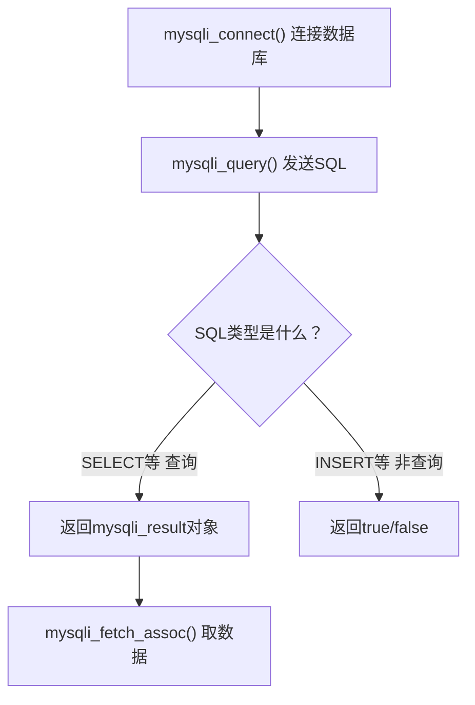

# 使用PHP请求MySQL操作与综合示例（Requesting MySQL Operations）

## 使用PHP请求MySQL操作

在连接上MySQL数据库之后，真正的核心工作就是向数据库“发号施令”——执行SQL查询。PHP通过`mysqli_query()`函数将SQL语句发送给MySQL服务器，然后获取返回的结果。

### 为什么需要请求操作

光连接数据库就像打通了电话但一句话不说，没有任何实际意义。==请求MySQL操作的本质是让PHP把SQL指令传递给MySQL服务器执行，并拿回结果==。无论是要查询学生成绩、插入新用户，还是更新库存数量，都必须通过这一步完成。

### 执行查询的基本流程

整个请求过程可以概括为三步：**连接** → **执行** → **处理结果**。



### 两种返回结果

`mysqli_query()`的返回值取决于SQL语句的类型，这是初学者最容易搞混的地方：

| SQL类型 | 操作举例 | 成功时返回 | 失败时返回 |
|---------|----------|-----------|-----------|
| 查询语句 | SELECT, SHOW, DESCRIBE | ==`mysqli_result`对象== | false |
| 非查询语句 | INSERT, UPDATE, DELETE | ==`true`== | false |

> [!WARNING]
> **常见坑**：很多同学用`if ($result == true)`来判断SELECT是否成功。实际上SELECT成功时返回的是对象而不是布尔值true（虽然对象在弱比较下可能为true，但这不是正确做法）。应该用`if ($result !== false)`或`if ($result)`来统一判断。

> [!IMPORTANT]
> 课件强调：**导致错误的操作会返回NaN**。这其实指的是当SQL执行失败时，`mysqli_query()`返回`false`，如果拿`false`去做算术运算就会产生NaN。核心记忆点：出错返回false。

### 一个完整的例子

下面是一个完整的查表操作，涵盖连接、查询、遍历输出、关闭连接的完整生命周期。

**场景**：从`students`表中查询所有年龄大于20的学生姓名和年龄。

```php
<?php
// 1. 连接数据库
$conn = mysqli_connect("localhost", "root", "123456", "school");

// 2. 检查连接
if (!$conn) {
    die("连接失败: " . mysqli_connect_error());
}

// 3. 构建SQL并执行查询
$sql = "SELECT name, age FROM students WHERE age > 20";
$result = mysqli_query($conn, $sql);

// 4. 处理结果
if ($result && mysqli_num_rows($result) > 0) {
    // ==mysqli_fetch_assoc()每次取一行，指针自动后移==
    while ($row = mysqli_fetch_assoc($result)) {
        echo "姓名: " . $row['name'] . ", 年龄: " . $row['age'] . "<br>";
    }
} else {
    echo "没有找到符合条件的记录。";
}

// 5. 释放结果集并关闭连接
mysqli_free_result($result);
mysqli_close($conn);
?>
```

### 取数据的三种方式对比

拿到`mysqli_result`对象后，PHP提供了不同风格的方法来取出行数据：

| 函数 | 返回格式 | 使用场景 |
|------|---------|---------|
| `mysqli_fetch_assoc()` | 关联数组，键是列名 | ==最常用==，`$row['name']`直观 |
| `mysqli_fetch_row()` | 索引数组，键是数字 | `$row[0]`，性能略高但不直观 |
| `mysqli_fetch_array()` | 默认同时返回两种索引 | 灵活但冗余，需指定第二参数 |

> [!TIP]
> 记法口诀：**assoc即association（关联），用列名当键；row就是按位置排，用0/1/2当键。**

### 非查询操作（INSERT/UPDATE/DELETE）

对于插入、更新、删除这类操作，关心的是**影响了多少行**，而不是取结果集。

```php
$sql = "DELETE FROM students WHERE age < 18";
$result = mysqli_query($conn, $sql);

if ($result) {
    echo "删除了 " . mysqli_affected_rows($conn) . " 条记录";
} else {
    echo "删除失败: " . mysqli_error($conn);
}
```

`mysqli_affected_rows($conn)`返回最近一次操作影响的行数，用于确认操作范围。

> [!CAUTION]
> 永远不要信任用户输入直接拼接到SQL中（上面例子仅为教学简化）。真实项目中应当使用**预处理语句**来防止SQL注入攻击。
