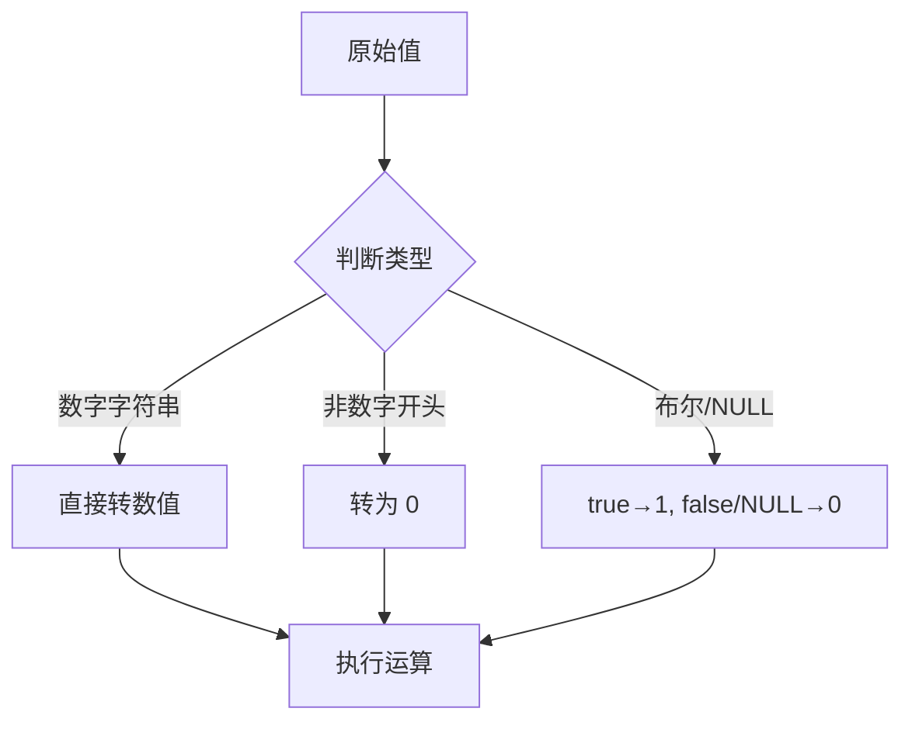

# PHP运算符与表达式（算术运算、字符串操作、标量类型转换、赋值运算符）

## PHP 运算符与表达式

PHP 是**弱类型**脚本语言，变量在使用前不需要声明类型。理解其运算符和**自动类型转换**规则，是避免逻辑错误的关键。

### 运算符分类与核心操作

| 类别 | 符号 | 示例 | 说明 |
|------|------|------|------|
| 算术运算 | `+` `-` `*` `/` `%` | `$a + $b` | 数值计算 |
| 字符串操作 | `.` (连接) | `"a" . "b"` | 返回 `"ab"`，**不是** `+` |
| 赋值运算 | `=` `+=` `.=` | `$x += 2` | 复合赋值 |

> [!IMPORTANT]
> PHP 中 ==字符串连接专用 `.` 运算符==，而非 `+`。使用 `+` 会对字符串进行算术转换，极易出错。

### 标量类型转换规则

当运算符作用于混合类型时，PHP 会自动转换：

- **算术运算**（`+`, `-`, `*`...）：操作数转为数值。`"10" + "5"` 得 `15`；`"abc" + 1` 得 `1`（并产生 Warning）。
- **字符串操作**（`.`）：操作数转为字符串。`10 . 5` 得 `"105"`。

### 常见陷阱与对比

> [!WARNING]
> 注意 ==`+` 与 `.` 的本质区别==，这是考试高频考点。

| 表达式 | 结果 | 解析过程 |
|--------|------|----------|
| `10 + "5"` | `15` | 字符串 `"5"` 转整数 `5`，算术加 |
| `10 . "5"` | `"105"` | 整数 `10` 转字符串 `"10"`，字符串连接 |
| `"10" + "5"` | `15` | 均为数字字符串，算术加 |
| `"a" . 1 . 2` | `"a12"` | 从左向右连接 |

**赋值运算符**的链式特性：`$a = $b = 5` 表示先将 `5` 赋给 `$b`，再将该表达式的值（即 `5`）赋给 `$a`。

### 一个算对的例子

**题目**：若 `$x = 10; $y = "20";`，求 `$x + $y` 与 `$x . $y` 的值。

**解答**：
1. `$x + $y`：使用算术运算符，字符串 `"20"` 被转换为整数 `20`，计算 $10 + 20 = 30$。
2. `$x . $y`：使用字符串连接符，整数 `10` 被转换为字符串 `"10"`，连接 `"10" . "20"` 得到 `"1020"`。

> [!TIP]
> 记忆口诀：**==点号连接，加号算数==**。看到 `.` 想拼接，看到 `+` 想转换。

> [!CAUTION]
> 避免在 PHP 中使用 `+` 进行字符串拼接。虽然 `"1" + "2"` 会得到 `3`（数值），但 `"1" + "a"` 会得到 `1` 而非 `"1a"`，这会导致数据丢失。
