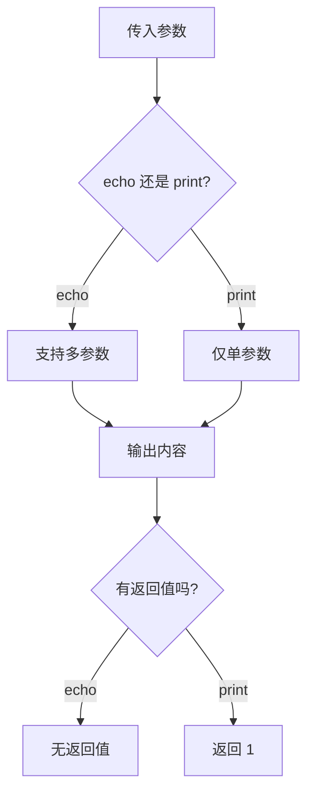

# PHP的输出语句

---
title: PHP的输出语句
requires: [Web技术（双语）/PHP语言基础]
---

当你用 PHP 处理完数据后，怎样把结果送回浏览器让用户看到？这就必须依赖输出语句。

## 它是什么与为什么需要

PHP 是服务器端脚本语言，代码在服务器上执行完毕后，需要将生成的 HTML 或文本发送给客户端。`echo` 和 `print` 就是 PHP 中最基础的两个输出结构（Language Construct），负责将字符串、变量值等内容写入 HTTP 响应体。

> [!IMPORTANT]
> `echo` 和 `print` 本质上是 ==语言结构==（Language Construct），而不是真正的函数，因此调用时可以省略括号。

## 怎么做

### echo

`echo` 可以同时输出多个表达式，用逗号 `,` 分隔，无返回值。

```php
$name = "NJUPT";
echo "Hello, ", $name, "!"; // 输出：Hello, NJUPT!
```

### print

`print` 只能接受一个参数，且固定返回整型 `1`，因此可以嵌入到表达式中。

```php
$result = print("Web Tech"); // 输出 Web Tech，且 $result 被赋值为 1
```

下面用流程图直观展示两者的执行差异：



## 相近概念的区别

考试中常要求辨析这几个输出方式：

| 特性 | `echo` | `print` | `print_r()` | `var_dump()` |
| :--- | :--- | :--- | :--- | :--- |
| **类型** | 语言结构 | 语言结构 | 函数 | 函数 |
| **参数数量** | 多个（逗号分隔） | 1个 | 1~2个 | 多个 |
| **返回值** | 无 | `1` | `true` / 字符串 | 无 |
| **主要用途** | 输出普通字符串 | 输出普通字符串 | 打印数组/对象 | 调试，含类型与长度 |
| **执行速度** | ==最快== | 略慢于 echo | 较慢 | 最慢 |

> [!NOTE]
> 如果只是向页面输出文本，优先用 `echo`；如果需要查看复杂变量的内部结构（如多维数组），才使用 `print_r()` 或 `var_dump()`。

## 常见的坑

> [!WARNING]
> 用 `echo` 输出多个变量时，==必须用逗号 `,` 分隔，不能用点号 `.` 拼接后再传参==。因为点号是字符串连接运算符，会将整个表达式先计算为一个字符串，失去了 `echo` 多参数的性能优势，有时还会引发优先级错误。

> [!CAUTION]
> 不要尝试这样写：`$val = echo "test";`。由于 `echo` 没有返回值，将其放在赋值语句右侧会导致 PHP 语法解析错误（Parse error）。

## 算对了的例子

阅读以下代码，写出浏览器的最终输出结果：

```php
$a = "South";
$b = "Post";
echo $a, " ", $b, "<br>";
$c = print($a . $b);
echo $c;
```

**逐步推导：**

1. 第 3 行：`echo` 依次输出 `$a`、空格、`$b` 和换行标签 `<br>`，页面显示 `South Post` 并换行。
2. 第 4 行：`$a . $b` 先通过点号拼接为 `"SouthPost"`，`print` 将其输出，页面追加显示 `SouthPost`；同时 `print` 返回 `1`，赋给 `$c`。
3. 第 5 行：`echo` 输出 `$c` 的值 `1`。

最终浏览器渲染的可见内容为：

$$\text{South Post}\langle\text{br}\rangle\text{SouthPost1}$$

即分两行显示：第一行为 `South Post`，第二行为 `SouthPost1`。

> [!TIP]
> 记忆口诀：==“echo 逗点多参快，print 单参返一在”==。做选择题时，盯紧“是否有返回值”和“能否接收多参数”这两个核心考点即可秒杀。
