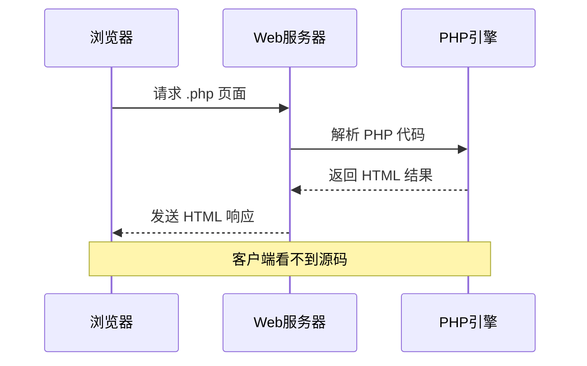

# PHP的起源、用途与概述（服务端脚本）

# PHP的起源、用途与概述（服务端脚本）

## 什么是PHP？

PHP（Hypertext Preprocessor，超文本预处理器）是一种广泛使用的==开源通用脚本语言==，尤其适用于 Web 开发并可以嵌入 HTML 中。它最初由 Rasmus Lerdorf 于 1994 年创建，旨在维护个人主页，后发展为强大的服务器端 scripting 语言。

> [!IMPORTANT]
> ==核心定义==：PHP 是一种**服务端**脚本语言。代码在服务器上执行，生成的纯 HTML 结果发送给客户端浏览器。



## 为什么需要服务端脚本？

试想一下，如果所有逻辑都在前端（JavaScript）处理，会发生什么？
1. **安全性缺失**：数据库密码、业务逻辑直接暴露在源码中。
2. **数据隔离困难**：无法直接安全地访问服务器文件系统或数据库。

PHP 填补了静态 HTML 与动态交互之间的空白。它允许开发者：
- 动态生成页面内容（如显示当前时间、用户信息）。
- 收集表单数据并保存到数据库。
- 发送和接收 Cookies，管理会话（Session）。

## PHP 与相近技术的区别

许多初学者容易混淆 PHP 与 JavaScript 或 ASP.NET。以下是关键对比：

| 特性 | PHP | JavaScript (Node.js除外) | ASP.NET |
| :--- | :--- | :--- | :--- |
| **执行位置** | ==服务端== | 客户端（浏览器） | 服务端 |
| **主要用途** | 动态网页、后端逻辑 | 前端交互、DOM操作 | 企业级Web应用 |
| **文件扩展名** | `.php` | `.js` | `.aspx` / `.cshtml` |
| **开源程度** | 完全开源 | 完全开源 | 部分开源 (Core) |

> [!TIP]
> 记忆口诀：**PHP 跑在服务器，JS 跑在浏览器**。除非使用 Node.js，否则 JS 无法直接操作服务器数据库。

## 常见误区与坑

> [!WARNING]
> 1. **标签闭合**：PHP 代码必须包裹在 `<?php ... ?>` 标签中。遗漏结束标签 `?>` 在某些配置下会导致后续 HTML 直接输出为文本。
> 2. **分号缺失**：每条语句必须以分号 `;` 结尾，否则解析报错。
> 3. **大小写敏感**：PHP 变量名区分大小写（`$Name` != `$name`），但函数名不区分。

## 实例演示：动态问候语

假设我们要根据当前服务器时间，向用户显示不同的问候语。这是一个典型的“算对了”的例子，展示了 PHP 如何嵌入 HTML 并执行逻辑。

```php
<!DOCTYPE html>
<html>
<body>

<?php
    // 获取服务器当前小时数 (0-23)
    $hour = date("H");

    if ($hour < "12") {
        echo "<h2>Good Morning!</h2>";
    } elseif ($hour < "18") {
        echo "<h2>Good Afternoon!</h2>";
    } else {
        echo "<h2>Good Evening!</h2>";
    }
?>

<p>This paragraph is standard HTML.</p>

</body>
</html>
```

**执行流程解析**：
1. 浏览器请求该 `.php` 文件。
2. 服务器识别 `<?php ... ?>` 块，执行 `date()` 和 `if-else` 逻辑。
3. 服务器将 `echo` 输出的 `<h2>...<h2>` 替换进 HTML 流。
4. 浏览器最终只收到纯 HTML，例如 `<h2>Good Afternoon!</h2>`，完全不知道背后有 PHP 逻辑。

> [!NOTE]
> 在双语课程考试中，常考题型包括：判断代码输出结果、识别服务端与客户端代码边界、以及简述 PHP 的工作原理。务必掌握 `echo` 输出与 HTML 结构的混合写法。
