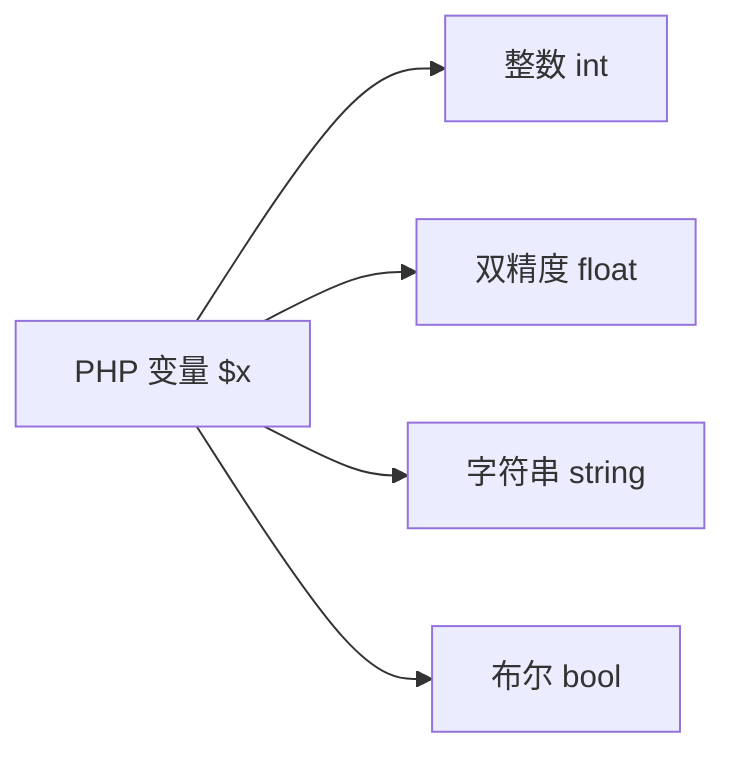

# PHP基本数据类型（变量、整数Integer、双精度Double、字符串String、布尔Boolean）

PHP 的变量不需要事先声明类型，解释器根据赋的值自动决定它是什么类型——这叫==弱类型（动态类型）==。要区分类型，靠 `var_dump()` 或 `is_int()/is_float()/is_string()/is_bool()`。

## 变量

变量名以 `$` 开头，后面跟合法标识符（字母/下划线开头，可含数字）：

```php
$name  = "张三";   // 字符串
$age   = 20;       // 整数
$price = 9.9;      // 双精度
$ok    = true;     // 布尔
```

变量==不声明、可改类型==：`$x = 1; $x = "hello";` 合法。使用未定义变量不会报错，值为 `NULL` 并可能触发 Notice，是常见坑。

## 四种基本类型

| 类型 | 关键字/函数 | 字面量写法 | 示例 | 说明 |
|---|---|---|---|---|
| 整数 Integer | `is_int` | 十进制、`0x` 十六进制、`0` 八进制 | `20`, `0x1A` | 32 位机器约 $\pm 2.1 \times 10^9$ |
| 双精度 Double | `is_float` | 小数或科学计数 | `9.9`, `1.2e3` | 64 位浮点 |
| 字符串 String | `is_string` | 单引号 `'`、双引号 `"` | `"abc"` | 双引号内可变量替换 |
| 布尔 Boolean | `is_bool` | `true` / `false` | `$ok = true` | 常用于条件判断 |



## 字符串：单引号 vs 双引号

这是本节==最高频考点==。

```php
$a = 10;
echo '$a = 10';   // 输出 $a = 10
echo "$a = 10";   // 输出 10 = 10
```

> [!IMPORTANT]
> ==单引号内不解析变量和转义（仅 `\\` 和 `\'`），双引号内会解析 `$var` 及 `\n` 等转义序列==。

字符串拼接用 `.`（点）而不是 `+`：`"Hello" . " " . "World"`。

## 类型转换（弱类型算术）

PHP 会==隐式转换==：`"5abc" + 2` → `7`（取前导数字），`"abc" + 2` → `2`。想严格控制，用强制转换：

```php
$x = (int)"123";    // 123
$y = (float)"3.14"; // 3.14
$z = (bool)0;       // false
```

## 一个算对了的例子

> [!TIP]
> 判断以下代码输出：
> ```php
> $x = "5"; $y = 10;
> $z = $x + $y;      // ?
> echo var_dump($z); // ?
> ```

逐步看：`$x` 是字符串 `"5"`，与整数 `10` 相加时被隐式转成 `5`，结果 $5 + 10 = 15$；`var_dump` 显示 `int(15)`。==结果是整数 15，不是字符串 "15"==。

> [!WARNING]
> - 判断相等时 `==` 会做类型转换（`"1" == 1` 为 `true`），`===` 要求类型与值都相等。
> - 未定义变量为 `NULL`，`$x = $y + 1;` 会把 `$y` 当 0 处理。
> - 整数溢出会自动升级为浮点，不再保证精度。
