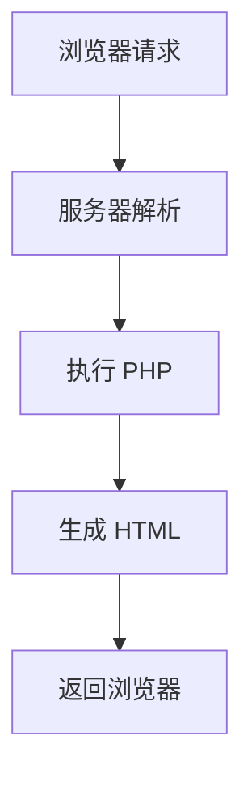

# PHP的一般语法特征

## PHP 的一般语法特征

PHP（Hypertext Preprocessor）是一种**服务器端**脚本语言，专门用于生成动态网页。它最大的特点是：**PHP 代码可以嵌入到 HTML 中**，在服务器上执行后，把结果替换回 HTML 再发给浏览器。



## 基本语法规则

PHP 脚本以 `<?php` 开始，以 `?>` 结束（纯 PHP 文件可省略结束标签）。每条语句以分号 `;` 结尾。

```php
<?php
    echo "Hello, World!";
    $name = "NUPT";
    echo "Welcome to " . $name;
?>
```

> [!IMPORTANT]
> PHP 变量必须以 `$` 开头，后跟字母或下划线；变量名区分大小写，但函数名不区分。

## 嵌入 HTML 的方式

PHP 可以直接写在 HTML 中，实现动态内容输出：

```php
<html>
<body>
    <h1><?php echo "南京邮电大学"; ?></h1>
    <?php
        $score = 85;
        if ($score >= 60) {
            echo "<p>及格</p>";
        } else {
            echo "<p>不及格</p>";
        }
    ?>
</body>
</html>
```

## 与相近语言的区别

| 特性 | PHP | JavaScript | C/Java |
|------|-----|-----------|--------|
| 运行位置 | 服务器端 | 浏览器端 | 编译后运行 |
| 变量声明 | `$var` 直接赋值 | `var/let/const` | 需指定类型 |
| 语句结束符 | 必须 `;` | 可省略 | 必须 `;` |
| 嵌入 HTML | 原生支持 | 需 `<script>` | 不支持 |

> [!WARNING]
> PHP 是**弱类型**语言，变量无需声明类型，但运算时会发生隐式类型转换，容易造成意外结果。

## 常见陷阱

```php
<?php
    $a = "5";      // 字符串
    $b = 5;        // 整数
    var_dump($a == $b);   // bool(true)  松散比较，类型转换
    var_dump($a === $b);  // bool(false) 严格比较，类型+值都需相等
?>
```

> [!CAUTION]
> `==` 与 `===` 是高频考点：==松散比较只比"值"，===严格比较同时比"类型和值"。建议优先使用 `===` 避免隐式转换的坑。

## 典型例题

**题目**：写出以下 PHP 代码的输出结果。

```php
<?php
    $x = "10";
    $y = 10;
    echo ($x == $y) ? "相等" : "不相等";
    echo ($x === $y) ? "严格相等" : "严格不相等";
?>
```

**解析**：

- 第一次比较 `$x == $y`：字符串 `"10"` 被转换为整数 `10`，值相等 → 输出 `相等`
- 第二次比较 `$x === $y`：类型不同（string vs int）→ 输出 `严格不相等`

**答案**：`相等严格不相等`

> [!TIP]
> 记忆口诀：**"三等号看类型，两等号只看值"**。遇到混合类型比较，先想会不会触发隐式转换。
