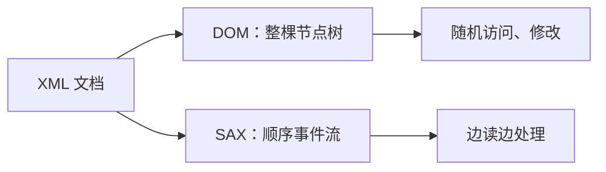

# SAX解析方法与DOM解析方法（含示例对比）

## 两种解析思路

XML 文档解析的核心问题是：**如何把标记文本转换成程序可操作的数据？** SAX 与 DOM 给出了两种答案。

**DOM（Document Object Model，文档对象模型）** 先把整个 XML 文档读入内存，构建一棵节点树，再通过树节点访问数据。**SAX（Simple API for XML）** 不建立完整树，而是顺序读取文档；遇到开始标签、文本、结束标签等位置时，触发相应事件，由应用程序处理。



==DOM 是“先建树，再访问”，SAX 是“边读取，边响应”。==

## DOM：把文档变成树

例如：

```xml
<book id="b1">
  <title>Web技术</title>
  <price>50</price>
</book>
```

DOM 会把它表示为树：`book` 是元素节点，`id="b1"` 是属性，`title`、`price` 是子元素，标签之间的文字是文本节点。程序可以查找 `title`、修改 `price`，也可以增删节点。

Java 中常见步骤为：

```java
DocumentBuilderFactory factory =
        DocumentBuilderFactory.newInstance();
DocumentBuilder builder = factory.newDocumentBuilder();
Document doc = builder.parse("book.xml");

Node title = doc.getElementsByTagName("title").item(0);
System.out.println(title.getTextContent()); // Web技术
```

这里 `DocumentBuilderFactory` 创建解析器工厂，`DocumentBuilder` 负责解析，`Document` 表示整棵文档树。

## SAX：用事件处理文档

解析同一份文档时，SAX 依次产生类似事件：

```text
startDocument
startElement: book
startElement: title
characters: Web技术
endElement: title
startElement: price
characters: 50
endElement: price
endElement: book
endDocument
```

应用程序通常继承 `DefaultHandler`，重写需要的方法：

```java
class BookHandler extends DefaultHandler {
    private boolean inTitle;

    public void startElement(String uri, String localName,
            String qName, Attributes attributes) {
        if (qName.equals("title")) inTitle = true;
    }

    public void characters(char[] ch, int start, int length) {
        if (inTitle)
            System.out.print(new String(ch, start, length));
    }

    public void endElement(String uri, String localName,
            String qName) {
        if (qName.equals("title")) inTitle = false;
    }
}
```

随后用 `SAXParserFactory` 创建 `SAXParser`，调用 `parse()` 并传入处理器。SAX 只报告“读到了什么”，当前元素之前的兄弟节点等内容不会自动保存。

## 对比与选择

| 对比项 | DOM | SAX |
|---|---|---|
| 工作方式 | 一次性构建文档树 | 顺序扫描、事件驱动 |
| 内存占用 | 通常较大 | 通常较小 |
| 访问方式 | 可随机访问、重复访问 | 默认顺序向前 |
| 修改文档 | 方便增删改节点 | 不适合直接修改 |
| 编程特点 | 通过节点对象操作 | 编写事件回调 |
| 典型场景 | 文档较小、需复杂查询或修改 | 文档很大、只需提取部分数据 |

> [!TIP]
> 记忆：**DOM 看“树”，SAX 看“流”；要修改选 DOM，大文档顺序提取优先 SAX。**

## 一个处理正确的例子

若题目要求“读取并输出书名，不修改 XML”，两种方法都能得到 `Web技术`。DOM 可直接定位 `title`；SAX 则用 `inTitle` 记录当前是否位于 `title` 内，只在 `characters()` 中输出文本。若文档有数 GB，且只需统计 `book` 元素个数，SAX 更合适：每遇到一个 `book` 的 `startElement` 就计数，无须保存整棵树。

> [!WARNING]
> `characters()` 可能分多次返回同一段文本，不能假设一次调用必得到完整书名；应累积字符串，在 `endElement()` 时统一处理。SAX 也不会自动保留已扫描内容，需要历史信息时必须自行保存。

> [!NOTE]
> “SAX 一定快、DOM 一定慢”并不严谨。主要差异是内存模型和访问能力；实际速度还受文档结构、处理逻辑与实现影响。
