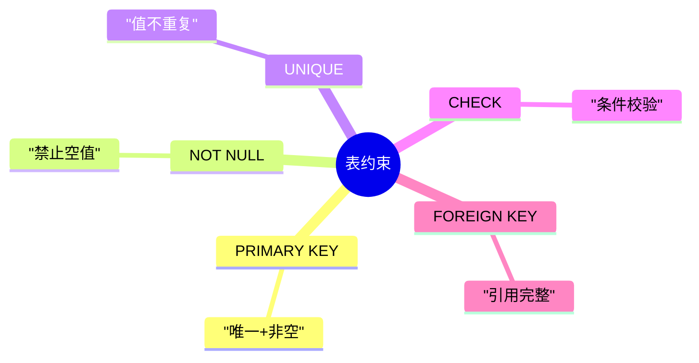

# SQL语言：CREATE TABLE命令与约束（Constraints）

## 什么是表约束

创建数据库表时，仅定义列名和数据类型就够了吗？如果用户向 `student_id` 插入重复值，或向 `score` 插入负数，数据库该如何应对？==CREATE TABLE 约束（Constraints）== 正是用来在数据写入时强制执行业务规则的机制，它确保数据的完整性与一致性，而非依赖应用层代码逐个校验。

> [!IMPORTANT]
> 约束是数据库层面的强制规则，比应用层验证更可靠、更高效。

## 五类核心约束详解

SQL 标准定义了五种基本约束，它们分别守护不同维度的数据质量：

| 约束类型 | 关键字 | 作用 | 是否允许空值 |
| :--- | :--- | :--- | :--- |
| 主键 | `PRIMARY KEY` | 唯一标识每行记录 | 否 |
| 非空 | `NOT NULL` | 禁止该列为空 | 否 |
| 唯一 | `UNIQUE` | 保证列值不重复 | 是 |
| 检查 | `CHECK` | 限定取值范围或条件 | 取决于表达式 |
| 外键 | `FOREIGN KEY` | 维护表间引用完整性 | 是 |



> [!TIP]
> 记忆口诀：“主键唯一非空，外键引用要对应，检查条件写清楚，唯一可空要分清。”

## 语法实践与正确示例

以下是一个完整的建表示例，涵盖所有约束类型且语法无误：

```sql
CREATE TABLE enrollment (
    enroll_id   INT PRIMARY KEY,
    student_id  INT NOT NULL,
    course_id   CHAR(6) NOT NULL,
    score       DECIMAL(4,1) CHECK (score >= 0 AND score <= 100),
    semester    VARCHAR(20) UNIQUE,
    CONSTRAINT fk_student FOREIGN KEY (student_id) REFERENCES student(id),
    CONSTRAINT fk_course FOREIGN KEY (course_id) REFERENCES course(cid)
);
```

> [!NOTE]
> `CONSTRAINT <name>` 可为约束命名，便于后续修改或删除；省略则系统自动生成名称。

## 易混淆点与常见陷阱

`PRIMARY KEY` 与 `UNIQUE` 有何本质区别？前者 ==隐式包含 NOT NULL==，后者允许一个或多个 NULL 值（因 NULL ≠ NULL）。此外，`CHECK` 约束中若引用其他列，某些数据库（如 MySQL 8.0 前）会静默忽略，务必确认版本支持。

> [!WARNING]
> 外键引用的列必须在父表中是 `PRIMARY KEY` 或 `UNIQUE`，否则建表失败。

> [!CAUTION]
> 在 `CREATE TABLE` 中将 `CHECK` 写成 `CHECK score > 0`（缺少括号）是高频语法错误，正确写法必须为 `CHECK (score > 0)`。

掌握这些约束，不仅能写出健壮的 DDL 语句，也为后续学习索引、触发器及 ORM 映射打下坚实基础。
