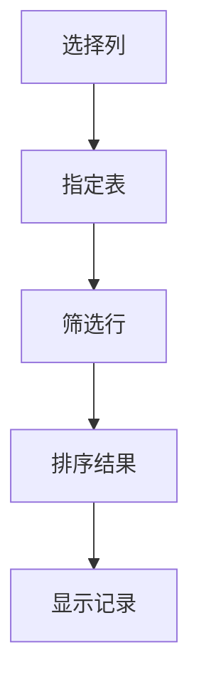

# SQL语言：INSERT命令与SELECT命令（含查询示例）

## INSERT命令：向表中写入数据

`INSERT`用于向数据库表中添加记录。基本语法是：

```sql
INSERT INTO 表名 (列名1, 列名2, ...)
VALUES (值1, 值2, ...);
```

它把 `VALUES` 中的值按顺序对应到指定的列，因此列名顺序与值的顺序必须一致。

```sql
INSERT INTO Student (Sno, Sname, Sdept)
VALUES ('20210001', '张三', '计算机学院');
```

若表中某些列允许省略，可以只列出要填写的列：

```sql
INSERT INTO Student (Sno, Sname)
VALUES ('20210002', '李四');
```

> [!IMPORTANT]
> `INSERT INTO Student VALUES (...)` 虽然可以省略列名，但此时必须按表结构中的完整列顺序提供所有值；初学时更推荐明确写出列名。

若一次插入多行，可写多条 `VALUES`：

```sql
INSERT INTO Student (Sno, Sname, Sdept)
VALUES
('20210003', '王五', '通信学院'),
('20210004', '赵六', '计算机学院');
```

实际插入的字段类型应与列定义匹配，例如学号列使用字符串时，值也应加单引号。

## SELECT命令：查询表中的数据

`SELECT`用于从表中检索数据。最基本的结构是：

```sql
SELECT 列名
FROM 表名;
```

例如：

```sql
SELECT Sname
FROM Student;
```

这表示从 `Student` 表中取出所有学生的姓名。`*`表示选择全部列：

```sql
SELECT *
FROM Student;
```

> [!TIP]
> 记忆顺序：`SELECT` 要什么，`FROM` 从哪里找，`WHERE` 筛选，`ORDER BY` 排序。

常见查询条件如下：

```sql
-- 查询计算机学院的学生
SELECT Sname, Sdept
FROM Student
WHERE Sdept = '计算机学院';

-- 查询年龄大于20岁且姓张的学生
SELECT *
FROM Student
WHERE Sage > 20 AND Sname LIKE '张%';

-- 查询学号、姓名，并按年龄降序排列
SELECT Sno, Sname, Sage
FROM Student
ORDER BY Sage DESC;
```

`LIKE`用于模糊匹配：`%`代表任意长度的字符，`_`代表一个字符。`%`放在末尾表示“以某内容开头”，放在开头表示“以某内容结尾”。

```sql
SELECT *
FROM Student
WHERE Sname LIKE '%华';
```

> [!NOTE]
> `WHERE`筛选的是行，`SELECT`决定显示哪些列。`ORDER BY`通常应写在 `WHERE`之后。

## 查询流程



## 一个算对了的例子

假设有如下表：

```sql
Student(Sno, Sname, Sage, Sdept)
```

现有记录：

| Sno | Sname | Sage | Sdept |
|---|---|---:|---|
| 20210001 | 张三 | 20 | 计算机学院 |
| 20210002 | 李四 | 22 | 通信学院 |
| 20210003 | 王五 | 21 | 计算机学院 |

题目要求查询计算机学院中年龄大于20岁的学生姓名，并按年龄升序排列：

```sql
SELECT Sname
FROM Student
WHERE Sdept = '计算机学院'
  AND Sage > 20
ORDER BY Sage ASC;
```

结果为：

| Sname |
|---|
| 王五 |
| 张三 |

王五年龄为21，张三年龄为20，因此按升序排列后王五在前。

> [!WARNING]
> 常见错误包括：漏写 `WHERE` 导致全表都被筛选、把 `AND`写成 `OR`、字符串忘记加引号，以及把 `>`写成 `>=`却仍声称查询的是“大于”。另外，`INSERT`插入数据，`SELECT`查询数据，两者不要混淆。
