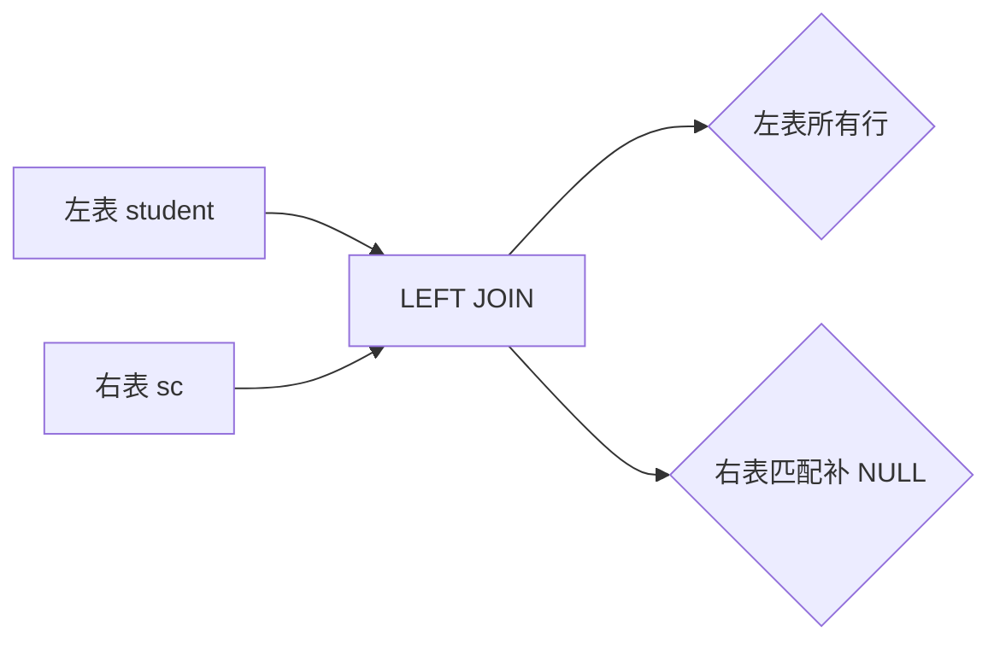

# SQL语言：连接查询（Joins）

## 连接查询（Joins）

在真实业务中，数据往往分散在多张表里。比如学生信息在 `student` 表，选课记录在 `sc` 表。如果想知道“张三选了哪门课”，就必须同时查两张表——这就是连接查询要解决的问题。

> [!IMPORTANT]
> ==连接查询的本质是“按某个关联条件，把多张表的行横向拼起来”==，关联条件通常是外键与主键的相等关系。

### 内连接：只保留两边都匹配的行

内连接（`INNER JOIN`）是最常用的一种。它先对两张表做笛卡尔积，再按 `ON` 后面的条件筛选出匹配行；**只要有一边不匹配，这一整行就不会出现在结果里**。

```sql
SELECT student.name, course.title
FROM student
INNER JOIN sc ON student.id = sc.student_id
INNER JOIN course ON sc.course_id = course.id;
```

可以用一个简单例子感受它的“过滤”效果：

| student.id | name |
|---|---|
| 1 | 张三 |
| 2 | 李四 |

| sc.student_id | sc.course_id |
|---|---|
| 1 | 101 |
| 3 | 102 |

内连接 `student.id = sc.student_id` 的结果：

| name |
|---|
| 张三 |

李四没有选课记录，学号为 3 的选课记录没有对应学生，==两者都被丢弃==。

> [!WARNING]
> 如果两张表里关联列有重复值，内连接会像“乘法”一样把行都组合出来。例如表 A 某键出现 2 次、表 B 对应键出现 3 次，结果会出现 $2 \times 3 = 6$ 行。这不是 bug，但很容易让统计结果翻倍，聚合前务必想清楚要不要先去重。

### 外连接：保留某一侧“孤独”的列

外连接分为三种：`LEFT JOIN`、`RIGHT JOIN`、`FULL OUTER JOIN`。它们的共同点是：**没有匹配到的行不会消失，而是用 `NULL` 补位**。

```sql
SELECT student.name, sc.course_id
FROM student
LEFT JOIN sc ON student.id = sc.student_id;
```

结果会包含所有学生，没选课的 `course_id` 为 `NULL`：

| name | course_id |
|---|---|
| 张三 | 101 |
| 李四 | NULL |

> [!NOTE]
> `RIGHT JOIN` 就是 `LEFT JOIN` 把表换一下位置；有些数据库（如 MySQL）不支持 `FULL OUTER JOIN`，可以用 `LEFT JOIN UNION RIGHT JOIN` 等价代替。



### 自然连接与笛卡尔积

- **自然连接（NATURAL JOIN）**：自动把所有同名列作为等值连接条件。省事但危险——如果两张表碰巧有别的同名列（如 `remark`），它们也会被悄悄加入连接条件，导致结果出人意料。课程使用中一般建议显式写 `ON`。
- **笛卡尔积（CROSS JOIN）**：不加任何连接条件，返回两表行数的乘积。大多时候这是“忘了写 `ON`”的事故现场，结果行数会爆炸。

### 常见错误与绕过

| 错误写法/想法 | 可能导致的问题 |
|---|---|
| 忘了写 `ON` 条件 | 退化成笛卡尔积，结果行数激增 |
| 认为 `WHERE` 和 `ON` 完全等价 | 对内连接等价，对外连接**不等价**：`WHERE` 会把补 `NULL` 的行再过滤掉 |
| 多表连接时不加表别名 | 出现列名歧义，SQL 直接报 `ambiguous column` |
| 一上来就 `SELECT *` | 结果里一堆重名列，自己都分不清来自哪张表 |

> [!TIP]
> 写多表连接时，先确定连接顺序：**先找“事实表”，再连“维度表”**。比如先 `FROM sc`，再连接 `student` 和 `course`，思路会更顺，也能减少笛卡尔积。

### 一个完整例题

现有 `student(sid, name)`、`sc(sid, cid)`、`course(cid, title)`，查询“所有学生的选课情况（包括没选课的学生）”。

```sql
SELECT s.name, c.title
FROM student s
LEFT JOIN sc ON s.sid = sc.sid
LEFT JOIN course c ON sc.cid = c.cid;
```

> [!NOTE]
> 为什么第二个连接也用 `LEFT JOIN`？因为如果学生没有选课，第一条 `LEFT JOIN` 已经把 `sc.sid` 补成 `NULL`，再用 `INNER JOIN` 连 `course` 会把这条记录淘汰掉。==外连接链中，只要中间一步引入 `NULL` 补位，后续最好继续用外连接保住这些行==。
