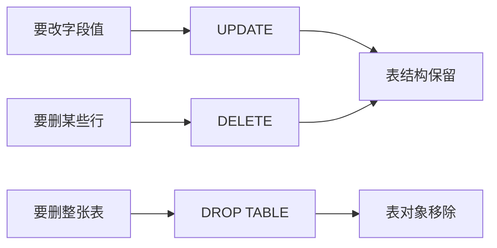

# SQL语言：UPDATE、DELETE与DROP命令

## 为什么需要这三条命令

数据库中的数据不是只增不改：学生转专业要修改记录，毕业生离校要删除记录，旧表不再使用时要移除表结构。SQL 分别用 `UPDATE`、`DELETE` 和 `DROP` 完成这些操作。

> [!IMPORTANT]
> `UPDATE` 修改==表中已有行的字段值==，`DELETE` 删除==表中的行==，`DROP` 删除==整个数据库对象==。三者操作对象不同，不能混用。

## UPDATE：修改已有记录

基本格式为：

```sql
UPDATE table_name
SET column1 = value1, column2 = value2
WHERE condition;
```

执行过程是：先由 `WHERE` 找出符合条件的行，再对这些行执行 `SET` 赋值。例如，把学号为 `B21010101` 的学生专业改为 `CS`：

```sql
UPDATE Student
SET major = 'CS'
WHERE student_id = 'B21010101';
```

若同时修改多个字段，在 `SET` 后用逗号分隔：

```sql
UPDATE Student
SET major = 'CS', grade = 2022
WHERE student_id = 'B21010101';
```

`SET major = 'CS'` 是赋值，不是条件判断；筛选条件应写在 `WHERE` 中。若省略 `WHERE`，则==更新整张表的所有行==。

## DELETE：删除表中的行

课件给出的基本形式是：

```sql
DELETE FROM table_name;
```

该语句删除 `table_name` 中的全部记录，但表结构仍然保留，之后还能继续 `INSERT`。更常用的是带条件的删除：

```sql
DELETE FROM Student
WHERE student_id = 'B21010101';
```

这里 `FROM` 不能省略，也不能写成 `DELETE Student FROM ...`。`DELETE` 按“行”删除，不能用 `DELETE major FROM Student` 来清除某一列；若只是把某字段改为空值，应根据表约束使用 `UPDATE ... SET major = NULL`。

## DROP：删除对象本身

删除整张表及其结构，使用：

```sql
DROP TABLE Student;
```

执行后，表中的数据、表结构以及依附于该表的索引等通常都会随表删除；再次查询该表会报“表不存在”。它不同于只清空数据的 `DELETE`。

| 命令 | 操作对象 | 是否保留表结构 | 典型用途 |
|---|---|---|---|
| `UPDATE` | 行中的字段值 | 保留 | 修改成绩、专业 |
| `DELETE` | 表中的一行或多行 | 保留 | 删除指定学生记录 |
| `DROP TABLE` | 整张表 | 不保留 | 废弃并移除表 |

> [!NOTE]
> `TRUNCATE TABLE` 也能清空全表，但它是另一条语句，通常用于快速移除全部行；不要把“清空数据”与 `DROP TABLE` 的“删除表对象”混为一谈。

## 一个完整例子

设当前表为：

| student_id | name | major | score |
|---|---|---|---:|
| B21010101 | Li | SE | 78 |
| B21010102 | Wang | SE | 85 |

先把 Li 的成绩加 2，再删除 Wang 的记录：

```sql
UPDATE Student
SET score = score + 2
WHERE student_id = 'B21010101';

DELETE FROM Student
WHERE student_id = 'B21010102';
```

结果只剩一行：`B21010101 | Li | SE | 80`。此时 `Student` 表仍存在，可以继续插入记录。若接着执行：

```sql
DROP TABLE Student;
```

则连表结构也不再存在，而不是得到一张“空表”。



> [!WARNING]
> `UPDATE` 和 `DELETE` 漏写 `WHERE`，会分别修改、删除全表数据。执行前可先用相同条件的 `SELECT * FROM table_name WHERE condition;` 检查目标行。

> [!CAUTION]
> `DROP TABLE` 不是“清空后可继续使用”。执行前应确认表名、依赖关系和备份；在 Web 应用中，这类管理语句不应直接拼接用户输入，业务代码还应使用参数化查询并进行权限控制。
