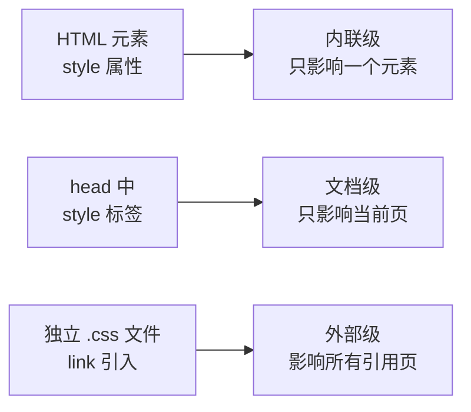

# 样式表的三个级别（内联级Inline、文档级Document、外部External）

## 样式表的三个级别

想把 HTML 页面变好看，CSS 规则必须“挂”到 HTML 上。挂的位置有三种，对应三个级别：内联级、文档级、外部级。它们的本质区别是 **CSS 规则写在哪里、作用范围有多大**。

在讲区别之前，先想一个问题：如果你要给自己写的 10 个网页统一换成蓝色主题，你会把颜色规则一条一条塞进每个标签里，还是找个别的地方一次写完？显然前者又累又容易漏。这就是“为什么要分级”的直觉来源。

### 三个级别各是什么

| 级别 | 写法位置 | 作用范围 | 语法示例 |
|------|----------|----------|----------|
| 内联级 Inline | 写在 HTML 元素的 `style` 属性里 | 仅当前元素 | `<p style="color: red;">` |
| 文档级 Document | 写在 `<head>` 的 `<style>` 标签里 | 当前整个页面 | `<style> p { color: red; } </style>` |
| 外部级 External | 写在独立 `.css` 文件里，用 `<link>` 引入 | 所有引用它的页面 | `<link rel="stylesheet" href="style.css">` |



### 各自的适用场景

**内联级**：临时改一个元素的样式，比如调试时想快速看看某个 `<p>` 变成红色好不好看。优点是立刻生效，缺点是每改一个元素都要写一遍，==一旦页面元素多了，维护成本极高==。所以正式的网页开发几乎不推荐用内联样式。

**文档级**：一个页面有独特样式、别的页面用不上时，写在 `<style>` 里很合理。比如某个活动落地页只有这一页有特殊背景色。

**外部级**：多个页面共享同一套样式时使用。它是实际项目里的主力，因为浏览器会缓存外部 CSS 文件——用户从第一页跳到第二页时，CSS 不用重新下载，加载更快。

> [!IMPORTANT]
> 三种级别同时存在时，==内联级优先级最高，其次是文档级，最后是外部级==（在特异度相同的前提下）。这与“就近原则”一致：离元素越近的规则越优先。

### 为什么要用外部样式表

简答 4 就要求为教材章节做一个外部样式表。以“二级目录结构”为例：

HTML 文档（节选）：

```html
<!DOCTYPE html>
<html lang="zh">
<head>
    <meta charset="UTF-8">
    <title>教材目录</title>
    <link rel="stylesheet" href="toc.css">
</head>
<body>
    <ul class="chapter">
        <li>第 3 章 层叠样式表（CSS）
            <ul class="section">
                <li>3.1 样式表的三个级别</li>
                <li>3.2 选择器</li>
                <li>3.3 盒模型</li>
            </ul>
        </li>
        <li>第 4 章 JavaScript 基础
            <ul class="section">
                <li>4.1 变量与类型</li>
                <li>4.2 函数</li>
            </ul>
        </li>
    </ul>
</body>
</html>
```

外部 CSS 文件 `toc.css`：

```css
.chapter {
    font-family: "Microsoft YaHei", sans-serif;
    font-weight: bold;
    color: #2c3e50;
    list-style-type: upper-roman;  /* 外层用大写罗马数字 */
}

.section {
    font-weight: normal;
    list-style-type: decimal;      /* 内层用阿拉伯数字 */
    margin-top: 4px;
}

.section li {
    margin: 3px 0;
    color: #555;
}
```

这样所有引用 `toc.css` 的页面都能得到同一套目录外观，改一次颜色全部生效。

### 文档级与内联级的对比：那道简答题

题目问：**文档级样式表相比内联级有什么优势？**

结合上面的例子可以这样回答：文档级把样式集中放在 `<style>` 标签里，==一组规则可以作用于整个页面的多个同类元素==，而内联级每条规则只能作用于一个元素。集中管理后，修改样式只需改一处而不是逐处修改，代码更清晰、冗余更少，也更容易保证页面内风格一致。

### 常见坑

[!WARNING]
内联样式优先级极高，会“压过”文档级和外部级的同名规则。如果调试时发现外部 CSS 改了没反应，先检查目标元素上是否残留了 `style="..."`。

[!CAUTION]
外部样式表要通过 `<link rel="stylesheet" href="...">` 引入，千万别顺手写成 `<style src="...">`——`<style>` 标签没有 `src` 属性，这样写不会加载任何外部 CSS。

[!NOTE]
多个外部样式表可以同时引入，后引入的会覆盖先引入的同名规则（特异度相同时）。简答 6 里“为什么定义两个外部样式表”通常就是这个原因：一个放通用基础样式，另一个做主题或适配覆盖，分开便于维护和复用。

### 判断练习

下面这段代码，两个段落最后显示为什么颜色？

```html
<head>
    <style>
        p { color: blue; }
    </style>
</head>
<body>
    <p style="color: red;">第一段</p>
    <p>第二段</p>
</body>
```

第一段有内联样式 `color: red`，它离元素最近、优先级最高，所以显示红色；第二段没有内联样式，使用文档级规则 `p { color: blue; }`，所以显示蓝色。这就是简答 2 的答案思路：==内联级覆盖了文档级==。
