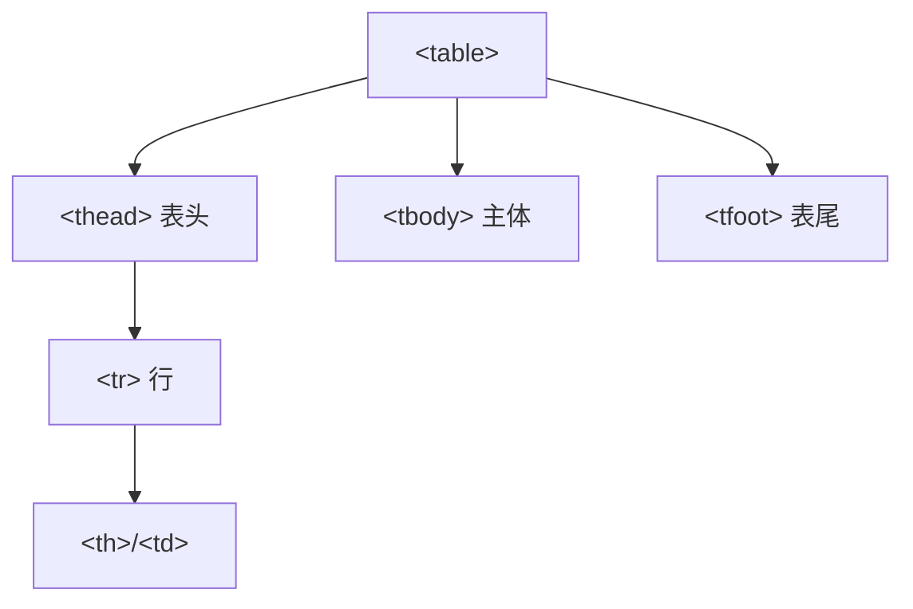

# 表格（基本标签、rowspan与colspan、表格分块、align与valign）

---
requires: [XHTML基础/基本标签与属性]
---

如果要在网页上展示一张课程表，有些课只占一节课，有些实验课却横跨两节甚至两列，普通的“一行几格”能搞定吗？显然不行。这就是表格合并单元格存在的意义。

## 基本标签与表格分块

一个 XHTML 表格由 `<table>` 包裹，内部通过行 `<tr>` 和单元格（表头 `<th>` / 数据 `<td>`）搭建骨架。为了语义清晰且方便 CSS 控制样式，通常将表格划分为三个逻辑区块：`<thead>`（表头区）、`<tbody>`（主体区）和 `<tfoot>`（表尾区）。

> [!IMPORTANT]
> 浏览器渲染时，==无论代码中 `<tfoot>` 写在 `<tbody>` 前面还是后面，它始终显示在表格最底部。==



## rowspan 与 colspan

当某个单元格需要占据多列或多行时，就要用到跨列 `colspan` 和跨行 `rowspan` 属性。

- **`colspan`**：指定该 `<th>` 或 `<td>` 横向跨越的列数。例如 `<th colspan="3">TV Schedule</th>` 表示这个标题横跨 3 列。
- **`rowspan`**：指定该 `<td>` 纵向跨越的行数。

> [!TIP]
> 记忆口诀：==col 管横（column），row 管竖（row）。== 设了跨度后，被“挤掉”的同行/同列单元格就不要再写了，否则表格会错位撑开。

以课件中的 TV Schedule 为例，"Celebrity Hoedown" 跨两列（`colspan="2"`），而 "Movie of the Week" 跨两行（`rowspan="2"`）：

```html
<table border="1">
  <tr>
    <th>Time</th><th>Mon</th><th>Tue</th><th>Wed</th>
  </tr>
  <tr>
    <td>8 pm</td>
    <td>Staring Contest</td>
    <td colspan="2">Celebrity Hoedown</td>
  </tr>
  <tr>
    <td>9 pm</td>
    <td>Hardy, Har, Har</td>
    <td>What's for Lunch?</td>
    <td rowspan="2">Movie of the Week</td>
  </tr>
  <tr>
    <td>10 pm</td>
    <td>Healers...</td>
    <td>It's a Crime</td>
    <!-- Wed 列已被上方 rowspan 占据，此处不再写 td -->
  </tr>
</table>
```

> [!WARNING]
> 考试常考简答：`<th>` 的 `colspan` 用于让表头横跨多列；`<td>` 的 `rowspan` 用于让数据单元格纵跨多行。千万别把属性和标签写反。

## align 与 valign

内容放进单元格后，默认是左对齐、垂直居中的。如果想改变位置呢？

- **`align`**：控制水平放置（horizontal placement），可取 `left`、`center`、`right`。它是 `<tr>`、`<th>`、`<td>` 的属性。
- **`valign`**：控制垂直放置（vertical placement），可取 `top`、`middle`、`bottom`。它是 `<th>`、`<td>` 的属性。

| 对比维度 | `align` | `valign` |
| :--- | :--- | :--- |
| 控制方向 | 水平（左右中） | 垂直（上中下） |
| 适用标签 | `<tr>`, `<th>`, `<td>` | `<th>`, `<td>` |

> [!NOTE]
> `<tr>` 可以设置 `align`，这会让该行所有单元格统一水平对齐；但 `<tr>` ==不能== 设置 `valign`，垂直对齐必须精确到每个 `<th>` 或 `<td>`。

> [!CAUTION]
> 在严格的 XHTML 规范中，表现与结构应分离。虽然课件要求掌握这两个属性，但在实际工程里，推荐用 CSS 的 `text-align` 和 `vertical-align` 替代它们。此外，表单题中若要求某列只能填数字，需在 `<input type="number">` 层面限制，而非靠表格对齐属性解决。
