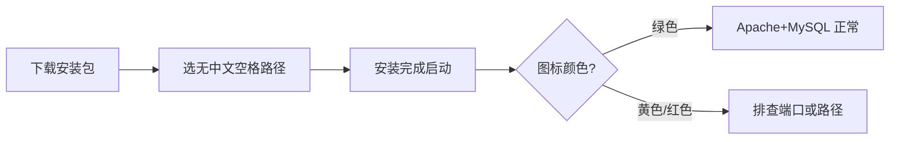

# Windows下WAMP环境的安装、配置、常见问题与使用方法

## Windows 下 WAMP 环境的安装与配置

WAMP 是 **W**indows + **A**pache + **M**ySQL/MariaDB + **P**HP 的集成开发环境套件。对《Web 技术（双语）》课程而言，它让你在本地电脑上就能运行 PHP 页面、操作数据库，不必购买服务器，也避免了在 Windows 上分别手动编译配置 Apache、PHP、MySQL 的繁琐过程。

> [!NOTE]
> 常见同类套件对比：**WAMP**（Windows 专用，菜单式操作）、**XAMPP**（跨平台，组件更全但略重）、**phpStudy**（国内常用，轻量）。本课程实验以 WAMP 为主。

### 安装步骤

1. 从官网下载与系统位数（32/64 位）匹配的安装包。
2. 安装时建议路径**不要含中文和空格**（如 `D:\wamp64`），否则后续 Apache 或 PHP 可能因路径解析失败而无法启动。
3. 按提示选择默认浏览器和文本编辑器。
4. 安装完成后，启动 WampServer，任务栏图标变为**绿色**即表示所有服务正常。



### 配置要点

WAMP 的核心配置文件有两个：

| 文件 | 作用 |
|---|---|
| `httpd.conf` | Apache 主配置，监听端口（默认 `80`）、根目录 `DocumentRoot` |
| `php.ini` | PHP 配置，如 `extension_dir`、`upload_max_filesize` |

默认网站根目录是 `wamp64/www/`（新版可能是 `wamp64/www/` 下的项目文件夹）。把 `.php` 文件放入其中，浏览器访问 `http://localhost/文件名.php` 即可执行。

> [!TIP]
> 如果 80 端口被占用（常见于系统服务或迅雷等软件），Apache 无法启动。可以改 `httpd.conf` 中 `Listen 80` 为 `Listen 8080`，再访问 `http://localhost:8080/`。

### 常见问题

| 现象 | 原因与解决 |
|---|---|
| 图标黄色/红色 | 端口 80 被占或 VC 运行库缺失，改端口或安装 VC++ 运行库 |
| `localhost` 打不开 | 检查 Apache 是否启动、防火墙是否拦截 |
| PHP 代码直接显示源码 | Apache 未正确加载 PHP 模块，检查 `httpd.conf` 中 `LoadModule php_module` |
| 数据库连接失败 | MySQL 服务未启动，或 `php.ini` 中 `mysqli` 扩展未开启 |

### 一个算对了的例子

**问题**：在 WAMP 环境下写一个 PHP 程序，输出 $1+2+3+\cdots+100$ 的结果。

**步骤**：在 `www` 根目录下新建 `sum.php`：

```php
<?php
$sum = 0;
for ($i = 1; $i <= 100; $i++) {
    $sum += $i;
}
echo $sum;
?>
```

浏览器访问 `http://localhost/sum.php`，页面显示：

```
5050
```

**验证**：等差数列求和公式 $S_n = \frac{n(a_1+a_n)}{2} = \frac{100 \times (1+100)}{2} = 5050$，==输出结果与理论值一致，说明 Apache 正确解析了 PHP 代码而非直接输出源码==。

### 易错坑

> [!WARNING]
> 1. 修改配置文件后必须**重启 Apache 服务**才生效。
> 2. 项目必须放在 `www` 根目录**之下**，子文件夹也可，但绝对路径不能写错。
> 3. PHP 文件必须用 `<?php ... ?>` 包裹，若用了短标签 `<? ... ?>`，需在 `php.ini` 中开启 `short_open_tag`，否则代码会被当 HTML 输出。

> [!CAUTION]
> 不要在 WAMP 的 `www` 目录中随意放置网上下载的整套 PHP 源码并直接运行，尤其是数据库配置未修改时，容易因默认密码为空被本地注入或造成数据丢失。

### 小结

WAMP 把 Apache、MySQL、PHP 三者打包，使 Windows 下的本地 Web 开发变得简单。==关键就三件事：装对路径、看图标颜色、改配置要重启==。以后每次实验前，先确认任务栏 WAMP 图标是绿色，再访问 `http://localhost/`，基本能避开 80% 的环境配置问题。
