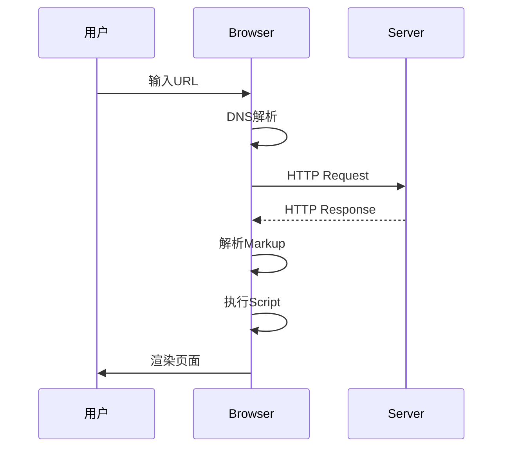

# Web浏览器的工作原理

当你在浏览器地址栏输入 URL 并回车，页面瞬间呈现，这背后究竟发生了什么？浏览器并非简单地“下载文件”，而是一个协调网络请求、资源解析与渲染的复杂引擎。理解这一过程，是掌握 Web 技术双语术语与调试能力的基石。

## 核心工作流程

浏览器的工作可抽象为“请求-响应-渲染”三阶段循环。它首先需要将用户输入的 `domain name` 通过 `name server` 解析为 `IP address`，再向目标 `host` 的指定 `port number` 发起 HTTP `request`。服务器返回 `response` 后，浏览器解析 HTML `markup` 与 `tag`，执行 `script`，最终将 `web page` 绘制到屏幕上。

> [!IMPORTANT]
> ==浏览器本质是资源调度器==，而非单纯的文件查看器。它需处理 `protocol` 协商、缓存策略及异步加载，`configuration` 错误常导致请求失败。

## 关键术语辨析

在双语课程中，以下术语极易混淆，需结合工作原理精准区分：

| 英文术语 | 中文译名 | 在工作流中的角色 | 常见误区 |
| :--- | :--- | :--- | :--- |
| `hypertext` | 超文本 | 包含链接的文本格式，是 `web page` 的内容基础 | 不等于 HTML，HTML 是其实现方式之一 |
| `markup` | 标记 | 定义文档结构的语法（如 `tag`） | 不是编程语言，无逻辑控制能力 |
| `script` | 脚本 | 嵌入或引用的可执行代码 | 与 `markup` 分离，负责动态行为 |
| `proxy server` | 代理服务器 | 中转 `request/response`，用于缓存或安全过滤 | 不同于 `name server`，后者仅做域名解析 |
| `partial path` | 部分路径 | 相对于当前文档的资源定位 | 非绝对 `path`，依赖基准 URL 解析 |

> [!WARNING]
> `identify` 指“标识/识别”资源（如 URI），而 `format` 指数据的“格式/编码”（如 MIME type）。考试中若问“如何 identify 一个 web page”，应答 URI/URL，而非 HTML format。

## 真题词汇映射示例

以简答题涉及的术语为例，正确理解需绑定工作流节点：

-   **`request` / `response`**：成对出现的 HTTP `message`，前者由 `browser` 发出，含方法、`path`、头部；后者由 `host` 返回，含状态码、`format` 与实体。
-   **`port number`**：传输层寻址依据，HTTP 默认 80，HTTPS 默认 443。缺失时浏览器按 `protocol` 自动补全。
-   **`development` vs `network`**：前者指 Web 应用构建过程，后者指底层通信基础设施。`web site` 是 `development` 的产物，运行于 `Internet` 之上。

> [!TIP]
> 记忆口诀：“DNS 找 IP，端口定服务；请求带路径，响应含格式；标记搭骨架，脚本赋灵魂。” 翻译题中遇到 `configuration`，优先联想浏览器或服务器的“配置”项，而非“构造”。

## 常见认知陷阱

许多学生误以为 `browser` 直接“打开” `web site`，实则它仅能处理单个 `web page` 资源。`web site` 是逻辑集合，浏览器通过 `hypertext` 链接在多个页面间导航。此外，`name server` 仅返回 `IP address`，不参与后续 `request` 转发——这是 `proxy server` 的职责。混淆二者会导致对缓存机制与安全架构的根本性误判。

> [!CAUTION]
> 在解释“浏览器如何获取资源”时，切勿省略 DNS 解析步骤。即使本地有缓存，`browser` 仍需验证有效性，此过程仍属 `request` 生命周期的一部分。
