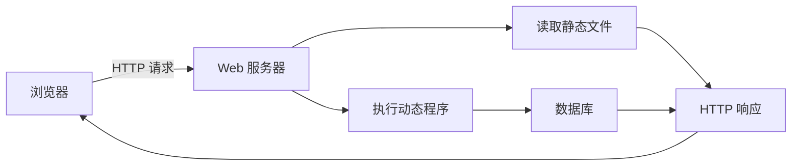
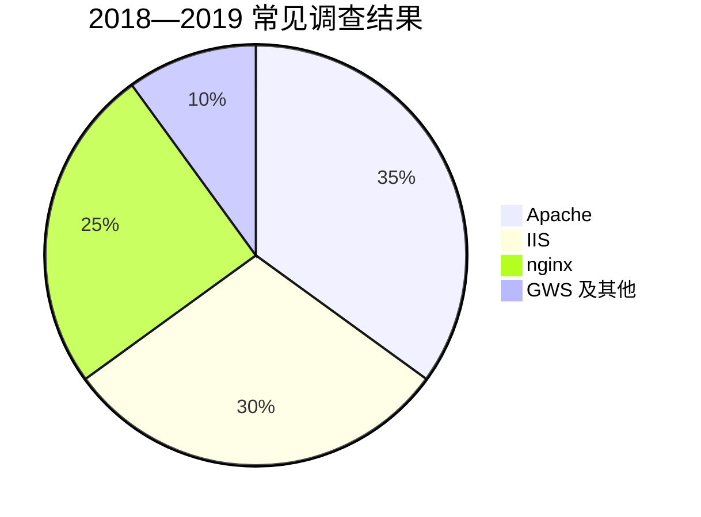

# Web服务器操作与常见服务器（Apache、IIS）

## Web 服务器是什么

Web 服务器也称为 HTTP 服务器，其核心工作是监听 HTTP 请求、定位资源，并把资源作为响应返回给客户端。用户看到的网页，通常由 HTML、JavaScript、CSS、图片等资源组成；服务器还可能执行脚本、访问数据库，再动态生成响应。

> [!IMPORTANT]
> Web 服务器并非“保存所有网页”的磁盘目录，而是遵循 HTTP 协议处理请求的服务器软件。

服务器软件和服务器硬件要区分：Apache、IIS、nginx、GWS 是服务器软件；一台安装了这些软件并接入网络的计算机才常被称为 Web 服务器。

## Apache 与 IIS

Apache HTTP Server 是历史悠久、跨平台的开源 Web 服务器。它以模块化扩展见长，可加载 PHP、负载均衡、认证、缓存等模块。其配置通常集中在 `httpd.conf`、`apache2.conf` 等文件中；Linux 发行版还可能把站点配置放在独立目录，通过包含机制加载。

IIS（Internet Information Services）是微软提供的 Windows Web 服务器平台，与 Windows、ASP.NET、.NET Framework 或现代 .NET 集成紧密，常用于托管 ASP.NET 应用。

| 对比项 | Apache | IIS |
|---|---|---|
| 厂商与运行平台 | 开源，主要运行于 Linux，也支持 Windows | 微软，主要运行于 Windows |
| 典型配置方式 | 编辑配置文件并重新加载 | 使用 IIS 管理器或 PowerShell 等配置 |
| 常见开发组合 | LAMP、WAMP | Windows + IIS + ASP.NET + 数据库 |
| 典型应用 | LAMP 中的动态网站、企业网站 | ASP.NET/.NET 网站与内部系统 |

LAMP 表示 **Linux + Apache + MySQL + PHP**，WAMP 表示 **Windows + Apache + MySQL + PHP**。它们是常见的软件栈组合，不表示每一种 Web 服务器都必须搭配 MySQL。

## nginx 与 GWS

nginx 使用异步、事件驱动模型处理大量连接，擅长静态资源、反向代理和负载均衡。它既可以作为前端 Web 服务器，也可以作为反向代理服务器。

GWS（Google Web Server）源自 Google 的网站基础设施，公开资料和产品信息远少于 Apache、IIS 与 nginx。因此，它在全球通用 Web 服务器市场统计中的份额通常很低，甚至未被部分榜单纳入。

> [!NOTE]
> 上图仅用于理解“Apache、IIS 居前，nginx 随后，GWS 较低”的相对关系。市场份额会随年份、统计网站和“是否计入反向代理”等口径变化，不能把图示比例当作统一标准答案。

按 **2018—2019 学年常见市场调查口径**，通常可排为：

| Web 服务器 | 排名 |
|---|---:|
| IIS | 1 |
| Apache | 2 |
| nginx | 3 |
| GWS | 4 |

> [!WARNING]
> 该题没有唯一的标准答案。不同榜单可能得到 Apache 与 IIS 互换的结果。答题时应写明数据年份和来源；GWS 常因缺乏公开、连续的统计而排在末位。

## 相关名词辨析

- **document root（文档根）**：某个虚拟主机对外发布网页的目录。浏览器请求 `/index.html` 时，服务器会在该目录下寻找 `index.html`。
- **Server root（服务器根）**：服务器软件自身所在或管理的顶级目录，与网站发布的 document root 不是一回事。
- **virtual document tree（虚拟文档树）**：服务器在逻辑上为不同主机或站点构造的目录视图，实际文件可以存放在不同物理路径。
- **virtual host（虚拟主机）**：在一台服务器上根据域名或 IP 提供多个网站的技术。每个虚拟主机可拥有独立的 document root 和配置。
- **proxy servers（代理服务器）**：代表客户端访问其他服务器。转发普通请求时是正向代理；代表后端服务器接收请求时是反向代理。
- **home page（主页）**：网站通常首先展示的页面，常称首页。严格来说，它不一定是服务器目录中名为 `index.html` 的文件。

## 端口与常见错误

| 任务 | 常用端口或协议 |
|---|---|
| 普通 HTTP | TCP 80 |
| HTTPS | TCP 443 |
| 代理访问 | 常见代理端口 8080，但可配置 |

> [!TIP]
> 记忆口诀：**Apache 配文件，IIS 靠管理；nginx 擅代理，GWS 资料少。**

常见错误包括：把 `document root` 当成软件安装目录；认为访问 `http://host/` 必然对应名为 `index.html` 的文件；把反向代理误认为正向代理；以及回答市场排名时不注明年份和统计口径。

例如，虚拟主机的 document root 为 `/var/www/site`，客户端请求 `/images/logo.png`，且该目录没有重写规则时，服务器通常查找 `/var/www/site/images/logo.png`。这体现了“URL 路径相对于文档根解析”的基本规则。
