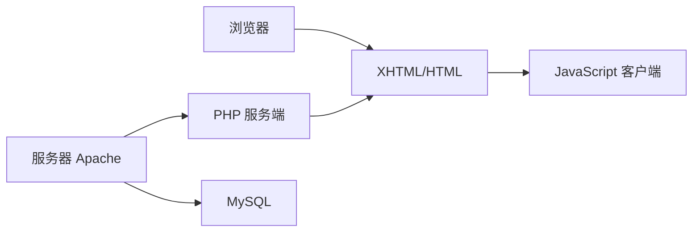

# Web程序员工具箱概览（XHTML、XML、JavaScript、PHP）

## 它是什么

Web 程序员工具箱里的四样常客：==XHTML 是 markup language==，==XML 是 meta-markup language==，==PHP 是 server-side scripting language==，==JavaScript 最常作为 client-side scripting language==（也可做服务端）。

先看一个反问：如果网页只要显示静态文字，够吗？一旦要提交表单、查数据库、换内容，就得有“结构 + 行为 + 服务器处理”的组合。

## 为什么需要

- XHTML：写页面骨架，比 HTML 更严，趋向 XML 语法。
- XML：自己造标签，用来存/传数据，是“定义标记语言的语言”。
- JavaScript：在浏览器里跑，做交互、校验、改 DOM。
- PHP：在服务器跑，嵌进 HTML 里生成动态页。

## 怎么做

创建 XHTML 文档可用普通编辑器或 WYSIWYG XHTML editors；好处是 ==Need not know XHTML to create XHTML documents==。PHP 与 JS 都常嵌入 HTML 文档。

本地练 PHP 要装 ==WAMP（Windows, Apache, MySQL, PHP）== 或 ==LAMP（Linux, Apache, MySQL, PHP）==。

> [!NOTE]
> XHTML 管结构；XML 管数据格式；JS 管客户端行为；PHP 管服务端生成。

## 相近概念区别

| 技术 | 类型 | 运行位置 |
|---|---|---|
| XHTML | markup language | 浏览器解析 |
| XML | meta-markup language | 存/传数据 |
| JavaScript | client-side（多数） | 浏览器 |
| PHP | server-side scripting | 服务器 |

## 常见坑

> [!WARNING]
> 别把 JavaScript 默认当服务端语言；课件说 most often client-side。
> PHP 代码不是在浏览器执行，而是在服务器执行后把结果变 HTML 发回。

> [!CAUTION]
> XHTML 比 HTML 严格：标签必须闭合、属性要引号，否则不合法。

## 算对了的例子

考题常问：“Which is a meta-markup language?” 答案是 ==XML==；因为 XHTML 只是 markup language，而 XML 可定义其他标记语言。再如“PHP 属哪种？”答 ==server-side scripting language==，本地环境选 ==WAMP/LAMP==。
