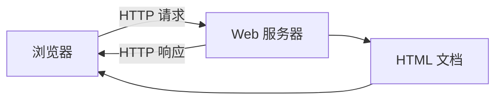
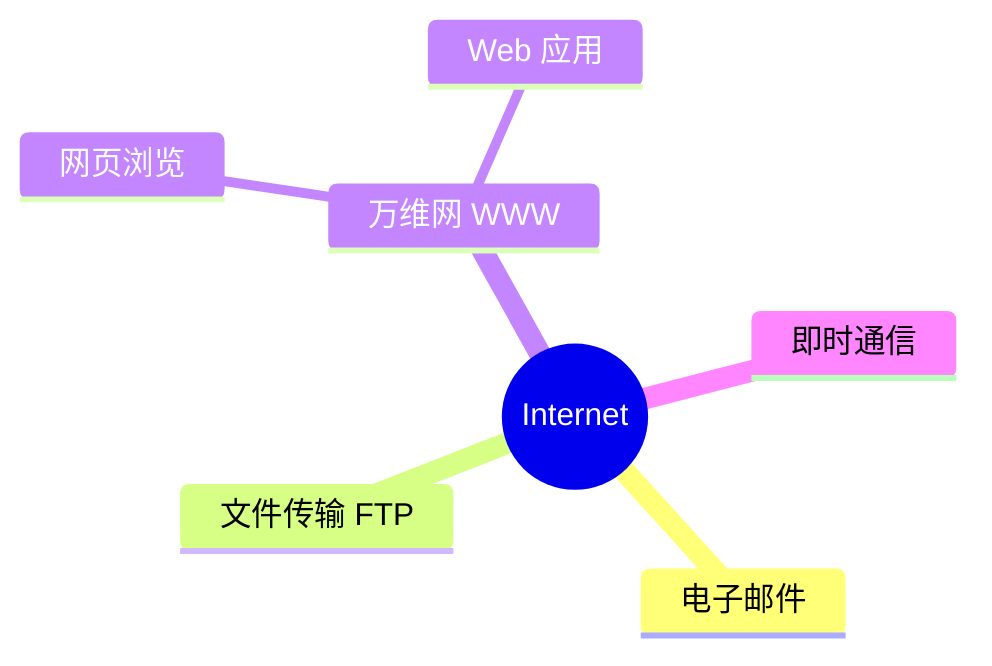

# 万维网（WWW）的概念及其与Internet的区别

## 它是什么

万维网（World Wide Web，WWW）是一种建立在 Internet 之上的==分布式超媒体信息系统==。它由三个核心组件构成：

- **URL**（统一资源定位符）：标识资源“在哪里”
- **HTTP**（超文本传输协议）：规定资源“怎么取”
- **HTML**（超文本标记语言）：描述资源“长什么样”

用一句话概括：**WWW 是 Internet 上运行的一项服务**，就像电子邮件（E-mail）和文件传输（FTP）一样，是构建在 Internet 基础设施之上的应用层系统。

## 为什么需要分清二者

> [!IMPORTANT]
> Internet 是物理网络（硬件 + TCP/IP 协议），WWW 是跑在上面的信息服务。==Internet 先于 WWW 存在==，没有 Internet 就没有 WWW，但反过来不成立。

互联网 1969 年（ARPANET）就已诞生，而 WWW 直到 1989 年才由 Tim Berners-Lee 提出。在 WWW 出现之前，人们已经在用 Internet 收发邮件、传文件——只是没有“点击链接跳转页面”这种体验。

## 一张表看清区别

| 维度 | Internet | WWW |
|------|----------|-----|
| 本质 | 全球互联的计算机网络 | 信息共享系统 |
| 层次 | 基础设施（网络层及以下） | 应用层服务 |
| 类比 | 高速公路 | 路上跑的快递车队 |
| 协议 | TCP/IP | HTTP/HTTPS |
| 资源标识 | IP 地址 | URL |
| 诞生时间 | 1969 年 | 1989 年 |

## 常见的坑

> [!WARNING]
> **“上网”不等于“上 Web”**。用微信发消息、玩联机游戏都用了 Internet，但如果没有经过浏览器访问网页，就没有用到 WWW。

> [!CAUTION]
> 考试遇到“WWW 就是 Internet”或“Internet 就是 WWW”这类判断题时必须打叉。二者是==包含关系==，不是等同关系：Internet 包含 WWW。

## 一个自测例子

判断题：**“没有 Internet，WWW 无法工作；没有 WWW，Internet 也无法工作。”**

- 前半句 ✅ 正确——WWW 依赖 Internet 的 TCP/IP 传输数据。
- 后半句 ❌ 错误——E-mail、FTP 等服务不依赖 WWW 也能运行。

所以整体判断为**错误**。这道题抓住了二者的核心差别：==WWW 依赖 Internet，Internet 不依赖 WWW==。

## 记忆口诀

> [!TIP]
> **“I 是路，W 是车；有路无车照常过，有车无路跑不脱。”**
> Internet 是路，WWW 是路上跑的一种车；没了车路还在，没了路车寸步难行。
