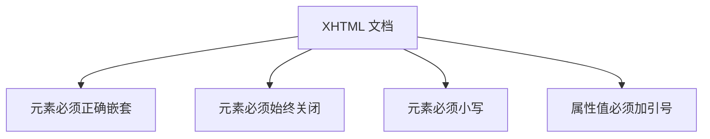

# XHTML基本语法规则与大小写敏感性

## 它是什么？

XHTML（Extensible HyperText Markup Language）是 HTML 与 XML 的结合体。**HTML 负责定义内容的结构，XML 负责定义内容的语法规则**。你可以这样理解：HTML 告诉我们“哪个是标题、哪个是段落”，而 XHTML 要求我们在描述时“每一个开头都必须有结束，每一个名字都必须用小写”。

> [!IMPORTANT]
> ==XHTML 文档在语法上是严格的 XML 文档==，这意味着所有元素必须正确嵌套、正确关闭、正确使用小写标签。

## 核心语法规则

XHTML 的基本语法规则可以归纳为一张对照表：

| 规则项 | HTML（宽松写法） | XHTML（强制要求） |
| :--- | :--- | :--- |
| **标签大小写** | `<HTML>`, `<Body>`, `
` | `<html>`, `<body>`, `
` |
| **元素关闭** | `
一段文字`（可省略 `
`） | `
一段文字
`（必须关闭） |
| **空元素** | ` `, `
`, `` | ` `, `
`, `` |
| **属性值** | `width=100`（引号可省） | `width="100"`（必须加引号） |
| **嵌套规则** | 浏览器有时会宽容错误 | ==必须严格遵循嵌套顺序，不能交叉== |

## 大小写敏感性

这是考试中出现频率最高的陷阱。在 XHTML 中，==所有标签名和属性名都必须使用小写字母==，因为 XML 是大小写敏感的。`
` 和 `
` 在 HTML 中会被浏览器理解为同一个“段落”标签，但在 XHTML 中会被视为两个完全不同的标签。

一个常见的坑：

- ❌ **错误写法**：``
- ✅ **正确写法**：``

## 嵌套规则：交叉是禁区

嵌套指的是一个元素完全包含在另一个元素内部。XHTML 要求标签必须**先开后关，后开先关**——就像堆叠盘子，后放上去的必须先拿下来。

- ✅ **正确嵌套**：`<strong><em>强调文字</em></strong>`  
  `strong` 先打开，`em` 后打开；`em` 先关闭，`strong` 后关闭。
- ❌ **错误嵌套**：`<strong><em>强调文字</strong></em>`  
  这种交叉在 XHTML 中会直接导致解析错误。

回到你看到的考题：

> Does HTML allow nested links?

这是一个典型的辨析点。浏览器对 HTML 的容错性较高，有时不会报错，但==从 XHTML 规范来看，`<a>` 元素内部不能再嵌套另一个 `<a>` 元素==，因为链接的嵌套在语义和逻辑上是无意义的。因此，XHTML 不允许嵌套链接。

## 它为什么重要？

为什么不能像旧 HTML 那样随便写？因为 XHTML 的严格语法让文档具备了“格式良好”的特性。这意味着：

1.  **可预测性**：浏览器不会因为猜测你的意图而浪费性能，页面渲染更快。
2.  **可交换性**：XHTML 文档可以被任何支持 XML 的工具读取、转换、处理，而不仅仅是浏览器。
3.  **可维护性**：格式良好的代码更容易让团队其他成员阅读和修改。

[!NOTE]
**记忆技巧**：可以把 XHTML 想象成“强迫症版本的 HTML”。写 XHTML 时，只要记住两件事：**标签都是小写的**，**标签都是成对关闭的**。凡是单个出现的标签（如换行），后面一定要加上 `/`。
