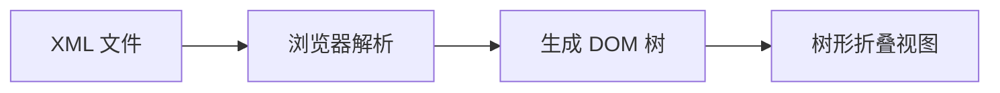

# 显示原始XML文档与使用CSS显示XML文档

## 为什么 XML 不能直接“看”？

HTML 自带语义标签（`<h1>`、`<p>`），浏览器知道如何排版。但 XML 的标签是==自定义==的，浏览器不认识它们，默认只会把它当成一棵节点树来展示。那么问题来了：如果我想让 XML 数据在网页上“像模像样”地呈现，该怎么办？

有两种常见方式：**直接显示原始 XML**，或者**用 CSS 控制显示**。

## 显示原始 XML 文档

当你在浏览器中打开一个没有关联样式表的 `.xml` 文件时，浏览器会将其解析为 DOM 树，并以==带语法高亮、可折叠的树形结构==展示。



> [!NOTE]
> 这并非“渲染”，而是浏览器的调试辅助功能。所有元素默认表现为类似块级元素的折叠节点，没有任何视觉排版设计。

## 使用 CSS 显示 XML 文档

既然原始显示太简陋，能不能像写网页一样给 XML 加样式？可以。只需两步：

1. **在 XML 中引入 CSS**：通过 `<?xml-stylesheet?>` 处理指令（Processing Instruction）。
2. **在 CSS 中用 XML 标签名作选择器**：直接拿自定义标签当选择器写规则。

### 完整示例

假设有一个图书数据的 XML 文件 `books.xml`：

```xml
<?xml version="1.0" encoding="UTF-8"?>
<?xml-stylesheet type="text/css" href="style.css"?>
<catalog>
  <book>
    <title>Web Technology</title>
    <price>59.00</price>
  </book>
</catalog>
```

对应的 `style.css`：

```css
catalog {
  display: block;
  background-color: #f4f4f4;
  padding: 10px;
}
book {
  display: block;
  border: 1px solid #ccc;
  margin: 5px;
}
title {
  display: block;
  font-size: 20px;
  font-weight: bold;
  color: navy;
}
price {
  display: inline;
  color: red;
}
```

> [!IMPORTANT]
> ==XML 标签默认没有 `display` 属性值==。如果不显式声明 `display: block` 或 `display: inline`，某些浏览器可能无法正常按预期排列这些自定义元素。

## 两种方式的对比

| 维度 | 原始 XML 显示 | CSS 显示 XML |
| :--- | :--- | :--- |
| **视觉效果** | 树形结构，带折叠按钮 | 自定义排版，类似网页 |
| **需要额外文件** | 否 | 是（需 `.css` 文件） |
| **适用场景** | 数据调试、API 响应预览 | 简单数据展示、轻量级报表 |
| **能否改变布局** | 不能 | 能（通过 `display` 等属性） |

## 常见的坑

> [!WARNING]
> **命名空间冲突**：如果 XML 使用了命名空间（Namespace），CSS 选择器必须带上命名空间前缀，否则样式无法匹配。例如 `<ns:title>` 不能用 `title {}` 选中。

> [!CAUTION]
> **CSS 只能管“皮囊”**：CSS 无法改变 XML 元素的顺序，无法根据条件隐藏节点，也==无法提取属性值作为文本显示==。如果需要重排结构或逻辑转换，必须使用 XSLT 而不是 CSS。

> [!TIP]
> 记忆口诀：**“一引二选三设块”**——**引**入 stylesheet 指令，标签名作**选**择器，记得**设**置 `display: block`。
