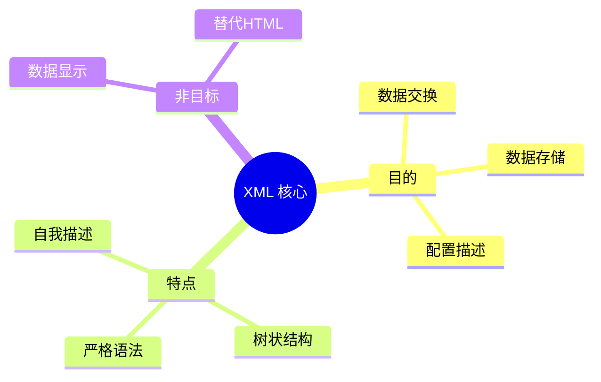

# XML简介与目的

## XML 是什么与核心目的

XML（eXtensible Markup Language，可扩展标记语言）是一种用于**存储和传输数据**的标记语言。与 HTML 不同，HTML 关注“数据如何显示”，而 XML 关注“==数据是什么==”。

> [!IMPORTANT]
> XML 的核心设计目标是**自我描述性**和**平台无关性**。它旨在解决异构系统间的数据交换难题，而非用于网页排版。

试想一下，如果南京邮电大学的教务系统和图书馆系统需要交换学生信息，两者数据库结构不同，如何统一格式？XML 通过自定义标签（如 `<student>`、`<id>`）提供了一种通用的数据容器。



## 为什么需要 XML？

在 Web 技术发展早期，不同操作系统（Windows, Linux）和编程语言（Java, C++）之间的数据格式不兼容。XML 的出现解决了以下痛点：

1.  **解耦数据与表现**：数据存储在 XML 中，样式由 CSS/XSLT 控制，逻辑由 JavaScript/后端处理。
2.  **结构化数据**：支持嵌套层级，能清晰表达复杂关系（如订单包含多个商品）。
3.  **广泛支持**：几乎所有现代编程语言都内置了 XML 解析器。

> [!TIP]
> 记忆口诀：**HTML 管长相，XML 管内涵。** HTML 是给浏览器看的，XML 是给程序读的。

## XML 与 HTML 的关键区别

许多初学者容易混淆两者，以下是核心对比：

| 特性 | XML | HTML |
| :--- | :--- | :--- |
| **标签定义** | 用户自定义（如 `<book>`） | 预定义（如 `<div>`, `<p>`） |
| **语法严格性** | ==极其严格==，必须闭合 | 相对宽松，容错率高 |
| **大小写敏感** | ==敏感== (`<Tag>` ≠ `<tag>`) | 不敏感 |
| **主要用途** | 数据传输、存储、配置 | 数据展示、页面结构 |

> [!WARNING]
> 常见坑：在 XML 中，`<br>` 是非法的，必须写成 `<br/>` 或 `<br></br>`。**所有标签必须正确嵌套且闭合**。

## 一个规范的 XML 示例

假设我们要传输一门课程的信息，合法的 XML 文档如下：

```xml
<?xml version="1.0" encoding="UTF-8"?>
<course id="CS101">
    <name>Web Technology</name>
    <credits>4</credits>
    <instructor>
        <firstName>San</firstName>
        <lastName>Zhang</lastName>
    </instructor>
</course>
```

**解析要点：**
1.  **声明头**：`<?xml ... ?>` 必须位于第一行。
2.  **根元素**：有且仅有一个根元素（此处为 `<course>`）。
3.  **属性与子元素**：`id="CS101"` 是属性，`<name>` 是子元素。一般建议**结构化数据用子元素，元数据用属性**。

> [!CAUTION]
> 高危误区：XML 中没有“默认值”概念，未定义的标签即不存在。解析器遇到格式错误（如标签未闭合）会直接抛出异常，停止解析，这与 HTML 浏览器的“尽力渲染”截然不同。
