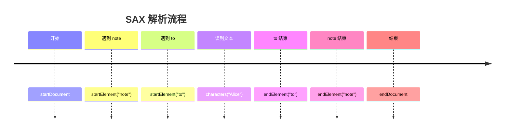

# XML处理器（Processors）的目的与解析（Parsing）概念

当你拿到一份 XML 文档，计算机看到的只是一长串字符。应用程序如何从中提取出 `<title>` 或 `<price>` 里的数据？这就需要一个“翻译官”——XML Processor。

## 它是什么与为什么需要

> [!IMPORTANT]
> ==XML Processor（XML 处理器）== 是读取 XML 文档并获取其结构与内容的软件模块。

我们写 Web 应用时，数据常以 XML 格式传输。但程序无法直接“看懂”纯文本，必须借助 Processor 将字符流转换为内存中的结构化对象。它的核心目的（Purposes）包括：

1. **检查良构性**：判断文档是否为 Well-formed XML（如标签是否闭合）。
2. **验证有效性**：可选地根据 DTD/Schema 检查文档是否 Valid。
3. **提供访问接口**：让应用程序能遍历、读取节点数据。

## 解析是怎么做的

Processor 完成上述目的的核心动作叫 ==Parsing（解析）==，即读取 XML 字节流，识别标记（Markup），并将其转化为应用程序可用的结构。


主流的解析方式有两种，它们决定了 Processor 的工作模式：

| 对比维度 | DOM 解析 | SAX 解析 |
| :--- | :--- | :--- |
| **加载方式** | 一次性读入内存，建树 | 逐行扫描，边读边触发事件 |
| **数据结构** | 树形结构（Tree） | 无持久结构，事件流 |
| **内存占用** | 大（$O(n)$，$n$ 为节点数） | 小（常数级 $O(1)$） |
| **读写能力** | 可读、可改、可删 | 只读 |
| **适用场景** | 需反复查询、修改的小文档 | 只需读一次的大文档 |

DOM 解析后在内存中构建的树形结构如下：


## 一个算对了的例子

假设有如下 XML 片段：

```xml
<note><to>Alice</to></note>
```

当 Processor 使用 **SAX 方式** 进行 Parsing 时，会按时间线依次触发以下事件：



应用程序只需注册对应的回调函数（如 `startElement`），就能在事件触发时精准提取出 `"Alice"`。

## 常见坑与相近概念辨析

> [!WARNING]
> 不要把 **XML Processor** 和 **XSLT Processor** 搞混！前者负责“读懂”（Parsing），后者负责“转换样式”。

- **Well-formed vs Valid**：Processor 默认必须检查文档是否 Well-formed（语法正确）；而 Validity（符合 DTD）检查是可选的。如果文档连 Well-formed 都不是，Parser 会直接报错停止。
- **DOM 的内存陷阱**：解析 MB 级别的 XML 时若误用 DOM，极易导致内存溢出（OOM）。

> [!TIP]
> 记忆口诀：**D**OM 建**树**（Document Object Model），**S**AX 扫**描**（Simple API for XML）。要改选 DOM，要大选 SAX。
