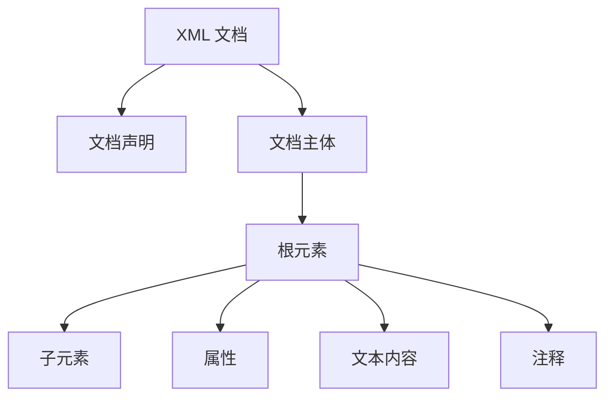

# XML的语法规则与文档结构

## 为什么需要 XML

HTML 用固定标签描述“怎么显示”，但计算机之间交换数据时，我们更关心“数据是什么”。XML（eXtensible Markup Language）允许你**自定义标签**，把数据的结构与内容一起交给对方，因此它常被用作配置文件、数据交换格式和 Ajax 中的数据载体。

> [!IMPORTANT]
> XML 的设计目标是**传输和存储数据**，而不是显示数据；标签必须成对出现且严格嵌套。

## 语法规则

一个合法 XML 文档必须满足以下规则：

| 规则 | 正确示例 | 常见错误 |
|------|----------|----------|
| 必须有且只有一个根元素 | `<students>…</students>` | 出现多个并列根 |
| 标签区分大小写 | `<Name>` 与 `</Name>` 配对 | `<Name>` 与 `</name>` 混用 |
| 必须正确嵌套 | `<a><b></b></a>` | `<a><b></a></b>` |
| 属性值必须加引号 | `id="001"` | `id=001` |
| 特殊字符用实体引用 | `5 &lt; 6` | 直接写 `5 < 6` |
| 注释不能出现在声明前 | `<!-- 注释 -->` | `<!-- 注释 --!>` |

> [!WARNING]
> XML 声明 `<?xml version="1.0" encoding="UTF-8"?>` 必须是文档的第一行，前面不能有任何空格、注释或其他内容。

## 文档结构

XML 文档在逻辑上分为两大部分：



- **文档声明**：说明版本与编码。
- **元素**：由开始标签、内容和结束标签构成，可包含子元素。
- **属性**：写在开始标签内，提供额外信息，如 `<student id="001">`。
- **文本与注释**：注释格式为 `<!-- … -->`。

> [!TIP]
> 判断 XML 是否合法时，先找根元素，再检查标签配对与嵌套，最后看声明位置。

## 与相近概念的区别

| 对比项 | XML | HTML | JSON |
|--------|-----|------|------|
| 主要用途 | 数据描述与交换 | 网页显示 | 轻量数据交换 |
| 标签 | 自定义 | 预定义 | 无标签 |
| 严格性 | 非常严格 | 较宽松 | 严格 |
| 可读性 | 冗长 | 一般 | 简洁 |

> [!NOTE]
> XML 强调**结构严谨**，HTML 允许一定的容错；JSON 更轻量，但 XML 支持属性、注释和命名空间，适合复杂文档。

## 一个算对了的例子

下面是一份合法的 XML 学生信息文档：

```xml
<?xml version="1.0" encoding="UTF-8"?>
<students>
  <student id="001">
    <name>张三</name>
    <score>90</score>
  </student>
  <student id="002">
    <name>李四</name>
    <score>5 &lt; 6</score>
  </student>
</students>
```

检查步骤：
1. 声明在第一行；
2. 只有一个根元素 `<students>`；
3. 所有标签成对且正确嵌套；
4. 属性值加了引号；
5. `<` 用 `&lt;` 转义。

> [!CAUTION]
> 如果写成 `<score>5 < 6</score>`，浏览器或解析器会报错，因为 `<` 会被误认为新标签的开始。

## 常见坑

- 忘记转义 `<`、`&` 等特殊字符；
- 多个根元素并列；
- 标签大小写不一致；
- 在 XML 声明前插入注释或空行。

> [!IMPORTANT]
> ==XML 的核心是“严格”：一个格式错误，整个文档就无法被正确解析。==
