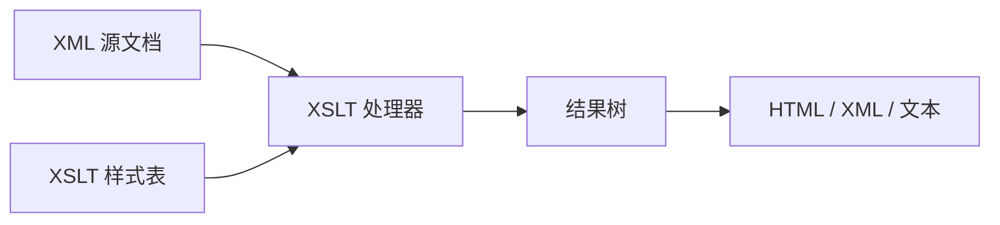
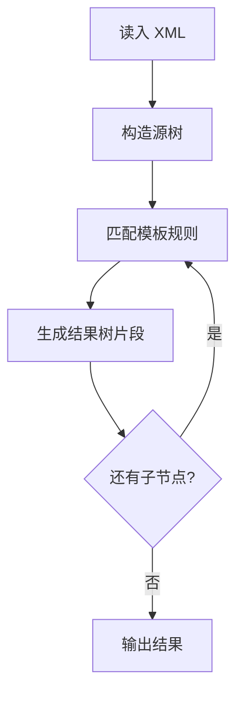

# XSLT样式表概述与XSLT处理过程（自学部分）

## XSLT 样式表概述

XSLT（Extensible Stylesheet Language Transformations）是一种把 XML 文档**转换**成另一种结构或格式的语言。它本身也是合法的 XML，以 `<xsl:stylesheet>` 或 `<xsl:transform>` 为根元素。

先想一个问题：XML 只管“数据是什么”，那谁来管“数据怎么显示”？CSS 可以给 HTML 加样式，但对 XML 来说，更多时候我们需要的是**结构变换**——把 XML 转换成 HTML、另一个 XML、纯文本乃至 PDF。XSLT 就是干这件事的。

> [!IMPORTANT]
> XSLT 是 XSL 家族中负责**转换**的部分；XSL 还包括 XSL-FO（格式化对象）和 XPath。XSLT 的匹配与选择大量依赖 ==XPath 路径表达式==，不会 XPath 就写不了 XSLT。

## 为什么需要 XSLT

- **数据与表现分离**：XML 存原始数据，XSLT 决定它呈现成什么样。
- **跨格式复用**：同一份 XML 可以套不同 XSLT，生成 HTML 网页、WAP 页面或 PDF。
- **结构化重组**：可以对 XML 元素排序、过滤、重命名、增删节点，这在 CSS 里做不到。

## XSLT 处理过程

XSLT 处理的本质：一个 **XSLT 处理器**读入 XML 源文档和 XSLT 样式表，按样式表里的模板规则生成结果树。



处理过程可以拆成三步：

1. **构建源树**：把 XML 解析成一棵节点树（根节点、元素、文本、属性等）。
2. **模板匹配**：处理器从根节点开始，在样式表中找 `<xsl:template match="...">` 与当前节点匹配的模板。
3. **实例化模板**：按模板内容生成结果树节点，再递归处理模板中 `xsl:apply-templates` 指定的子节点。



> [!TIP]
> 记忆口诀：**“一棵树进，一套规则转，另一棵树出”**。输入是源树，输出是结果树，XSLT 是中间的转换规则。

## 一个算对了的例子

假设有 XML：

```xml
<student>
  <name>张三</name>
  <score>92</score>
</student>
```

XSLT 样式表：

```xml
<xsl:stylesheet version="1.0"
  xmlns:xsl="http://www.w3.org/1999/XSL/Transform">
  <xsl:template match="/">
    <html>
      <body>
        <xsl:apply-templates select="student"/>
      </body>
    </html>
  </xsl:template>

  <xsl:template match="student">
    <p><xsl:value-of select="name"/>：<xsl:value-of select="score"/>分</p>
  </xsl:template>
</xsl:stylesheet>
```

处理过程：根节点 `/` 匹配第一个模板，生成 `<html><body>`，然后 `apply-templates` 找到 `student` 节点；`student` 匹配第二个模板，输出 `<p>张三：92分</p>`。最终结果：

```html
<html>
  <body>
    <p>张三：92分</p>
  </body>
</html>
```

## 和相近概念的区别

| 技术 | 作用 | 是否改变结构 |
|------|------|--------------|
| CSS | 给 HTML/XML 加样式 | 否，只改显示 |
| XPath | 在 XML 中定位节点 | 不生成输出 |
| XSLT | 把 XML 转换成另一棵树 | 是，可增删改节点 |
| XQuery | 查询 XML 数据 | 可返回序列，但不是模板驱动 |

> [!WARNING]
> `xsl:value-of` 只输出**第一个匹配节点的字符串值**，多个匹配不会全部输出。要循环输出多个节点，得用 `xsl:for-each` 或对每个节点 `apply-templates`。

> [!CAUTION]
> XSLT 样式表自己必须**良构**（well-formed），否则处理器直接报错。另外，忘记声明 XSLT 命名空间 `xmlns:xsl="http://www.w3.org/1999/XSL/Transform"` 是最常见的翻车点。
