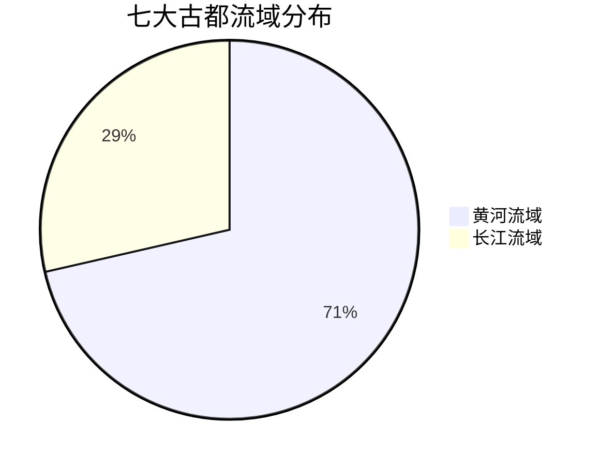

# 七大古都（安阳、西安、洛阳、开封、北京、南京、杭州）

## 什么是七大古都

> [!IMPORTANT]
> 中国“七大古都”指==西安、洛阳、开封、安阳、北京、南京、杭州==。这一概念属于“地理环境与文化发展”章节，核心考点在于理解**农业经济基础如何决定政治文化中心的分布**。

为什么古代王朝定都多选在这七座城市？根本原因在于古代中国以农立国，只有==农业经济发达==的地区才能供养庞大的官僚机构与军队，进而形成历代政治中心和文化中心。这并非单纯的政治选择，而是地理环境对文化发展的刚性约束。

## 空间分布与流域归属

复习时最容易混淆的是各古都所属的流域。请记住一个关键数据：七大古都有==五个位于黄河流域==。

| 古都 | 所属流域 | 备注 |
| :--- | :--- | :--- |
| 安阳、西安、洛阳、开封、北京 | 黄河流域 | 早期中华文明核心区 |
| 南京、杭州 | 长江流域 | 经济重心南移后的代表 |

> [!TIP]
> 记忆口诀：“安西洛开北属黄，南杭归江记心房”。其中“安西洛开北”对应黄河流域五都，“南杭”对应长江流域两都。

## 与相近概念的辨析

考试中常将“七大古都”与“六大古都”或“八大古都”混用，需明确区分：

-   **六大古都**：不含安阳，是较早的学术提法。
-   **八大古都**：在七大基础上增加郑州（2004年增补）。
-   **本课程标准**：严格采用教材定义的==七大古都==，答题时切勿自行增减。

> [!WARNING]
> 若题目问“下列不属于七大古都的是”，选项中出现“郑州”或“大同”即为正确答案。课件未提及的城市一律不选。

## 结合地域文化的延伸理解

七大古都不仅是政治符号，更是区域文化的载体。例如南京作为长江流域古都，其文化发展与江苏地域沿革紧密相关；杭州则依托浙江（钱塘江）水系成为南宋文化中心。同时，佛教在魏晋南北朝的传播也印证了古都的文化枢纽地位——长安、洛阳、建康（今南京）均为当时佛教活动中心，鸠摩罗什在长安译经、慧远在庐山结社，皆依托古都的资源集聚效应。

> [!NOTE]
> 郡望意识（如“昌黎韩”“彭城刘”）虽反映门第观念，但其地理指向与古都分布高度重合，侧面说明黄河流域在传统文化认同中的核心地位。

## 典型例题解析

**例题**：简述中国七大古都的地理位置特点及其成因。

**解题思路**：

1.  先列举七座古都名称（缺一不可）；
2.  点明“五个位于黄河流域”的空间特征；
3.  归因于“农业经济发达→政治文化中心”的逻辑链。

**参考答案**：中国的七大古都是西安、洛阳、开封、安阳、北京、南京、杭州。其地理位置特点是==有五个位于黄河流域==。成因在于这些地区农业经济发达，能够支撑大规模人口与国家机器运转，从而形成历代政治中心和文化中心。

> [!CAUTION]
> 切忌只答城市名而忽略“黄河流域”和“农业经济”两个得分点。本题本质是考查“地理环境对文化发展的制约作用”，而非单纯的历史地名默写。
