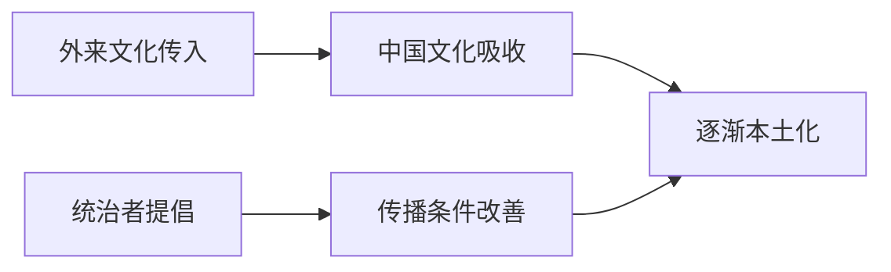

# 中国文化的民族特点与基本精神

## 它是什么

“中国文化的民族特点与基本精神”回答的是：==中国文化为什么呈现独特面貌，又靠什么精神延续发展==。前者侧重文化的外在表现和民族风格，后者侧重贯穿文化发展的价值追求。二者不是两张互不相干的清单：民族特点是基本精神的具体表现，基本精神又在历史实践中不断塑造民族特点。

## 为什么需要

复习时不能只背“历史悠久、博大精深”等笼统评价，而要能说明特点、精神及其历史条件。例如，佛教在中国传播并发展，既与中国文化的包容性有关，也有现实的社会条件。课件所说的**阶级基础**，就是统治阶级逐渐认识到佛教有助于维护统治秩序，因而予以重视和提倡。

## 怎么理解

可从“特点—精神—条件”三个层面组织答案：

| 层面 | 回答重点 | 写作要求 |
|---|---|---|
| 民族特点 | 中国文化呈现怎样的民族风格 | 结合具体文化现象说明 |
| 基本精神 | 维系文化发展怎样的价值力量 | 不只列名词，要解释作用 |
| 历史条件 | 某种文化现象为何形成、传播 | 区分文化自身与社会条件 |

分析外来文化本土化时，可用下面的思路：

> [!IMPORTANT]
> 佛教的传播不能只用“文化包容”解释。课件明确指出：==刻苦修行以求解脱，以及因果报应、轮回转世等说教，不构成对统治秩序的威胁，反而有助于维护这种秩序==。从东汉到南北朝，封建统治者逐渐认识其作用并大力提倡，有的还因极端迷信而极度推崇。

## 和相近概念的区别

- **民族特点**重在“中国文化是什么样”，强调可观察、可概括的特征。
- **基本精神**重在“中国文化凭什么延续”，强调较稳定的价值取向和精神动力。
- **传播的社会条件**重在“某种文化为何在特定时期发展”，如统治阶级的提倡和利用，不能直接当作中国文化的基本精神。

> [!WARNING]
> 不要把佛教思想简单等同于儒学。课件特别指出，佛教==不像儒学那样主张忠孝节义、安分守己==；但它仍可能客观上有利于统治秩序。也不能把“统治者提倡”写成唯一原因，更不能说所有统治者都出于政治考虑，因为其中还有极端迷信者。

## 一个答对了的例子

**问：简述佛教在中国受到重视和提倡的阶级基础。**

**答：**佛教要求教徒刻苦修行以求解脱，并宣扬因果报应、轮回转世等思想。这些说教不构成对封建统治秩序的威胁，反而有助于维护这种秩序。因此，从东汉到南北朝的五百年间，封建统治者逐渐认识到佛教的作用，予以重视并大力提倡；部分统治者还因极端迷信而极度推崇。由此可见，佛教的发展既有文化吸收的一面，也受到统治阶级利用这一社会条件的推动。
