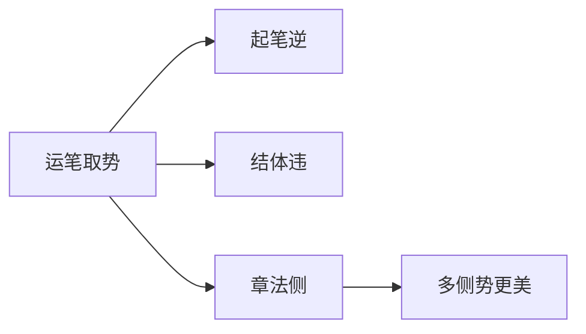

# 书法艺术的基本要素（用笔、结体、章法）

## 它是什么

先想一个问题：为什么汉字能写成“书法”，而随便写英文字母很少被叫作书法？课件告诉我们：==书法成为一门艺术，是以汉字的方形结构和线条变化为基础的==。

在这个基础上，一幅书法作品好不好看，主要看三个基本要素：**用笔、结体、章法**。用笔是每一笔怎么运笔取势；结体是单个字里的笔画怎么安排；章法是整篇字怎么排布。书法艺术的特点正是：运笔取势，力在其中，以笔法的曲直、行滞，章法的虚实、疏密，结构的奇正、主次，显示出“相反相成”的美感。

## 为什么需要

如果没有这三要素，写字只是记录信息；有了它们，才能把“力”和“势”写出来。所谓“运笔取势”是说：起笔要注意“逆”，结体要注意“违”，章法要注意“侧”，从而形成一定势态。其中 ==“侧”就是笔画和章法要多取侧势，因为侧势造成的美更富于变化==。

## 怎么做：三要素对照

| 要素 | 看什么 | 关键要求 | 美感来源 |
|---|---|---|---|
| 用笔 | 笔法曲直、行滞 | 起笔要“逆”，运笔取势 | 力在其中 |
| 结体 | 结构奇正、主次 | 结体要“违” | 单字不平庸 |
| 章法 | 章法虚实、疏密 | 章法要“侧”、多侧势 | 整篇富于变化 |

## 相近概念的区别与常见坑

- 用笔 ≠ 只把笔画写直：曲直、行滞都要有，才有“力”。
- 结体 ≠ 把字写对称：要注意“奇正、主次”，一味平正就呆板。
- 章法 ≠ 把格子填满：要看虚实、疏密，还要多取侧势才富变化。

> [!WARNING]
> 易错点：一说“章法要注意”，别只答疏密，课件明确写的是要注意 ==“侧”==，且侧势美更富于变化。

## 一个算对了的例子

考题问：“书法成为一门艺术的基础是什么？”正确回答是：以汉字的==方形结构和线条变化==为基础。不是因为毛笔特别软，也不是因为纸特别好，而是汉字本身的方形结构加上线条能变化，才让用笔、结体、章法有发挥空间。再如考王羲之《兰亭序》：唐太宗把真迹带入昭陵；智永是王羲之七世孙，写《千字文》极受推崇——这些例子都建立在“汉字结构+线条变化”这一基础之上。
