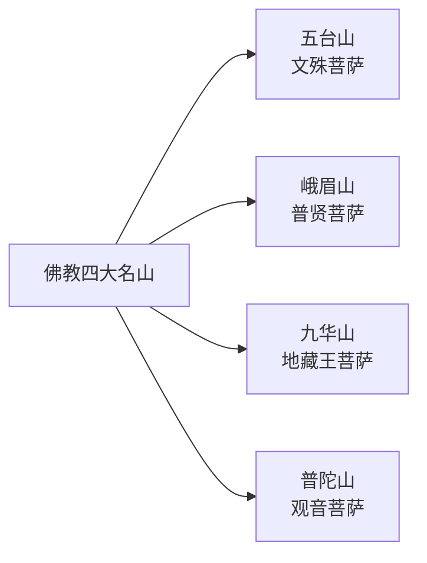

# 佛教四大名山（五台、峨眉、普陀、九华）

## 什么是佛教四大名山

佛教四大名山，是指在中国佛教历史和民间信仰中具有特殊地位的四座佛教圣地。它们分别是：

| 名山 | 所在地区 | 主要供奉菩萨 |
|---|---|---|
| 五台山 | 山西省五台县 | 文殊菩萨 |
| 峨眉山 | 四川省峨眉山市 | 普贤菩萨 |
| 九华山 | 安徽省青阳县 | 地藏王菩萨 |
| 普陀山 | 浙江省舟山市 | 观音菩萨 |

四大名山不仅寺院众多、僧侣云集，而且是佛教文化传播的重要中心。历代帝王、文人墨客和普通民众都常到这里进香、礼佛、游览，因此这些名山也形成了丰富的建筑、雕塑、绘画、民俗和文学文化。

## 四座名山分别供奉谁

四座名山与四大菩萨之间有固定对应关系，可以从菩萨所代表的精神和实践来理解。

- **五台山—文殊菩萨**：文殊菩萨象征智慧，常被尊称为“大智文殊菩萨”。
- **峨眉山—普贤菩萨**：普贤菩萨象征实践与修行，其“大行普贤菩萨”的称号突出愿行和行动。
- **九华山—地藏王菩萨**：地藏菩萨誓愿“地狱不空，誓不成佛”，体现慈悲救度和承担众生的精神。
- **普陀山—观音菩萨**：观音菩萨具有大悲精神，能够回应众生苦难，因此受到尤其广泛的民间信仰。

可以将四大菩萨简要概括为：

> [!TIP]
> 记住口诀：**五台文殊、峨眉普贤、九华地藏、普陀观音。**

看到题目询问“中国佛教四大名山分别供奉哪几位菩萨”，应先按所在省份或城市定位名山，再填写对应菩萨，不能把名称与所在地混淆。

## 菩萨是什么

从佛教教义上说，菩萨是已经获得智慧、具备修行成就，并愿意利益众生、帮助众生，未来能够成佛的修行者。“菩萨”通常意为“菩提萨埵”，意译为“觉有情”，即以觉悟之心利益有情众生。

不过，在宗教实践和普通信众的信仰方式中，人们往往把菩萨与佛同等恭敬地供养。因此，佛教徒通常会对观音菩萨、文殊菩萨、普贤菩萨、地藏菩萨等进行礼敬和祈愿。

> [!IMPORTANT]
> 标准答案是：**菩萨是能利益众生、未来可以成佛的修行者；但佛教徒实际上常把菩萨当作佛来供养。**

## 容易混淆的地方

首先，==四大名山是四处佛教圣地，不等于四大佛教宗派==。宗派是依据经典、理论立场和修行方式形成的派别，如天台宗、华严宗、禅宗等；四大名山则是具有代表性的地理与信仰中心。

其次，菩萨的全称并不完全相同。民间常称“地藏王菩萨”，正式佛教名称通常是“地藏菩萨”；答题时写“地藏王菩萨”符合课件表述，也不会影响核心考点。

最后，佛教传入中国后，四大名山都经过了长期的历史发展。民间往往把一些与菩萨信仰相关的传说、节日和习俗附着在名山之上。复习时应以课件中的“地点—名山—菩萨”对应关系为主，不必把未经课程说明的民间传说当作标准答案。

## 一个算对了的例子

题目问：**佛教四大名山分别位于哪里？各供奉什么菩萨？**

答案可写成：

> 山西五台山供奉文殊菩萨，四川峨眉山供奉普贤菩萨，安徽九华山供奉地藏王菩萨，浙江普陀山供奉观音菩萨。

核对时可分两步：先检查“五台、峨眉、九华、普陀”四个名称是否齐全，再检查“文殊、普贤、地藏、观音”是否依次对应。==四个地点和四个菩萨都正确，且没有错位，答案才算完整。==
