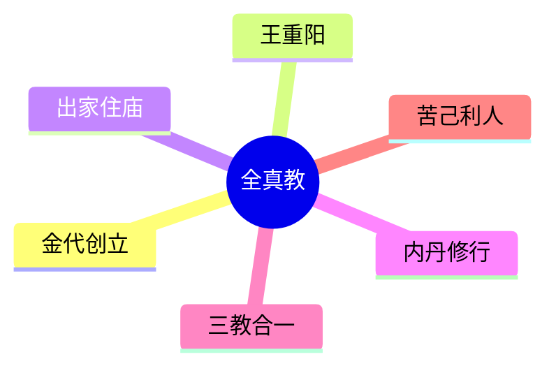

# 全真教创始人王重阳及全真教特点

## 它是什么

先想一个问题：如果一种宗教既要求信徒出家住庙，又强调“自己救自己”、不靠符水丹药，它和传统道士有什么不同？

在南京邮电大学《中国文化概论》第六章“宗教文化”里，答案就是金元之际新出现的道教派别——**全真教**。课件 P147 第 3 段明确写道：

> 全真教的创始人是金代王重阳。

因此，记忆锚点只有一句话：==全真教 = 金代 + 王重阳==。

## 为什么需要区分它

教材在同一章前面（P146）讲过南朝陶弘景的贡献：他写《真灵位业图》，==首创道教神仙等级、品位，构想神仙谱系==。这属于“早期道教体系化”。

而全真教不是整理神仙名单，而是改革修行方式。它出现在金代北方，代表道教从“外丹符箓”转向“内丹心性”。

## 怎么做：王重阳与全真特点

王重阳原名中孚，入道后号重阳子。他在山东传道，收“全真七子”（如丘处机）。全真教的核心特点可用一张图概括：

注意几个术语：

- **三教合一**：儒家的忠孝、佛家的戒律、道家的炼养混在一起；
- **内丹**：以身体为炉鼎炼精气神，不靠 external 丹药；
- **出家制度**：和正一道“居家火居”不同，全真道士须住宫观、素食、独身。

## 相近概念区别

| 概念 | 时代/人物 | 关键区分 |
|---|---|---|
| 陶弘景 | 南朝 | 《真灵位业图》定神仙谱系 |
| 王重阳 | ==金代== | 创全真教，重内丹出家 |
| 正一道 | 汉末以来 | 可娶妻、重符箓斋醮 |

## 常见的坑

> [!WARNING]
> 不要把“王重阳”写成小说里的武侠人物就忽略时代；考题常把“金代”换成“宋代/唐代”做干扰项。

另一个坑：看到“神仙等级”立刻答王重阳，其实是陶弘景——两人一前一后，别串线。

## 算对了的例子

复习提纲原题：

> 了解全真教的创始人是金代王重阳。

正确作答只需写：**全真教创始人是金代的王重阳**。如果多写“他编《真灵位业图》”，就错把陶弘景的功绩安到王重阳头上了。
