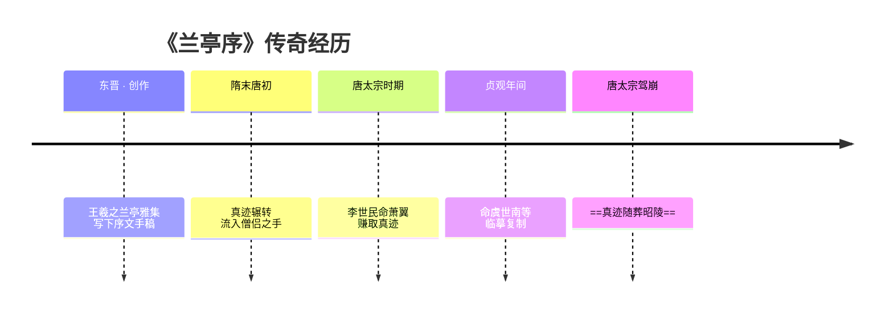
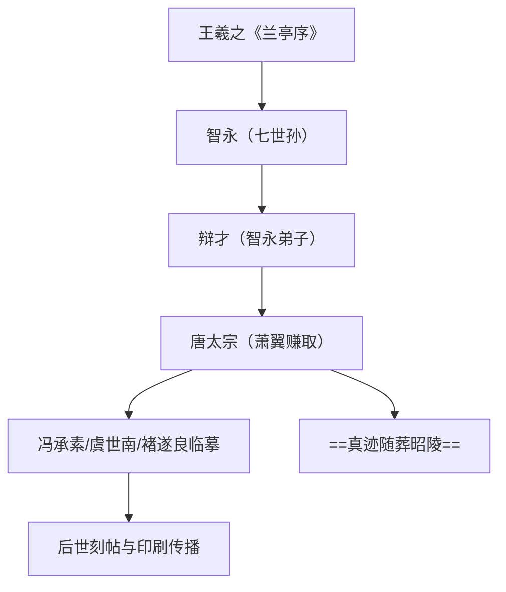

# 王羲之《兰亭序》及其书法地位

## 《兰亭序》及其书法地位

《兰亭序》是中国书法史上最负盛名的作品，被誉为==“天下第一行书”==。

### 是什么

《兰亭序》是东晋书法家**王羲之**于永和九年（353年）三月三日，与友人在会稽山阴兰亭雅集后，为集会所作诗篇写下的序文手稿。全帖共28行，324字，其中有二十余个“之”字，各具姿态，无一雷同。

从书法本体来看，它的笔法兼具**中锋的圆润**与**侧锋的妍美**，结体平正中寓奇险，章法自然畅达，一改汉魏以来质朴的书风，开创了行书的妍美流便新格局。

### 为什么重要

《兰亭序》的地位之所以不可撼动，可以从三个层面理解：

> [!IMPORTANT]
> 《兰亭序》标志着中国行书从“隶书笔意”向“楷行笔法”的彻底转型，确立了行书独立的审美品格。唐太宗极度推崇王羲之书法，不仅亲自为《晋书·王羲之传》撰写赞辞，更将==《兰亭序》真迹带入昭陵陪葬==。帝王推崇使王羲之被后世尊为“书圣”，《兰亭序》也由此成为书法典范。

### 与之相关的传承人物

在南邮考试中，**智永**是常与《兰亭序》关联考查的人物。

| 人物 | 与《兰亭序》关系 | 要点速记 |
| :--- | :--- | :--- |
| **智永** | 王羲之七世孙 | ==智永为王羲之七世孙==，书法深得家风，传《兰亭序》于辩才 |
| **辩才** | 智永弟子 | 萧翼奉唐太宗命，从辩才处赚取《兰亭序》 |
| **唐太宗** | 收藏者 | 命人临摹，死后==真迹随葬昭陵== |

> [!TIP]
> 记忆口诀：**“七世孙智永，千字文传名；太宗葬昭陵，真迹绝尘寰。”**
> 考试常设干扰项：将“智永”说成王羲之的儿子、孙子，或说《兰亭序》真迹葬于乾陵，均属错误。

### 真迹去向与后世影响

《兰亭序》真迹已随唐太宗葬入昭陵，今天我们看到的都是摹本、临本或刻本。其中最著名的包括：

- **冯承素“神龙本”**：被认为最接近原作风貌
- **虞世南临本、褚遂良临本**：唐初书法大家的临写
- **定武刻本**：据欧阳询摹本刻石，影响颇大

### 常见的坑

> [!WARNING]
> 1. **真迹去向**：不是乾陵（武则天陵），不是茂陵（汉武帝陵），而是==昭陵（唐太宗陵）==。考试中极易以武则天混同考查。
> 2. **智永身份**：不是王羲之的儿子（王献之才是），是==七世孙==。
> 3. **作品性质**：《兰亭序》是“行书”，不是楷书、草书。宋徽宗赵佶的“瘦金体”是楷书的变体，与王羲之无关，考试可能在同一题中作为干扰项出现。
