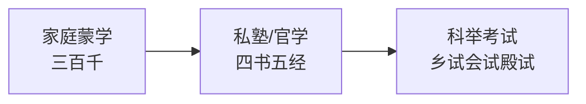

# 古代启蒙教材（《三字经》《百家姓》《千字文》）

## 什么是古代启蒙教材

古代启蒙教材是旧时家庭教育中供儿童识字、明理的入门读物。最经典的“三百千”——《三字经》《百家姓》《千字文》，加上稍后的《幼学琼林》，构成了传统蒙学的主干；再往后，学习内容便升入“四书五经”，与学校教育接轨。

> [!IMPORTANT]
> 核心考点：四部蒙书各自的**朝代**与**编者**。
> 《三字经》传为南宋王应麟编（一说明代黎贞编）；《百家姓》为宋代无名氏编；《千字文》为南朝梁代周兴嗣编；《幼学琼林》为明代程登吉编。

## 为什么需要启蒙教材

古代没有现代意义上的普及学校，识字教育主要在家庭或私塾中完成。蒙书要解决三个问题：

- **识字**：让儿童快速掌握常用字；
- **常识**：传递历史、伦理、社会名物等基本知识；
- **规范**：以韵语、对偶等形式便于记诵，培养语感。

《千字文》用一千个不重复的字编成四言韵语，《三字经》以三字一句概括经史子集，《百家姓》把姓氏编成韵文便于记诵，《幼学琼林》则按门类介绍成语典故与自然知识。

## 四部蒙书速览

| 书名 | 朝代 | 编者 | 内容与特点 |
|------|------|------|------------|
| 《三字经》 | 南宋（传） | 王应麟（一说黎贞） | 三字一句，涵盖伦理、历史、经籍 |
| 《百家姓》 | 宋代 | 无名氏 | 姓氏韵文，便于记诵 |
| 《千字文》 | 南朝梁 | 周兴嗣 | 千字不重复，四言韵语 |
| 《幼学琼林》 | 明代 | 程登吉 | 分类介绍典故、名物、成语 |

> [!TIP]
> 记忆口诀：**“南宋王应麟三字经，宋代无名百家姓，梁周兴嗣千字文，明程登吉幼学琼。”**

## 常见误区

> [!WARNING]
> 不要把《颜氏家训》混入启蒙教材。《颜氏家训》是颜之推所著的中国古代第一部家庭教育**专著**，共二十篇，讨论家教原则；而“三百千”是儿童识字课本，二者性质不同。

> [!CAUTION]
> 《三字经》的作者存在两说（王应麟或黎贞），考试若遇判断题，答“传为南宋王应麟编”通常即可得分，不要绝对化。

## 与学校教育的衔接

蒙学阶段结束后，学习内容转向“四书五经”，与官学、科举考试的内容基本一致。因此，启蒙教材是传统教育链条的第一环：家庭蒙学 → 私塾/官学 → 科举应试。

> [!NOTE]
> 启蒙教材与科举并非直接对应，但它奠定了识字与经典基础，是士人成长的起点。
