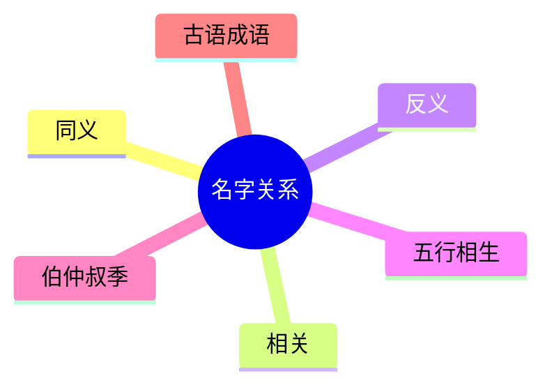

# 名与字的关系（同义、反义、相关联）

## 名与字是什么关系

先秦以来，男子二十成人行冠礼，取**字**；女子十五许嫁行笄礼，亦取字。**名**用于自称，**字**供他人称呼，故《礼记》说"男子二十冠而字""名者，所以正体也；字者，所以表德也"。古人取字并非随意为之，**名字之间几乎总有内在关联**。想一想：诸葛亮为什么叫"孔明"？李白为什么字"太白"？它们都不是巧合。

> [!IMPORTANT]
> ==名与字不是同一件事==：名是本名，是自谦自称；字是表字，是尊称美称。两者的意义关系，是《中国文化概论》第四章的常考要点。

## 名与字的六种意义关系

| 关系 | 要点 | 代表人物（名字对照） |
| --- | --- | --- |
| ==意义相同== | 名与字互为同义词 | 屈原（平—原）、诸葛亮（亮—明）、柳公绰（绰—宽） |
| ==意义相关== | 因事、因物、因典故相关 | 孔丘—仲尼（尼山）、赵云—子龙（云从龙）、岳飞—鹏举 |
| ==意义相反== | 名与字互为反义词 | 公孙黑—子皙（黑—白）、罗隐—昭谏（隐—昭）、晏殊—同叔（殊—同） |
| ==五行相生== | 按金木水火土相生取名 | 明成祖朱棣（木）→ 朱高炽（火）→ 朱瞻基（土） |
| ==排行作字== | 以伯、仲、叔、季、孟表行次 | 刘邦字季、班固字孟坚、欧阳修字永叔 |
| 取自古语成语 | 典出《诗》《书》《易》等 | 陆游字务观、秦观字少游 |

> [!TIP]
> 记忆口诀：==同义相关反义，五行排行古语==。看到题目问"名字意义相同"，直接找"平—原""亮—明"这类互训词。

## 常见的坑

- **不要把"字"当成"名"的重复**：字是后取的别称，不是名的别名或化名。
- **排行字与意义字可并存**：班固字"孟坚"，"孟"是排行，"坚"才与"固"同义，==两层含义要拆开看==。
- **反义关系不等于名字毫无关系**：黑—皙、隐—昭仍是紧密关联，只是取对立面。
- 除上述六类，==还有取自古语、成语的情况==，题目若写"此外"勿漏答。

> [!WARNING]
> 易错：看到"子""仲""季"就以为是排行，忽略了真正表义的后一个字（如"子龙""永叔"）。

## 一个例子

问：诸葛亮字孔明，名与字属哪种关系？  
答："亮"与"明"互为同义词（《说文》："明，照也；亮，明也"），故属==名与字意义相同==一类，与屈原（平—原）、方东树（树—植）同类。
